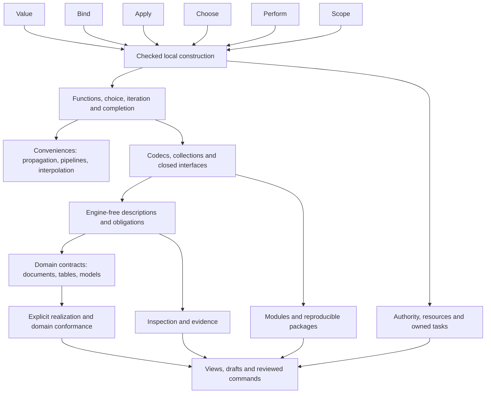

# Primitives And Their Compositions

> Status: designing synthesis, 2026-10-10. A dependency model for comparing the
> documented language and computational medium; no new syntax, Core opcodes,
> universal domain IR or conformance claim is accepted here.

Nomi can organize much of its design around six recurring semantic families:
**Value, Bind, Apply, Choose, Perform and Scope**. Richer constructs combine
these families with contracts that preserve their meaning. This gives the
designer a second view of the language: start with the few responsibilities
that cannot disappear, then see which combinations support actual activities.

The [synthesis](synthesis.md#candidate-primitive-synthesis-and-integration-path)
owns this candidate; [syntax](syntax.md), [semantics](semantics.md) and
[industrial contracts](industrial.md) still own accepted meaning. The
[maintainer guide](../research/synthesis_guide.md) owns the research method.
The [vision](vision.md) can challenge this decomposition. A smaller kernel or
a richer primitive can win if it improves whole-activity reasoning and retains
the laws below. Counting primitives is not the objective.

Read the next two sections for the hierarchy, the worked reductions for its
meaning, and the catalog for a particular construct. The final integration
path turns the map into implementation work.

## Distill Responsibilities Before Choosing Instructions

These are **semantic families**, not six indivisible machine instructions.
For example, Value contains atoms, products, alternatives and opaque handles;
Scope contains several independently specified completion policies. We have
not proved a minimal basis or chosen a concrete executable Core from them.

| Family | Small responsibility | Facts every reduction must retain |
| --- | --- | --- |
| Value | Construct or inspect an explicit value | Exact scalar representation, product fields, variant tag, nominal declaration identity, opacity and permitted projection. |
| Bind | Associate a resolved identity with a value or explicit cell | Lexical owner, evaluate-once creation, capture mode, fresh allocation and atomic visibility. A spelling is not identity. |
| Apply | Invoke a supplied operation under its callable contract | Callee/argument order, arity and names, defaults, capture/effect/region facts, result checking and invocation count. |
| Choose | Select one continuation from a Bool or inert structural test | Unselected work does not run; pattern captures are tentative; pure guards and coverage are checked separately. |
| Perform | Request an operation from the actual state, host or scheduler owner | Publication, authority, suspension and representation rules. A local cell update does not grant world access. |
| Scope | Own completion and lifetime under a named policy | Exact return/loop target, cleanup order, retained causes, resource non-escape and child joins. Policies are not interchangeable. |

Three dimensions accompany these families rather than becoming universal
execution primitives:

- **Contracts:** types, constraints, effects, regions, numeric profiles and
  domain laws specify legal compositions. Their checker may be richer than
  runtime branch selection. A supplied annotation is a promise to check.
- **Identity and context:** declaration, graph revision, row, model incarnation,
  run and authority identities have different owners and invalidation rules.
  Equal displays or equal counters cannot substitute for them.
- **Evidence and observation:** static proof, runtime enforcement, tested
  example, external observation and unresolved assumption remain distinct.
  Every claim names its context, phase and coverage.

A closure encoding of a product does not establish its nominal identity or
decoder. A callback encoding of a scope does not establish exactly-once release.
A tuple containing a path and permission label does not grant filesystem
authority. These are counterexamples to treating representation equivalence
as semantic equivalence.

## A Hierarchy Of Reusable Combinations

The hierarchy is a dependency DAG: one reusable combination can feed several
others. These levels are explanatory groupings, not a compulsory teaching order
or a total ladder of assurance. A user can start by composing ordinary calls.

| Level | Build from | Reusable results |
| --- | --- | --- |
| 0 — semantic responsibilities | Value, Bind, Apply, Choose, Perform, Scope | A vocabulary for value, name, call, choice, action and lifetime laws. |
| 1 — checked local construction | Level 0 plus declared contracts | Lexical bindings, closures, owned products/variants, tentative captures, typed completion and validated cell updates. |
| 2 — ordinary control and conveniences | Checked construction and specific completion policies | Functions, match, loops, Option/Result, propagation, safe navigation, pipelines, defaults and interpolation. |
| 3 — reusable boundaries and carriers | Ordinary functions/data plus carrier-specific contracts | Strict collections, codecs, protocols, capabilities, resources, tasks, streams and checked modules. |
| 4 — domain models and implementation boundaries | Typed descriptions, named references, obligations, domain theories and explicit realization | Documents, table plans, statistics, learned state, symbolic models, temporal models, transactions and workflows. |
| 5 — creation, sharing and operation | Domain models plus revision/evidence/authority contracts | Inspectors, projections, semantic commands, drafts, delegation, packages, builds and deployment. |



This graph shows useful joins, not a proof that every edge is a minimal runtime
dependency. The catalog also includes validation and tooling ingredients. A
pure report can have an effectful test harness without acquiring that harness's
effects itself. Requirements belong to the relevant owner and phase.

### One Verb Does Not Mean One Algebra

`map` can be an eager ordered collection call, a demand-bearing stream
operation, a schema-bound table expression or a quoted symbolic transformation.
The common responsibility is typed composition. Order, cardinality, demand,
failure, effects, termination and equality belong to the selected carrier.
Do not infer those facts from the verb or a pipeline glyph.

Engine-free objects make this separation concrete: a node describes an input,
definition or intention; an adapter may realize a selected computation later.
An ordinary eager function remains an ordinary eager function. The framework
does not turn all language values into deferred graphs.

## Worked Reductions That Preserve The Difficult Parts

The following traces are semantic metalanguage, not new Nomi APIs or executable
Core instructions. They expose reusable responsibilities and exact obligations.

### A Pipeline Is A Call With A Temporary

For `source() |> transform(option())`:

```text
resolve the transform callee under the ordinary call rule
evaluate source() once; retain its value under a fresh identity
evaluate option() once as the remaining argument
invoke the retained callee(retained_source, evaluated_option)
```

Expected observable calls are `source`, `option`, then the transform body when
callee lookup is inert. The exact callee evaluation still follows ordinary
call rules. No partial application, delayed input, parallel task or Result
propagation is introduced. The temporary cannot capture a user's binding.

### Propagation Is Variant Choice With A Fixed Return Target

For `load().map_error(convert)?` inside a Result-returning function:

```text
evaluate load once
invoke map_error using convert under its callback contract
choose the returned variant:
    Ok(payload): bind the payload as the expression's value
    Err(error): request Return(function_identity, Err(error))
unwind required inner scopes before the caller observes that return
```

The target is the lexical function, not an implementation helper introduced by
lowering. Error conversion is explicit. A panic or cancellation is not an Err.
The independent negative case is an absent Option or a host panic at the same
site: it cannot be silently converted into this Result branch.

### A Decoder Reuses Validation Without Reusing Failure Meaning

```text
parse received format to an explicit structural value
check each independent declared field, preserving original paths
retain tentative typed fields and accumulated expected errors
when valid, check declaration constraints and construct one owned value
otherwise return DecodeErrors; publish no partial owned object
```

Internal construction uses the same field and invariant descriptions but a
contract violation channel. Sequential `?` cannot replace accumulated
independent field validation. A projection such as JSON Schema must disclose
constraints it cannot express. Defaults retain provenance; malformed data is
never repaired by hidden coercion.

### Cleanup Is A Completion Protocol, Not A Repeated Callback

For a resource scope whose body returns early:

```text
acquire under current authority
enter an owned resource scope
run the body once; retain its requested completion
release exactly once; retain release completion too
combine causes under this scope's specified policy
observe the original lexical return only after required cleanup
```

With a successful release, the trace is `acquire, body, release, observe-return`.
With both body and release failures, both causes must survive. The general
carrier/panic/cancellation policy remains under the
[resource owner](resource_lifetime.md); this reduction does not settle it.
Task groups additionally own children, joins and cancellation. Retrying a
callback additionally owns attempts and possible already-observed effects.
Their similar indentation is not evidence for one universal handler.

### A Document Exists Before Rendering

```text
declare DocumentSpec(title, ordered sections/paragraphs)
bind each named object in a revision-qualified graph
compose a passive description and separate render/projection requests
check shapes and optional declared publication conditions without an engine
select a pinned renderer; bind an explicit detached input snapshot
realize RenderedText; explicitly convert to Text if requested
```

The [implemented example](object_framework.md#a-document-domain-with-explicit-rendering)
uses two local renderers and independently replayed nested obligations.
Checking an unknown title yields pending evidence; checking an empty supplied
title refutes the condition. A document with empty parts can be a valid draft.
No renderer choice, preview or satisfied shape condition publishes a file.

### Statistical Equality Needs A Theory In Addition To Composition

`mean(x)` can expand to `sum(x) / count(x)` only under the
[owned statistical contract](statistical_data.md#the-first-implemented-law).
The same observation domain, mask and exact numeric profile must qualify both
forms; empty/undefined cases retain their selected meaning. Floating rounding,
weighted observations, differing masks and grouped cardinality are separate
theories. A family called Number and a shared input name do not prove them.

This is the division of responsibility: the shared framework owns references,
typed composition and context; a domain owns definitions, laws and side
conditions; an independent consumer owns admitted replay rules; an explicit
adapter owns execution capability and capacity. A proof receipt cannot acquire
data, invent a scientific assumption or install an engine law.

### A View Edit Must Become An Owner-Checked Proposal

```text
project a model at a known revision and coordinate basis
interpret an edit as a candidate semantic operation
validate the candidate; retain unsupported/ambiguous alternatives
obtain the required review of that exact candidate/context
ask the owner to commit against current revision and authority
record committed, stale, refused or externally uncertain outcome
```

Validation and review remain distinguishable from publication and permission.
Sorting a view must preserve row identity; resetting a revision counter must
not revive an old proposal. An inverse edit needs its own domain law. Undoing
a source change cannot undo a sent message or physical action. These are
[interaction proposals](interaction_model.md), not implemented language APIs.

## Composition Catalog And Coverage

The [declarative catalog](../../config/primitive_composition.json) contains six
families and 57 compositions. Each row gives dependencies, placement, status,
a semantic law and a gate. All 25 current category/overall/research target
programs have at least one declared mapping. That is **navigation coverage**,
not exhaustive identification of constructs in their source and not semantic
coverage of every research idea. The checker does not parse or prove them.

Status `target` means a documented target construct, with implementation work
remaining. `experiment` means a bounded implemented laboratory surface whose
broader integration remains open. `open` and `hypothesis` are design work.
An accepted surface can depend on an open generalization: strict collections
can have closed monomorphic callbacks before generic protocol syntax settles.

From a source checkout:

```bash
python3 -m tools.primitive_composition check
python3 -m tools.primitive_composition show first-report
python3 -m tools.primitive_composition show statistics
python3 -m tools.primitive_composition show delegation
```

`show` returns the selected composition and its dependency closure, grouped by
computed DAG depth, with all retained gates. Depth is not priority, readiness
or an assurance rank. `check` refuses unknown dependencies, cycles, missing
owners, unmapped target files and a stale table below. It also refuses promotion
of candidate root families into accepted status. `render` produces this table.
The catalog is a design projection; canonical owners decide actual semantics.

<!-- composition-catalog:start -->

| Construct / ID | Dependencies | Placement / status | Law and unclosed gate |
| --- | --- | --- | --- |
| Value / `value` | Candidate root | semantic-family / hypothesis | [Owner](../design/synthesis.md). Atoms, products, closed variants and explicit opaque handles retain representation and nominal identity. **Gate:** Representation and primitive numeric/host profiles remain independently specified. |
| Bind / `bind` | Candidate root | semantic-family / hypothesis | [Owner](../design/synthesis.md). Names resolve lexically to declaration identities; capture and fresh cells retain their meaning. **Gate:** Shadowing, package identity and mutable capture evidence must survive lowering. |
| Apply / `apply` | Candidate root | semantic-family / hypothesis | [Owner](../design/synthesis.md). Ordered arguments are evaluated once and invoked under an explicit callable contract. **Gate:** General call shapes, defaults, capture and effect evidence are not inferred from a lambda encoding. |
| Choose / `choose` | Candidate root | semantic-family / hypothesis | [Owner](../design/synthesis.md). Only selected work executes; structural tests are inert and captures commit atomically. **Gate:** Coverage and pure-guard checking must be demonstrated. |
| Perform / `perform` | Candidate root | semantic-family / hypothesis | [Owner](../design/synthesis.md). An owner handles an explicit state, host or scheduler request with declared authority. **Gate:** Local mutation, world authority and suspension require different operational profiles. |
| Scope / `scope` | Candidate root | semantic-family / hypothesis | [Owner](../design/synthesis.md). A specified boundary owns completion, cleanup and child lifetime. **Gate:** Function, loop, resource and task policies cannot share an unspecified handler law. |
| Scalars, products and variants / `literal` | `value` | core / target | [Owner](../design/semantics.md). Value constructors retain exact representations; Bool and Int are distinct. **Gate:** Portable wire, capacity and non-first-product scalar laws remain incomplete. |
| Bindings, imports and irrefutable destructuring / `binding` | `value`, `bind` | core / target | [Owner](../design/semantics.md). Evaluate once, tentatively bind, check and commit all names or none. **Gate:** Resolved identities and source-derived type/constraint evidence need target conformance. |
| Return, loop transfer, panic and cancellation / `completion` | `value`, `choose`, `scope` | core / target | [Owner](../design/semantics.md). Normal value, function return, loop transfer, panic and cancellation retain distinct targets and causes. **Gate:** General multi-cause envelopes and cancellation during release remain open. |
| Types, constraints and evidence / `contracts` | `value`, `apply`, `choose` | core / target | [Owner](../design/semantics.md). A declared promise is checked; satisfied, refuted and unknown evidence remain distinct. **Gate:** Full inference and proof rules are not established by a codec or supplied annotation. |
| Closures and ordinary functions / `callable` | `value`, `bind`, `apply`, `scope`, `completion`, `contracts` | core / target | [Owner](../design/function_contracts.md). Immutable captures have value semantics; mutable captures retain shared cell identity. **Gate:** General generic, capture, region and callback-effect contracts remain designing. |
| Nominal products and closed alternatives / `owned-data` | `literal`, `binding`, `contracts` | core / target | [Owner](../design/semantics.md). Construction checks all fields and declaration invariants before publishing one owned value. **Gate:** Source-derived constructors and codecs need independent target agreement. |
| Bool choice and short circuit / `choice` | `literal`, `choose`, `binding` | core / target | [Owner](../design/syntax.md). Conditions require Bool; unselected expressions are never evaluated. **Gate:** Typed source lowering and exact event traces must agree. |
| Visible local state update / `mutation` | `binding`, `contracts`, `perform` | core / target | [Owner](../design/semantics.md). Validate the replacement before owner-controlled atomic cell publication. **Gate:** Captured-cell and invalid-update traces must agree across backends. |
| Text interpolation and display / `interpolation` | `literal`, `binding`, `apply` | convenience / target | [Owner](../design/syntax.md). Evaluate embedded expressions once in order; display is a distinct protocol from encoding. **Gate:** General display/protocol and secret-redaction contracts remain open. |
| Exhaustive structural matching / `patterns` | `owned-data`, `choice`, `contracts` | core / target | [Owner](../design/pattern_matching.md). Shape failure and guard rejection discard tentative captures; every match is exhaustive. **Gate:** Coverage, guard purity and formatter/diagnostic conformance remain required. |
| For/while and loop boundaries / `iteration` | `choice`, `callable`, `completion`, `scope` | core / target | [Owner](../design/syntax.md). Iteration order and nearest lexical break/continue targets remain observable. **Gate:** Recursion alone does not prove bounded stack, progress or iterator cleanup. |
| First-argument pipeline insertion / `pipeline` | `binding`, `apply`, `callable` | convenience / target | [Owner](../design/syntax.md). Insert one evaluated value at the first argument position; preserve call order. **Gate:** Do not infer laziness, concurrency, currying or propagation. |
| Parameter and field defaults / `defaults` | `binding`, `callable`, `contracts` | core / target | [Owner](../design/semantics.md). Evaluate each omitted default at the specified call/construction phase and retain provenance. **Gate:** A supplied value and an equal default value need distinct provenance. |
| Progressive checking policies / `assurance` | `contracts`, `binding`, `callable` | tool / target | [Owner](../design/semantics.md). A policy selects required evidence without changing successful meaning or granting authority. **Gate:** General public inference and dependency invalidation remain incomplete. |
| Explicit generic interface quantification / `generics` | `contracts`, `callable`, `owned-data` | library / open | [Owner](../design/function_contracts.md). A generic contract names quantification, variance, constraints, captures and effects. **Gate:** One concrete call does not establish generality; source syntax and solver remain open. |
| Effect contracts and runtime grants / `capabilities` | `contracts`, `owned-data`, `perform` | core / target | [Owner](../design/industrial.md). Static effect evidence and unforgeable current runtime authority are separate facts. **Gate:** Grant delegation/revocation and host substitution require executable contracts. |
| Engine-free references and descriptions / `engine-objects` | `owned-data`, `binding`, `contracts` | library / experiment | [Owner](../design/object_framework.md). Typed references, inert operation descriptions and closed definitions exist without an executor. **Gate:** The lab envelope has no control-flow, effectful execution or universal domain algebra. |
| Option and Result / `option-result` | `owned-data`, `patterns` | library / target | [Owner](../design/semantics.md). Absence and expected rejection are ordinary distinct closed carriers. **Gate:** Target nominal carriers cannot be inferred from host None or exceptions. |
| Protocols, methods and dispatch / `protocols` | `generics`, `binding`, `apply` | library / open | [Owner](../design/function_contracts.md). Operation selection is explicit/coherent within its declared package and import context. **Gate:** Collision, variance, specialization and extension visibility need a bounded comparison. |
| Strict collection verbs / `strict-collections` | `callable`, `choice`, `iteration` | library / target | [Owner](../design/semantics.md). Callbacks run in declared order and multiplicity; Result elements do not auto-propagate. **Gate:** General pure/effect-polymorphic, retaining and failure callback contracts remain open. |
| Exactly-once resource scopes and defer / `resource-scope` | `capabilities`, `completion`, `scope`, `callable` | core / target | [Owner](../design/resource_lifetime.md). Acquire/body/release phases retain every completion cause; defer cleanup is lexical LIFO. **Gate:** General release-error carrier, non-escape and asynchronous release remain designing. |
| Cold async descriptions and explicit await / `cold-task` | `owned-data`, `callable`, `capabilities`, `completion`, `scope` | core / target | [Owner](../design/semantics.md). Constructing a cold task does not start it; await names suspension and outcome ownership. **Gate:** Scheduler transitions, cancellation and latent effects require conformance. |
| Retry and backoff / `retry` | `callable`, `choice`, `completion`, `capabilities` | library / target | [Owner](../design/decisions.md). Invoke a fresh explicit attempt under policy; previous external effects are not undone. **Gate:** Idempotency, uncertainty and cancellation belong to the operation and host. |
| Closed checked module interfaces / `modules` | `binding`, `callable`, `contracts`, `assurance` | core / target | [Owner](../design/industrial.md). Public identity, types, effects and dependencies are available without executing private code. **Gate:** Source-derived closed reuse and unknown-dependency refusal still need completion. |
| Secrets and redacted observation / `secrets` | `owned-data`, `capabilities`, `contracts` | library / target | [Owner](../design/industrial.md). Secret projection is redacted by default; reveal requires explicit audited authority. **Gate:** Redaction across display, paths, logs and crash records requires conformance. |
| Explicit compilation, binding and realization / `realization` | `engine-objects`, `callable`, `contracts`, `completion` | library / experiment | [Owner](../design/object_framework.md). Choose a pinned implementation, check capability/preconditions, then execute detached bound values. **Gate:** Trusted callbacks and cooperative cancellation are bounded lab evidence, not formal conformance. |
| Reactive, incremental and temporal models / `temporal-model` | `engine-objects`, `contracts`, `capabilities`, `scope` | library / open | [Owner](../design/vision.md). Every change has a model/revision/time basis and an explicit invalidation/publication policy. **Gate:** Caching, snapshots, live adoption and physical time are distinct choices. |
| Local transactions and owner commit / `transaction` | `mutation`, `capabilities`, `completion`, `contracts` | library / open | [Owner](../design/synthesis.md). The actual owner defines atomicity, isolation, revision validation and visible publication. **Gate:** Pure candidate validation is not serializable publication or a distributed transaction. |
| Postfix propagation / `propagation` | `option-result`, `completion`, `callable` | convenience / target | [Owner](../design/syntax.md). Inspect once; success extracts, rejection returns to the nearest compatible function. **Gate:** Error mapping is explicit; pending cleanup still precedes observation. |
| Safe navigation and fallback / `optional` | `option-result`, `choice`, `callable` | convenience / target | [Owner](../design/syntax.md). Evaluate receiver once and evaluate only the selected fallback/property. **Gate:** Nested Option shape and effectful receiver traces require conformance. |
| Strict accumulated decoding / `decode` | `owned-data`, `contracts`, `option-result`, `iteration` | library / target | [Owner](../design/semantics.md). Validate received structure before owned construction; preserve independent original error paths. **Gate:** Custom field rules, budgets and non-projectable predicates need source-derived evidence. |
| Explicit encoding and schema projection / `encode` | `owned-data`, `contracts`, `option-result`, `iteration` | library / target | [Owner](../design/industrial.md). Encoding follows owned declarations; schema export reports omitted or approximate constraints. **Gate:** Human display and private engine transport cannot define the external format. |
| Numbers, units and tensor shapes / `numeric-profile` | `literal`, `contracts`, `protocols` | library / open | [Owner](../design/synthesis.md). Numeric domain profiles own exactness, rounding, dimensions, axes and failures. **Gate:** No host numeric default or shared method name establishes common laws. |
| Owned concurrent children / `task-group` | `cold-task`, `resource-scope` | library / target | [Owner](../design/semantics.md). Children cannot silently escape their group; completion waits for owned cleanup and children. **Gate:** Failure envelope, observation order, running and queue bounds remain open. |
| Streams and generators / `stream` | `cold-task`, `iteration`, `resource-scope` | library / open | [Owner](../design/semantics.md). Demand, consumption multiplicity, backpressure and release are explicit carrier laws. **Gate:** No generator source spelling or universal map schedule is admitted. |
| Engine-free refinement obligations / `obligations` | `engine-objects`, `contracts`, `option-result` | library / experiment | [Owner](../design/object_framework.md). Literal and explicit input evidence discharge closed unary and cross-object representation rules; every computed operand stays pending. **Gate:** Quantification, contract-only input dependencies and scientific assumptions require separately owned laws. |
| Schema-bound relational plans / `table-plan` | `engine-objects`, `contracts`, `protocols` | library / open | [Owner](../design/synthesis.md). Schema, grain, nullability, order and cardinality belong to the table carrier. **Gate:** Strict callbacks cannot be retagged as row expressions; adapters need pinned table laws. |
| Channels, locks, atomics and actors / `synchronization` | `capabilities`, `task-group`, `completion` | library / open | [Owner](../design/industrial.md). Publication visibility and ownership follow the selected synchronization protocol. **Gate:** A task group or mutable cell does not imply a memory model or delivery guarantee. |
| Content-addressed packages and builds / `packages` | `modules`, `capabilities`, `encode` | tool / target | [Owner](../design/industrial.md). Source, lockfile, toolchain, target and declared inputs determine a sandboxed build. **Gate:** Resolver, trust, edition migration and deployment receipts remain incomplete. |
| FFI and explicit host adapters / `foreign` | `owned-data`, `capabilities`, `completion`, `resource-scope`, `encode`, `decode` | library / target | [Owner](../design/industrial.md). ABI, copying/borrowing, affinity, blocking and host failures are declared at the boundary. **Gate:** A host value is not nominal proof; portable ABI and ownership fixtures remain open. |
| Diagnostics, traces and explanation / `inspection` | `contracts`, `binding`, `encode` | tool / target | [Owner](../design/industrial.md). A claim names its source, dependencies, phase, coverage and unresolved facts. **Gate:** A friendly view must not upgrade evidence or expose secret payloads. |
| Document specifications and rendering / `document` | `engine-objects`, `obligations`, `realization`, `encode` | library / experiment | [Owner](../design/object_framework.md). Meaning and publication conditions are separate from renderer choice and Text conversion. **Gate:** Two local profiles do not establish remote rendering, review or file publication. |
| Training, prediction and evaluation / `learned-model` | `engine-objects`, `table-plan`, `numeric-profile`, `contracts` | library / open | [Owner](../design/synthesis.md). Train-only learned state and evaluation split identities remain separate from predictions. **Gate:** Adaptive evaluation, uncertainty and deletion/unlearning are unresolved domain contracts. |
| Delivery, outbox and reconciliation / `messaging` | `transaction`, `retry`, `encode`, `decode`, `task-group` | library / open | [Owner](../design/synthesis.md). Delivery identity, processing ownership, settlement and uncertain external outcomes remain distinct. **Gate:** Broker profiles and crash/recovery traces are required; retries do not ensure exactly-once effects. |
| Reusable multi-output graph workflows / `graph-workflow` | `engine-objects`, `binding`, `obligations` | library / experiment | [Owner](../design/object_framework.md). Reference parameters substitute explicitly; namespaced intermediates and carried conditions retain graph-qualified identity. **Gate:** Independent pinned substitution runs; broader interfaces, operational scopes and authoring/repair benefits need comparison. |
| Examples, checks and test harnesses / `examples` | `callable`, `choice`, `inspection`, `capabilities` | tool / target | [Owner](../design/industrial.md). Independent expectations, compared values and replaced host capabilities retain context. **Gate:** Passing examples do not prove all-input equivalence or backend conformance. |
| Declared expansion and independent replay / `definition-proof` | `engine-objects`, `contracts`, `inspection` | tool / experiment | [Owner](../design/object_framework.md). Replay uses context-bound rules and preserves source identity; unsupported equality is unknown. **Gate:** Formal domain equality needs an admitted theory, side conditions and independent consumers. |
| Durable workflows and orchestration / `workflow` | `engine-objects`, `messaging`, `modules` | library / open | [Owner](../design/synthesis.md). Dependency, attempt, partition and idempotency identities survive recovery and handoff. **Gate:** Persistence, compensation, grant freshness and unknown outcomes need real adapters. |
| Reviewed semantic edits and commands / `semantic-command` | `owned-data`, `contracts`, `transaction`, `inspection` | tool / open | [Owner](../design/interaction_model.md). A proposal names its intent, target revision and review scope; commit checks current authority. **Gate:** No UI token or validated candidate can stand in for owner-enforced commit. |
| Statistical summaries and exact laws / `statistics` | `engine-objects`, `numeric-profile`, `definition-proof`, `obligations` | library / experiment | [Owner](../design/statistical_data.md). Observation domains, shared masks and numeric theory qualify sum/count/division identities. **Gate:** Empty samples, missingness, units and physical engines need independent domain evidence. |
| Symbolic quotation, rewriting and staging / `staging` | `engine-objects`, `definition-proof`, `modules` | scoped-candidate / open | [Owner](../design/decisions.md). A quoted model retains stage, hygiene, effects, provenance and bounded transformations. **Gate:** No global macros or ambient compile-time execution is admitted. |
| Views, visualizations and inverse edits / `projection` | `engine-objects`, `inspection`, `semantic-command` | tool / open | [Owner](../design/interaction_model.md). A projection states its model basis, losses and editable inverse obligations. **Gate:** Human comprehension, accessibility and inverse-law comparisons remain unvalidated. |
| The first coherent report activity / `first-report` | `decode`, `encode`, `strict-collections`, `propagation`, `defaults`, `modules`, `examples` | library / target | [Owner](../design/synthesis.md). Decode every row before eligibility filtering; preserve order/duplicates and explicit error mapping. **Gate:** Current compatibility delivery is not target data/call/Result/reuse conformance. |
| Scoped query, tensor, grammar and template notation / `domain-notation` | `staging`, `table-plan`, `numeric-profile`, `document` | scoped-candidate / open | [Owner](../design/decisions.md). An explicitly entered scope has declared input/output meaning and inspectable expansion. **Gate:** Every notation needs its own parser, diagnostics, laws and whole-activity evidence. |
| Drafts, holes and last-good states / `partial-work` | `owned-data`, `contracts`, `temporal-model`, `projection` | tool / open | [Owner](../design/vision.md). An incomplete draft and recovery guess retain their status rather than manufacturing a valid program. **Gate:** Supported-hole semantics and safe partial execution need a distinct admission. |
| Natural-language and automated proposals / `delegation` | `semantic-command`, `partial-work`, `capabilities` | tool / open | [Owner](../design/vision.md). Inference, checked meaning, reviewed intent, authority and external observation are separate evidence. **Gate:** Actual role validation, calibrated reliance and interrupted recovery need human and host evidence. |
| Cross-domain creative and shared activity / `whole-medium` | `document`, `statistics`, `learned-model`, `workflow`, `projection`, `delegation`, `temporal-model` | tool / hypothesis | [Owner](../design/vision.md). Meaning, representations, evidence, authority and revision remain recoverable across one activity. **Gate:** A dependency map is not a demonstrated coherent computational medium. |

<!-- composition-catalog:end -->

## Residual Mechanisms We Must Not Explain Away

| Tempting reduction | Fact still missing | Discriminator |
| --- | --- | --- |
| Everything is lambda application | Exact scalar representation, nominal identity, ordered defaults, stack behavior and diagnostic provenance | Compare actual call/constructor traces, malformed input and boundary evidence, not only final values. |
| Every control form is a handler | Return targets, loop ownership, exactly-once cleanup, child lifetime and failure multiplicity | Early return inside nested scope; body plus release failure; cancellation while a child releases. |
| Every validator is a Bool predicate | Independent accumulated errors, external versus internal failure and constructor publication | Two invalid fields plus a cross-field rule; neither partial publication nor lost paths. |
| Every workflow is a DAG | Demand, repeated work, mutable state, cycles/recursion, authority and uncertain external outcomes | Retry after an unknown external result; reactive invalidation while an old run is pending. |
| Every domain is a typed record | Units, grain, missingness, model assumptions, schema evolution, row identity and inverse laws | Same representation with different domain/mask/unit; identical initial output with different time model. |
| Every effect label is permission | Runtime unforgeability, revocation, owner freshness and delegation limits | Valid static effect evidence with an expired or denied runtime grant. |
| Every view is source sugar | Lost information, coordinate basis, partial work, accessibility and user interpretation | Sort/filter/reset then edit; unsupported content export; compare actual repair and handoff activity. |
| Every strict check increases assurance | Independent policy axes and supported enforcement | A pure computation with unknown type evidence; valid schema with denied authority. |

If the selected six-family model cannot express an obligation clearly, revise
it. A needed primitive is justified by a missing law or a whole-activity cost,
not by inability to fit a new row into this table. Rejected source forms remain
rejected; a reducible alias does not earn another spelling.

## Integrate Along One Coherent Path

Reuse the [D0-D7 agenda](redesign_agenda.md) and existing packet owners. This is
a dependency path through their work, not a second release schedule.

| Next increment | Primitive/composition focus | Concrete closure receipt |
| --- | --- | --- |
| Establish the first report's typed local spine | Value/Bind/Apply/Choose; owned-data, callable, Option/Result and codecs | Source-derived declarations, ordered calls/defaults, complete local interfaces and independent invalid-input paths; honest unsupported cases. |
| Preserve source identity through convenience reductions | Pipeline, interpolation, propagation and pattern attempts | Typed long form plus expected call/control traces, source-linked failures and unchanged lexical targets. |
| Compare reusable graph authoring | Engine-objects, graph-workflow, obligations and definition-proof | Two instances and their carried conditions now have independent pinned substitution replay. Compare reusable and inline authoring on prediction, composition mistakes, changed contracts and repair before generalizing. |
| Bridge one statistical computation | Numeric-profile, statistics and realization | Preserve domain/mask/exact theory, conditional or unknown proof status and independent v1 replay; refuse incompatible engines. |
| Admit operational scopes under their owners | Perform/Scope; capability, resource and task contracts | Non-escape checks and deterministic acquire/body/release/cancel/join traces with all causes and bounded work. |
| Test a contrasting whole activity | Projection, temporal-model and semantic-command | Equal semantic tasks across representations; stale edit refusal and measured prediction/repair/handoff outcomes. |
| Promote a useful abstraction | Generics, protocols or a scoped candidate when earned | Independent consumers, formatter/diagnostics, precise effect/region and removal contracts; update accepted owners explicitly. |

For each increment, record the source form, typed long form, domain/operational
laws, independent expectations, actual evidence and unresolved gates. Compare
two compositions that solve the same task before extending the core. Successful
reductions should remove duplicate reasoning while preserving the information a
person needs to predict, repair, reuse and authorize work.
