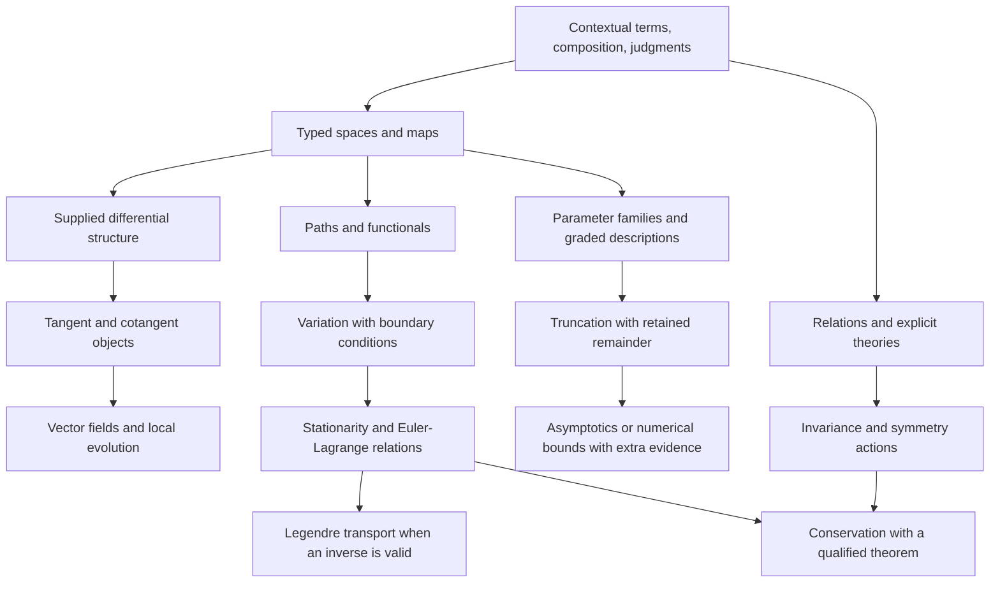

# A Minimal Algebra Of Scientific Reasoning

> Status: foundational redesign candidate, 2026-10-11, under language-coherence.
> Exact maps, scoped terms, premise support and finite bridges run from a checkout. No new
> syntax, universal IR, analytic calculus or physical theory is accepted here.

The proposed pivot is to make **contextual terms, checked composition and
explicit judgments** the common foundation. Spaces, variation, invariants,
selection and approximation supply structures and laws over that foundation.
They do not each become a compiler feature. This is a candidate architecture,
not a proof that three concepts are irreducible or sufficient for every domain.

This document owns the cross-cutting redesign comparison. The
[synthesis](synthesis.md#candidate-primitive-synthesis-and-integration-path)
owns integration; [scientific models](scientific_discovery.md) owns scientific
contracts; [intelligent programs](ai_frameworks.md) owns AI pressures on the shared foundation
and the numeric/model/inference contracts.
[Primary evidence](../research/scientific_models.md#foundational-algebra-evidence)
and the [bridge](../review/2026-09-29-language-synthesis.md) retain provenance and
migration evidence. The current [semantics](semantics.md) remains the accepted
target until a replacement meets its obligations.

## First Audit: What Is Actually Irreducible Now?

There is no established minimal Nomi calculus. Four layers currently coexist:

| Layer | Actual concepts | What the audit establishes |
| --- | --- | --- |
| Accepted language meaning | Owned scalar/data values, lexical identity, calls/capture, alternatives, cells, completion, failure, authority and lifetimes | These have distinct observable laws. An encoding cannot discard their distinctions. |
| [Composition hierarchy](primitive_composition.md) | Value, Bind, Apply, Choose, Perform, Scope, accompanied by contracts/context/evidence | Six **families of responsibilities**, not six irreducible terms or accepted opcodes. |
| [Implementation Core](../../prototype/syntax/core.py) | 31 registered node classes, including literals/load/bind/function/call, branch/loops/match, data access and raise/handle/defer | A transitional executable vocabulary; neither a minimal calculus nor target authority. Python AST and frontend lowering remain separate substrates. |
| Engine-free laboratories | Typed named descriptions, ports, closed definitions, conditions, domain checking and selected adapters | Meaning can precede execution. Nominal ports alone establish neither mathematical structure nor domain equivalence. |

The [scientific checker](../../tools/scientific_probe.py) implements exact
commutative polynomials with flat generator IDs, a declared formal derivation
and equality witnesses. It has no general scoped binder, transformation space,
tangent bundle, integration, inverse solver or analytic remainder judgment.
The [AI checker](../../tools/ai_probe.py) checks named-axis metadata, not
derivatives. The generic framework does not fill those gaps implicitly.

The current irreducible **obligations** are distinguishable values and owners,
binding/capture, admissible composition, selected elimination, observable action,
and completion ownership. Their smallest representation is still open. The
redesign challenges their organization; it does not erase effects or cleanup
because mathematical functions compose elegantly.

## Compare Foundations Before Selecting One

| Candidate | What is small | Strength | Cost or missing law |
| --- | --- | --- | --- |
| Six current execution families plus domain libraries | Existing operational decomposition | Preserves ordinary programming; easiest incremental bridge | Mathematical binding, theories and evidence remain loosely connected laboratories. |
| Lambda/variant encoding of everything | Few term constructors | A concrete reduction target; closures and data are reusable | Small encoding does not establish nominal identity, authority, cleanup or useful diagnostics. Extra rules return elsewhere. |
| Objects and composable arrows only | Identity and associative composition | Clean account of transformations | Does not supply branching, binding, effects, differentiation, predicates or approximation. Category laws alone imply no derivative. |
| **Contextual terms + composition + judgments** | Three recurring semantic responsibilities, with explicit structures | Connects execution and reasoning without making every value a graph | Requires scoped artifacts, checker ownership and phase boundaries. This remains a design hypothesis, not a three-opcode machine. |

Investigate the last candidate. Minimality means fewer independent rules and
fewer concepts a user must maintain, with laws still visible. Hiding twenty
special mechanisms behind a word such as “object” is not a reduction.

## The Candidate Core

### 1. Form A Term In A Context

A context resolves declarations and binders, types, available structures,
assumptions and actual capabilities. A term has a meaning and owner in that
context. Products, alternatives, scalar literals, references and functions are
term forms. A mathematical space is a typed description; a point inhabits it.
A scientific hypothesis is an explicitly marked premise, not a host capability.

Binding is fundamental here: two symbols printed `x` can have different owners.
Substitution must preserve binding and avoid capture. Models can retain cyclic
relations; executable dependencies need their own ordering contract. A term
need not have an executable realization, and drafts need not be well typed.

### 2. Compose Under A Carrier's Contract

Application, substitution, product construction and alternative elimination
compose terms. An explicit map `A -> B` can compose with `B -> C` when its domain
and obligations agree. A relation from A to B is not automatically a total,
single-valued executable map. An ordinary effectful call retains argument order,
evaluate-once behavior and completion rules; it is not a pure mathematical map.

Carriers supply additional rules: lists preserve their ordering/cardinality;
streams preserve demand/cancellation; smooth maps supply tangent structure;
open equation systems supply boundary composition. Shared composition machinery
does not make these carriers interchangeable.

### 3. Make A Judgment With Explicit Coverage

Separate a description, an obligation and evidence. The proposed metalanguage is:

```text
context |- term : type, with effect/completion contract
context |- claim, supported by method and covered premises
```

This is explanatory notation, not Nomi source. A language checker can establish
a type/call contract. A domain checker may establish an identity in a named
algebra. A solver may report a bounded numerical result. An observation may
support a model empirically. A human may leave a premise unresolved. None
substitutes for the others. “Unknown,” “refused,” “not an identity” and
“contradictory premises” must retain their different meanings.

Evidence names claim, context/revision, method, premises and coverage. A Boolean
or copied certificate label cannot mint it. Generic code transports an evidence
artifact; its semantic owner determines whether it establishes anything.
The proposal does not require unrestricted dependent types or a proof assistant
in every script. Compare a bounded typed-term/checker interface first.

### A Concrete Kernel Candidate, Rather Than Three Labels

The smallest viable candidate to compare has the following **metalanguage**
forms. This is a proposed semantic grammar, not source notation or accepted IR.

```text
type        = scalar(profile) | nominal(declaration) | product(fields)
            | sum(variants) | callable(input, result, completion_contract)
term        = reference(owner) | literal(profile, payload)
            | construct(type, fields) | project(term, field)
            | inject(variant, term) | eliminate(term, bound_cases)
            | lambda(bound_parameters, computation) | apply(term, arguments)
computation = pure(term) | sequence(bound_result, computation, computation)
            | request(actual_owner, operation, arguments)
            | complete(lexical_target, cause, term)
            | scope(registered_policy, computation)
definition  = bind(owner, term) | recursive_group(bound_definitions)
```

The grammar retains type-level products/sums and their introduction/elimination
laws, not a special mathematical “space” type. Nominal declarations and profiles
retain invariant-preserving construction. Binding/context is shared by function
parameters, variant cases and recursive groups. Recursion supplies expressiveness
without promising termination, fairness or a differentiable numeric description.
Literal profiles and authorized requests are explicit intrinsic boundaries.

`sequence` is evaluate-once ordered composition. `complete` preserves exact
return/loop/abnormal targets while scopes unwind. `scope` selects a specified
policy; it is not an arbitrary user handler that can discard cleanup. Exception,
resource and task contracts must determine their actual cause/ownership behavior
before such lowering is valid. Region/capture facts accompany callable types.

| Current family | Location in this grammar | Reduction obligation |
| --- | --- | --- |
| Value | Literal, constructor, projection, injection | Nominal/scalar identity and data invariants survive. |
| Bind | Explicit owners, bound parameters/cases/results/definitions | Capture-free substitution and fresh cells; spelling is only a projection. |
| Apply | Application and ordered sequence | Eager once-only arguments and exact completion contract survive. |
| Choose | Sum/Bool elimination | Only the selected computation runs; captures commit atomically. |
| Perform | Owned request | Actual authority and publication/suspension rules cannot be replaced by labels. |
| Scope | Completion and registered scope policy | Cleanup, retained causes, non-escape and owned child joins survive. |

This is the proposed executable base. Judgments are **checking rules over these
artifacts**, not another instruction executed for every expression. Domain
descriptions can be ordinary data or reifications of an explicitly admitted
subset. A general callable with foreign captures is not automatically reifiable.
First-class maps are library values with typed domains and admitted rules.

Arithmetic, loops, match, propagation and scientific APIs must each produce a
long-form reduction against this grammar or justify a retained intrinsic. The
comparison can delete forms when their laws genuinely reduce, or retain a form
when simpler encoding hides a crucial rule. The present polynomial lab tests
only the map-library slice; it does not implement this whole kernel.

### Keep Description, Checking, Transformation And Action Separate

Describe a selected term; check its well-formedness and obligations; transform
it under an explicit structure; check a resulting claim; select a realization;
then request execution through its owner. None of the earlier phases implicitly
performs the last one. Transformation failure retains the original description.
Unknown premises can remain useful drafts without becoming executable grants.

The scientific, AI and statistical owners can share reference/binder and receipt
mechanisms. They need not share every term constructor or evaluator. A scientific
equation, tensor kernel, host call and causal hypothesis keep different meaning
even when shown in the same workspace. R1's source-derived ordinary/scientific
comparison is the bridge from today's separate laboratories to this kernel.

## Language Primitives Versus Library Structures

| User's candidate foundation | Composition over the candidate core | Extra structure that must be supplied |
| --- | --- | --- |
| Objects and spaces | Typed terms, products, constrained descriptions and named points | Membership, equality, topology, measure, chart or quantity structure as needed. A type is not automatically a manifold. |
| Transformations | Functions/maps, identity, composition, restrictions and supplied inverse candidates | Totality/domain, effects, bijectivity or reconstruction evidence. Inversion is partial work. |
| Variation | A transformation from a map description to a linearized description | Differential structure and admissible rules; tangent/cotangent ownership, regularity and branch/event conventions. |
| Structure and invariants | Relations/predicates plus preservation judgments | A selected algebra, action, metric, symplectic form, connection or conservation theorem and its premises. |
| Selection | A relation describing feasible, stationary, minimal or maximal candidates | Ordering, domain, existence, uniqueness, constraints, boundary conditions and a separately selected search/solver strategy. |
| Scale and approximation | Families indexed by a parameter, graded terms, transformations and remainder judgments | Limit/regime, comparison scale, norm/topology, validity region, error or order semantics and transport rules. |

**True language-level work:** lexical binders and typed construction/elimination;
contract-preserving calls; effect/authority/completion ownership; inspectable
descriptions and owner-qualified checker interfaces. Representation, lowering,
source spans and diagnostics must preserve these facts. Whether some inspection
facilities are ordinary library protocols remains a comparison to settle.

**Library work:** spaces and maps, tangent/cotangent bundles, vector fields,
paths, functionals, measures, differential forms, symmetry actions, stationary
sets, duality, filtrations and approximation claims. Lagrangians, Hamiltonians,
optimizers, statistical estimators and AI losses compose these structures.

**Adapter work:** symbolic normalization, AD, numerical solvers, simulation,
storage and visualization. An adapter explicitly declares its admitted profile
and evidence; selecting one does not redefine the object. General AD work still
begins with the established-engine comparison in the AI proposal. This finite
formal polynomial experiment is not that general engine.

## A Hierarchy That Exposes The Missing Structure



These edges state dependencies, not automatic derivations. In particular a
vector field does not automatically provide a complete flow, and a symmetry does
not automatically supply a conservation law outside the theorem's setting.

## Work Through The Five Scientific Chains

### Spaces To Tangents To Fields To Flows

Given differentiable structure, `T` maps a space M to TM and a smooth map f to
Tf, preserving identities and composition. A vector field is a section
X: M -> TM with base projection equal to identity. In an affine coordinate
profile its components can be represented as an endomap, with that convention
explicit. General bundles cannot use that representation unconditionally.

A flow is separately an evolution map on an admitted time/state domain, with
identity at zero, composition where defined, and generator X. Existence,
uniqueness and extension require hypotheses. Even x' = x² has finite-time
blow-up for positive initial states; global composition cannot be assumed.
The executable example verifies an explicitly supplied translation flow,
not a general flow-construction theorem.

### Transformations To Invariants To Symmetries To Conservation

Invariance states that a particular quantity or relation is preserved by a
particular transformation. A symmetry action also has identity/composition
laws and preserves the selected model structure. An invariant and a symmetry
are different objects. Conservation states preservation along admitted
evolution, possibly only on solutions and with boundary/source terms.

For free kinetic L = v², translation q -> q+s preserves L, and the specified
free field conserves p = 2v. The experiment checks those two identities
separately. It does not implement a general Noether theorem. A theorem library
must expose action/variation, symmetry and boundary hypotheses before
transporting conservation evidence.
[SICM's treatment](https://tgvaughan.github.io/sicm/chapter001.html).

### Paths To Functionals To Variations To Stationary Action

A path is a map from an admitted interval to a configuration space. An action
is a functional on admissible paths, often constructed by integrating a
Lagrangian along a lifted path. Vary within the correct function space and
boundary conditions. Stationarity requires the first variation to vanish on
admissible directions. It is not automatically minimization.

The lab checks the finite discrete functional
S(q0,q1,q2) = (q1-q0)² + (q2-q1)² with fixed endpoints: substitution of
q1 = (q0+q2)/2 makes its interior derivative zero. Separately it constructs
the local Euler-Lagrange residual 2(a+q) for L = v²-q² under q' = v, v' = a.
Neither operation establishes integration by parts, continuum stationarity,
boundary terms or solution existence. Those need the next variational contract.

### Lagrangians To Legendre Transport To Hamiltonians

For L(q,v) = v²-q², form the fiber derivative (q,v) -> (q,p=2v), supply
(q,p) -> (q,v=p/2), and verify both compositions are identity. Only then
construct H = p*v-L = p²/4+q². No inverse-solving engine is invoked.

A singular velocity Hessian prevents this unrestricted inverse route. Local
regularity is not global bijectivity. A library can return an obligation,
restricted domain or constrained Hamiltonian description rather than inventing
an inverse. The classical smooth Legendre transformation and the convex
Legendre-Fenchel conjugate have different domains and conclusions; neither
should hide behind an unqualified `dual` operation.
[SICM's explicit inversion requirement](https://tgvaughan.github.io/sicm/chapter003.html).

### Local Approximation To Perturbation To Asymptotics

Expand (x+epsilon)³ into retained x³+3x²epsilon and exact remainder
3x*epsilon²+epsilon³. The lab verifies reconstruction without samples. It does
not infer a numerical error or big-O claim. Such a claim needs a limit, regime
and bounds on x; x = epsilon^-2 invalidates an unqualified small-remainder
reading. Differentiating the remainder in epsilon lowers its leading order.

Formal truncation, asymptotic expansion, convergence and numerical tolerance
are separate judgments. Rules for differentiated asymptotics require extra
conditions; uniform claims also specify which parameters range uniformly.
[NIST DLMF definitions and differentiation](https://dlmf.nist.gov/2.1).

## Contexts, Interpretations And Reasoning Methods

The [knowledge-framework synthesis](../research/knowledge_frameworks.md) sharpens
the candidate after tracing selected primary work from Leibniz onward. A common
description format cannot supply a common ontology, consequence relation or
execution method. Keep the three foundational responsibilities; make their
contracts more precise rather than add a universal knowledge primitive.

**Contextual terms** distinguish lexical binding, nominal identity, a theory's
signature and parameters, endorsed premises, and artifact revision. These are
related contexts with different owners, not interchangeable labels. Ordinary
programs need only the relevant obligations. A quoted statement is a description;
importing or displaying it does not assert it as a premise. A theoretical claim
about an actor's permission cannot confer an actual capability.

Ontologies are selected theory libraries, not a mandatory runtime superclass
hierarchy. Ontological classification, nominal typing, structural compatibility
and set membership require explicit correspondence. Identical observed fields
cannot merge two actual owners. This keeps rich domain modeling possible while
preserving simple ordinary values and the library's chosen commitments.

**Checked composition** has at least two questions: can these terms compose under
their type/completion contracts, and which semantic judgments does a proposed
interpretation preserve? A theory bridge declares source and destination,
translation direction, assumptions and preservation obligations. Equivalence,
one-way sound translation, approximation and unchecked correspondence are distinct
library contracts. A type-correct bridge is not automatically judgment-preserving.
Do not infer global inverses from local coordinate inverses or exact arithmetic
laws from an executable floating-point adapter.

**Explicit judgments** retain a particular question, profile, premises, method,
result and dependencies. Different profiles may have different result types.
Exact identity, constructible witness, ontology entailment, shape validation,
posterior probability, empirical support and a suggested explanation are not
members of one ordered truth/confidence scale. A bounded unsuccessful search
cannot fabricate a refutation. Mention, endorsement and proof from premises are
separate lifecycle states; endorsement can change while the old conditional
proof remains valid in its recorded context.

These facets belong first in library descriptions and checker interfaces. A
theory, statement, interpretation or method plan can be ordinary data assembled
with the existing candidate's products, variants, binders and calls. No claim is
made that every logic can be encoded without cost, or that every such description
is automatically executable. If a concrete activity repeatedly requires a
residual mechanism, reopen the foundation comparison instead of hiding it.

| Library composition | Preserved obligation | Refusal discriminator |
| --- | --- | --- |
| Signature + scoped terms + premises + supplied consequence rules | Conclusions name their theory and exact support. | Same-spelled imported parameter captures a local binder. |
| Theory description + interpretation + discharged obligations | Transfer only covered statements/judgments. | An array export loses nominal space identity or reverses a one-way theorem implication. |
| Question + method plan + explicit realization | Result retains method limits and actual execution owner. | A timeout is displayed as false, or opening a view executes a remote query. |
| Evidence + justification dependencies + revision policy | Withdrawal invalidates dependent support without erasing history. | A conclusion with two independent supports disappears when one is removed. |
| Alternative models + observation descriptions + comparison view | Mathematical and empirical claims remain qualified. | An ideal conservation proof is displayed as evidence that measured fading cannot occur. |

R1 should first compare binder representations, then add a finite supplied-rule
premise ledger as a discriminator. R2 should make profiles and interpretation
obligations explicit, using an established checker for independent replay. This
is not an implementation of general theorem proving or AGM belief revision.
The current exact lab still implements only its fixed polynomial profile, with
no general premise ledger, theory bridge or rule-provider plugin boundary;
the separate finite ledger below does not change that polynomial profile.

## Compact Executable Examples

Run every worked composition without supplying data or selecting a solver:

```bash
python3 -m tools.reasoning_examples
pytest -n 0 prototype/tests/unit/tools/test_reasoning_algebra.py
```

This is Python research code in the checkout, **not runnable Nomi syntax**.
Fourteen judgments report `identity` in the fixed
`scoped-rational-polynomial-maps-v1` profile. A small direct example is:

```python
from tools.reasoning_algebra import Space, Mapping, coordinates, compose, tangent, compare

A = Space("A", ("x",))
B = Space("B", ("x",))
x, = coordinates(A)
y, = coordinates(B)
f = Mapping("square", A, B, (x ** 2,))
g = Mapping("cube", B, A, (y ** 3,))
claim = compare(tangent(compose(f, g)), compose(tangent(f), tangent(g)))
assert claim["status"] == "identity"
```

`compose(first, second)` means second after first. Same-spelled variables in A
and B cannot mix directly; substitution uses the explicit map. Descriptions
are immutable, and judgments fingerprint both complete descriptions and the
profile. `realize(mapping, exact_bindings)` is a separate exact-rational adapter;
composition and checking never call it. No floating coercion is admitted.

The profile admits 1–8 coordinate axes, 128 terms, degree at most 12 and
256-bit rational coefficients. It rejects over-capacity work instead of
changing meaning. These are laboratory budgets, not language limits. Equality
is decided for the admitted full polynomial maps; nonzero residual means
`not-an-identity` here, rather than disproving a conditional physical claim.

The descriptions are engine-free but profile-specific coordinate forms. They
do not yet establish representation-independent manifolds, quantities,
cotangent variance, lexical higher-order binders or arbitrary expression
plugins. Transformation functions own polynomial rules; extracting alternate
rule/representation providers is the next boundary, not a claim already met.
There is no persisted certificate consumer or independent symbolic replay for
this new profile. Seeded exact-rational tests use independent hand arithmetic
for primal/tangent results; the earlier scientific witness profile retains its
own independent replay and is not silently reinterpreted.

## Executed Scoped-Binder Comparison

The [scoped-term laboratory](../../tools/scoped_terms.py) now implements the
first R1 artifact in `pure-scoped-rational-terms-v1`. It compares nominal
owner/revision/slot references with locally nameless bound indices and qualified
free references. A replaceable Python-expression producer admits only exact
integer literals, rational arithmetic, positional lambdas and application;
it never uses host `eval`, name lookup or callbacks. This is **research source,
not Nomi grammar**, and does not admit automatic currying into Nomi.

```bash
python3 -m tools.scoped_terms
pytest -n 0 prototype/tests/unit/tools/test_scoped_terms.py
```

The report-line calculation and scientific square map have source-derived
artifacts, typed callable contracts and passive inspection. Nested same-spelled
parameters retain separate owners. Simultaneous substitution freshens a binder
when an inserted free reference would be captured; it does not subsequently
rewrite inserted terms. Beta reduction checks the application's type before
and after transformation. Immutable descriptions carry no engine.

Source origins use UTF-8 byte offsets, source identity/revision and a content
digest. The lower form deliberately drops bound labels and source layout;
inspection retains those separately. Alpha-equivalent terms can have different
artifact fingerprints because their source contexts differ. Transformation
origins identify contributing source, not a regenerated spelling of the result.
A source view refuses stale revisions, changed bytes under the same revision
and spans splitting a UTF-8 scalar.

Twenty-four new checks include an independent owner-keyed interpreter versus
the index-based exact adapter, seeded hand-arithmetic report/map vectors,
nested shadowing, capture avoidance, simultaneous swaps, higher-order manual
terms, stale imports and passive/detached inspection. The lab caps source at
8192 bytes, terms at 256 nodes/depth 32 and exact scalars at 256 bits; capacity
refusal does not change meaning. These are research budgets, not language limits.

Neither binder representation is selected as Nomi Core. Nominal references aid
source ownership/inspection; indices provide a small alpha-normal form but need
source metadata beside them. No inverse formatter, Nomi producer, recursive
binding groups, variants, effect/completion terms, general import resolver or
shared domain-library migration is implemented. The next R1 artifact is the
finite premise ledger; R2 then checks declared theory bridges independently.

### Actual Nomi Source Production

The [Nomi term producer](../../tools/nomi_terms.py) now captures one named
`func` with a single expression return, or one parenthesized anonymous function,
through the existing frontend. Run `python3 -m tools.nomi_terms`. Both feed the
same bounded typed term extraction as constructor/Python-expression producers;
no source rewriting, host lookup or evaluation occurs during capture.

This explicit adapter selects exact Rational interpretation for its unannotated
parameters; it does not change ordinary Nomi scalar semantics or introduce
implicit quotation. Annotations, effects, recursion, defaults and unsupported
syntax are refused. Source origins retain UTF-8 byte intervals and content
identity. The temporary position collector derives contributor intervals when
precedence lowering loses metadata; typed Surface should eventually own this
correspondence. Source reconstruction and general typed/effectful production
remain open. A constructor-normal-form oracle and exact arithmetic vectors
check the supported named/anonymous forms and lexical shadowing.

## Executed Premise Ledger And Revision

The [premise ledger](../../tools/premise_ledger.py) implements
`finite-signed-rule-support-v1`: immutable qualified atoms, quoted reports,
explicit endorsement, supplied rules and revision-bound support. It reuses
qualified identity from the binder lab, but does not reinterpret rational terms
or pretend that the two profiles share a universal truth algebra.

```bash
python3 -m tools.premise_ledger
pytest -n 0 prototype/tests/unit/tools/test_premise_ledger.py
```

Both signs of an atom may have support. This profile uses only its supplied rules;
contradiction does not entail arbitrary facts. Missing support is not falsity.
An unconditional rule is an explicitly supplied assumption, not an imported
report. The producer retains nondominated report/rule dependency sets, including
alternative rules with the same report basis. An independent set-only consumer
replays each sufficient support and checks complete closure coverage. Twelve new
checks compare seeded systems against exhaustive Horn models with **separate
support flags for both signs**, not classical complementary truth values.

Revision returns a new ledger with increasing local revision and parent digest.
Withdraw one endorsement and the other justification survives; withdraw all and
the result is unestablished. Old evidence remains replayable only in its captured
context. Display records preserve originating sources: two copied reports are
not asserted to be statistically independent merely because they have different
report IDs. History is not a distributed publication protocol or an automatic
choice of which report is correct.

A derivation budget can leave partial support with `incomplete` coverage;
unsupported questions then report `search-incomplete`, never fabricated
refutation. Existing support may be displayed with partial coverage, so an unseen
opposing derivation is not ruled out. Limits are 16 atoms, 32 rules/reports,
8 literals per rule and 50000 candidate attempts. These are refusing lab budgets,
not target-language limits. No probabilities, default logic, general belief
revision, learned inference, remote retrieval or actual authority is implied.

## Executed Finite Theory Bridges

`python3 -m tools.theory_bridges` checks captured classical propositional theories
with at most eight qualified atoms each. An interpretation maps every source
atom to a destination formula; identical spelling is not a bridge. Soundness
requires every destination model to reduce to a source model. A **finite model
bijection** additionally requires coverage of all source models and no merged
destination models. It is not general equivalence of logics, an empirical model
fit, or permission to transfer arbitrary evidence.

The executable examples distinguish a sound one-way translation, a failed
bijection and an invalid interpretation with a countermodel. Independent tests
use set denotations rather than the producer's recursive Boolean evaluator.
An optional pinned established adapter replays Boolean meanings with SymPy:

```bash
python3 -m pip install -e '.[reasoning-check]'
python3 -m tools.theory_bridges --sympy
```

Eleven focused checks pass with SymPy 1.14.0 installed; the ordinary suite has
ten passes and an explicitly skipped optional adapter check without that extra.
The adapter compares semantic evaluations, not an independent proof-search
implementation. Assessment fingerprints include constructor tags, theory
identity/revision, exact signatures, axioms, interpretation and claim. A new
context refuses an old assessment. Complete enumeration can validate a finite
claim; exhausting a valuation budget cannot. Inconsistent theories are named
and do not earn vacuous success.

`from_ledger` is an explicit **classical reinterpretation**, never an implicit
conversion of a support certificate. Quoted reports stay inert; endorsed
reports and supplied rules become axioms. A conflicting signed-support ledger
can still be inspected, while an inconsistent classical export refuses.
Different profiles do not share a universal truth result. Translation of
probability, approximation, effects or authority needs separate obligations.
General first-order theories, continuum spaces, derived evidence transport and
source-level syntax remain open R2 gates.

## Intelligence Tests The Proposed Minimality

The user's October 11 direction adds intelligence induction to the scientific
and knowledge pressures. [The conceptual AI owner](ai_frameworks.md#intelligence-belongs-in-the-shared-foundation)
uses the same candidate responsibilities to organize generative models,
conditional inference, program/abstraction learning, goals, planning, memory and
inquiry. Particular algorithms remain supplied methods; the ability to describe,
compose, inspect and revise them is a proposed shared language guarantee.

A probability measure supplies laws over a space; a kernel supplies lawful
uncertain transformation; a hypothesis is a candidate contextual description.
A question can ask for consequences, a conditional measure, an explanatory
candidate or a policy selected under an objective. These are distinct answers,
not a universal theorem result. Differentiation is useful to some learning
methods; it does not define learning, causality or intelligent action.

`python3 -m tools.finite_inquiry` executes the finite probability/inquiry slice.
It composes normalized exact kernels, conditions captured joint worlds on events,
compares decisions and values prospective observations without performing them.
Identity/associativity and independent path/contingent-policy vectors pass;
separate unnormalized-loss replay checks inquiry. Withdrawing evidence recomputes
from the original model; repeated events do not imply independent sampling.
Zero modeled probability supplies no posterior. Changed model/objective/experiment
content or revision refuses an old inquiry assessment.

This pressures R1/R2 toward a **shared scoped source and structure-provider
contract**. The separate labs still have different term/signature/space objects;
reusing qualified identity alone does not complete integration. Compare one
source-derived ordinary function and a tiny scientific hypothesis family using
shared binding/source laws, then explicit logical and finite probabilistic
interpretations. Include a learned example-fit proposal that fails universal
replacement and two observationally indistinguishable causal models. Preserve
R3/R4 analytic/approximation gates and R5 comprehension/handoff evidence.

The [source-linked comparison](../../tools/intelligence_examples.py) now closes
one tiny cross-lab boundary: source-derived typed oscillator hypotheses become
finite alternatives through full artifact fingerprints. Changed source content
invalidates inquiry. Supplied binary causal mechanisms retain different
intervention answers despite identical observational distributions; example-fit
versus a universal replacement and hygienic beta extraction also run. Five
independent checks pass. These are finite discriminators, not general causal or
learning support. Shared providers and a Nomi producer remain open.

Inquiry explanations now retain named hypothetical branches, posteriors and
decisions, not only their aggregate score. Independent replay checks those
intermediates; passive JSON inspection does not assert an observation occurred.
A zero-mass branch remains referable without a fabricated conditional result.

No stochastic keyword, universal model superclass, model-generated authority,
mandatory brain theory or general inference engine is accepted by these examples.
A kernel comparison can guide the design without requiring ordinary eager
programming to become a probabilistic execution graph.

## Ordinary Programming Must Stay Ordinary

Writing a function, matching a Result, reading a file or building a report must
not require manifold annotations or evidence objects. Inferred local terms and
ordinary calls remain the default. Explicit reasoning begins when the user
asks to describe a program, change its representation or establish a claim.
Quoted descriptions are distinct from invoking eager code.

The same foundations help validate a dataframe mean decomposition, compose a
document, inspect an AI loss or repair a program contract. They do not permit
reordering effectful calls, differentiating arbitrary file access, assuming an
empty mean exists or importing exact polynomial laws into IEEE arithmetic.
Cleanup and task joining retain their operational owners even if scopes can
be represented as terms. This is a general-purpose redesign, not a physics DSL.

## Evaluate The Recommendation

| Criterion | Evidence now | Remaining discriminator |
| --- | --- | --- |
| Expressiveness | One closed map algebra covers all five chains at finite/formal slices | Continuum paths, partial maps, cyclic relations, nonsmooth/stochastic and constrained examples remain unsupported. |
| Composability | Typed composition, pullback, tangent functor laws and inverse candidates run without inputs | Compare non-polynomial and alternate representations; validate premise/domain transport. |
| Coherence | Variation/selection/scale have explicit supplied laws; effects remain separate | Determine whether checker interfaces simplify the ordinary language rather than create two disconnected authoring systems. |
| Feasibility | Stdlib exact lab; immutable descriptors; bounded refusing operations; no parser migration | Source-derived binding, adapter conformance and independent proof replay need new artifacts. |
| Usability | Compact executable long forms and named judgments | Matched authoring/repair/handoff with ordinary programmers and domain users is prepared work, not a measured benefit. |
| Minimality | Three responsibilities replace a catalog of proposed domain keywords | Compare actual rule counts and annotation/diagnostic burden; no irreducibility theorem or universal calculus is established. |

## One Integration Path, With Closure Receipts

1. **R0 — foundation comparison, this pass.** Audit the four layers, compare
   candidates, run explicit compositions and counterexamples. Keep accepted
   source/runtime behavior unchanged while the replacement is designing.
2. **R1 — scoped typed descriptions.** Compare nominal/context-indexed references
   with locally nameless terms. Close capture-free substitution, alpha-equivalence,
   same-name binders, imports and revision invalidation for one monomorphic slice.
   Include an ordinary report function and a scientific map; neither must become
   a global lazy graph. Then use a finite supplied-rule premise ledger to test
   mention versus assertion, scoped imports and independent justification paths.
   The executed finite binder/ledger artifacts close a comparison slice; Nomi
   production, reconstruction, effects/recursion and common domain migration
   remain gates, not new source features.
3. **R2 — structures and qualified transformations.** Introduce explicit providers
   for map rules, tangent/cotangent roles and partial-domain obligations. Use an
   established symbolic/AD adapter for independent vectors, plus an independent
   exact certificate consumer. Incorrect chain rules and tangent/cotangent swaps
   must fail; unknown operators remain unsupported. Add a declared theory
   interpretation, one-way preservation and an invalid bridge; retain each
   profile's own result type and distinguish exhausted search from refutation.
   The finite classical bridge and exact inquiry artifacts now challenge these
   laws independently. Next connect scoped sources to explicit structure
   providers and compare causal/learned interpretation obligations.
4. **R3 — relations, selection and variation.** Compose a constrained model and
   a continuum action with named admissible variations and boundary terms.
   Independently check one Euler-Lagrange derivation. Retain stationary saddles,
   singular Legendre maps and contradictory premises as discriminators.
5. **R4 — scale and realization.** Add a parameter regime and separately checked
   remainder bound or asymptotic rule, then compare two execution adapters.
   Include nonuniform perturbation, capacity exhaustion, units and chart changes.
   Never turn local solver tolerance into a global scientific guarantee.
6. **R5 — admission and interaction.** Compare ordinary/scientific/AI/data authoring,
   repair and handoff; measure context burden separately from formal coverage.
   Promote only a settled slice into syntax/semantics, lowering, formatter,
   diagnostics and runtime conformance. Delete superseded laboratory wiring;
   keep unsupported structures explicit.

R1/R2 refine SP1/SP2 and AF1/AF2; R3 refines SP2; R4 refines SP3; R5 includes
SP0/AF0. Existing observation, inverse-discovery, AI state and distribution gates
remain relevant. The [registered packet](../../config/design_passes.json), not
this document's prose, owns the immediate work order.
