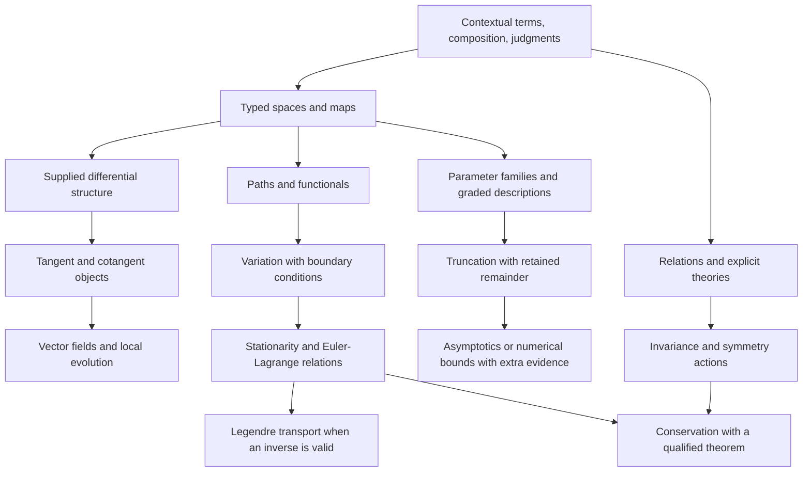

# A Minimal Algebra Of Scientific Reasoning

> Status: foundational redesign candidate, 2026-10-10, under language-coherence.
> A closed exact polynomial-map experiment runs from a source checkout. No new
> syntax, universal IR, analytic calculus or physical theory is accepted here.

The proposed pivot is to make **contextual terms, checked composition and
explicit judgments** the common foundation. Spaces, variation, invariants,
selection and approximation supply structures and laws over that foundation.
They do not each become a compiler feature. This is a candidate architecture,
not a proof that three concepts are irreducible or sufficient for every domain.

This document owns the cross-cutting redesign comparison. The
[synthesis](synthesis.md#candidate-primitive-synthesis-and-integration-path)
owns integration; [scientific models](scientific_discovery.md) owns scientific
contracts; [AI frameworks](ai_frameworks.md) owns numeric-program contracts.
[Primary evidence](../research/scientific_models.md#foundational-algebra-evidence)
and the [bridge](../review/2026-09-29-language-synthesis.md) retain provenance and
migration evidence. The current [semantics](semantics.md) remains the accepted
target until a replacement meets its obligations.

## First Audit: What Is Actually Irreducible Now?

There is no established minimal Nomi calculus. Four layers currently coexist:

| Layer | Actual concepts | What the audit establishes |
| --- | --- | --- |
| Accepted language meaning | Owned scalar/data values, lexical identity, calls/capture, alternatives, cells, completion, failure, authority and lifetimes | These have distinct observable laws. An encoding cannot discard their distinctions. |
| [Composition hierarchy](primitive_composition.md) | Value, Bind, Apply, Choose, Perform, Scope, accompanied by contracts/context/evidence | Six **families of responsibilities**, not six irreducible terms or accepted opcodes. |
| [Implementation Core](../../prototype/syntax/core.py) | 31 registered node classes, including literals/load/bind/function/call, branch/loops/match, data access and raise/handle/defer | A transitional executable vocabulary; neither a minimal calculus nor target authority. Python AST and frontend lowering remain separate substrates. |
| Engine-free laboratories | Typed named descriptions, ports, closed definitions, conditions, domain checking and selected adapters | Meaning can precede execution. Nominal ports alone establish neither mathematical structure nor domain equivalence. |

The [scientific checker](../../tools/scientific_probe.py) implements exact
commutative polynomials with flat generator IDs, a declared formal derivation
and equality witnesses. It has no general scoped binder, transformation space,
tangent bundle, integration, inverse solver or analytic remainder judgment.
The [AI checker](../../tools/ai_probe.py) checks named-axis metadata, not
derivatives. The generic framework does not fill those gaps implicitly.

The current irreducible **obligations** are distinguishable values and owners,
binding/capture, admissible composition, selected elimination, observable action,
and completion ownership. Their smallest representation is still open. The
redesign challenges their organization; it does not erase effects or cleanup
because mathematical functions compose elegantly.

## Compare Foundations Before Selecting One

| Candidate | What is small | Strength | Cost or missing law |
| --- | --- | --- | --- |
| Six current execution families plus domain libraries | Existing operational decomposition | Preserves ordinary programming; easiest incremental bridge | Mathematical binding, theories and evidence remain loosely connected laboratories. |
| Lambda/variant encoding of everything | Few term constructors | A concrete reduction target; closures and data are reusable | Small encoding does not establish nominal identity, authority, cleanup or useful diagnostics. Extra rules return elsewhere. |
| Objects and composable arrows only | Identity and associative composition | Clean account of transformations | Does not supply branching, binding, effects, differentiation, predicates or approximation. Category laws alone imply no derivative. |
| **Contextual terms + composition + judgments** | Three recurring semantic responsibilities, with explicit structures | Connects execution and reasoning without making every value a graph | Requires scoped artifacts, checker ownership and phase boundaries. This remains a design hypothesis, not a three-opcode machine. |

Investigate the last candidate. Minimality means fewer independent rules and
fewer concepts a user must maintain, with laws still visible. Hiding twenty
special mechanisms behind a word such as “object” is not a reduction.

## The Candidate Core

### 1. Form A Term In A Context

A context resolves declarations and binders, types, available structures,
assumptions and actual capabilities. A term has a meaning and owner in that
context. Products, alternatives, scalar literals, references and functions are
term forms. A mathematical space is a typed description; a point inhabits it.
A scientific hypothesis is an explicitly marked premise, not a host capability.

Binding is fundamental here: two symbols printed `x` can have different owners.
Substitution must preserve binding and avoid capture. Models can retain cyclic
relations; executable dependencies need their own ordering contract. A term
need not have an executable realization, and drafts need not be well typed.

### 2. Compose Under A Carrier's Contract

Application, substitution, product construction and alternative elimination
compose terms. An explicit map `A -> B` can compose with `B -> C` when its domain
and obligations agree. A relation from A to B is not automatically a total,
single-valued executable map. An ordinary effectful call retains argument order,
evaluate-once behavior and completion rules; it is not a pure mathematical map.

Carriers supply additional rules: lists preserve their ordering/cardinality;
streams preserve demand/cancellation; smooth maps supply tangent structure;
open equation systems supply boundary composition. Shared composition machinery
does not make these carriers interchangeable.

### 3. Make A Judgment With Explicit Coverage

Separate a description, an obligation and evidence. The proposed metalanguage is:

```text
context |- term : type, with effect/completion contract
context |- claim, supported by method and covered premises
```

This is explanatory notation, not Nomi source. A language checker can establish
a type/call contract. A domain checker may establish an identity in a named
algebra. A solver may report a bounded numerical result. An observation may
support a model empirically. A human may leave a premise unresolved. None
substitutes for the others. “Unknown,” “refused,” “not an identity” and
“contradictory premises” must retain their different meanings.

Evidence names claim, context/revision, method, premises and coverage. A Boolean
or copied certificate label cannot mint it. Generic code transports an evidence
artifact; its semantic owner determines whether it establishes anything.
The proposal does not require unrestricted dependent types or a proof assistant
in every script. Compare a bounded typed-term/checker interface first.

### A Concrete Kernel Candidate, Rather Than Three Labels

The smallest viable candidate to compare has the following **metalanguage**
forms. This is a proposed semantic grammar, not source notation or accepted IR.

```text
type        = scalar(profile) | nominal(declaration) | product(fields)
            | sum(variants) | callable(input, result, completion_contract)
term        = reference(owner) | literal(profile, payload)
            | construct(type, fields) | project(term, field)
            | inject(variant, term) | eliminate(term, bound_cases)
            | lambda(bound_parameters, computation) | apply(term, arguments)
computation = pure(term) | sequence(bound_result, computation, computation)
            | request(actual_owner, operation, arguments)
            | complete(lexical_target, cause, term)
            | scope(registered_policy, computation)
definition  = bind(owner, term) | recursive_group(bound_definitions)
```

The grammar retains type-level products/sums and their introduction/elimination
laws, not a special mathematical “space” type. Nominal declarations and profiles
retain invariant-preserving construction. Binding/context is shared by function
parameters, variant cases and recursive groups. Recursion supplies expressiveness
without promising termination, fairness or a differentiable numeric description.
Literal profiles and authorized requests are explicit intrinsic boundaries.

`sequence` is evaluate-once ordered composition. `complete` preserves exact
return/loop/abnormal targets while scopes unwind. `scope` selects a specified
policy; it is not an arbitrary user handler that can discard cleanup. Exception,
resource and task contracts must determine their actual cause/ownership behavior
before such lowering is valid. Region/capture facts accompany callable types.

| Current family | Location in this grammar | Reduction obligation |
| --- | --- | --- |
| Value | Literal, constructor, projection, injection | Nominal/scalar identity and data invariants survive. |
| Bind | Explicit owners, bound parameters/cases/results/definitions | Capture-free substitution and fresh cells; spelling is only a projection. |
| Apply | Application and ordered sequence | Eager once-only arguments and exact completion contract survive. |
| Choose | Sum/Bool elimination | Only the selected computation runs; captures commit atomically. |
| Perform | Owned request | Actual authority and publication/suspension rules cannot be replaced by labels. |
| Scope | Completion and registered scope policy | Cleanup, retained causes, non-escape and owned child joins survive. |

This is the proposed executable base. Judgments are **checking rules over these
artifacts**, not another instruction executed for every expression. Domain
descriptions can be ordinary data or reifications of an explicitly admitted
subset. A general callable with foreign captures is not automatically reifiable.
First-class maps are library values with typed domains and admitted rules.

Arithmetic, loops, match, propagation and scientific APIs must each produce a
long-form reduction against this grammar or justify a retained intrinsic. The
comparison can delete forms when their laws genuinely reduce, or retain a form
when simpler encoding hides a crucial rule. The present polynomial lab tests
only the map-library slice; it does not implement this whole kernel.

### Keep Description, Checking, Transformation And Action Separate

Describe a selected term; check its well-formedness and obligations; transform
it under an explicit structure; check a resulting claim; select a realization;
then request execution through its owner. None of the earlier phases implicitly
performs the last one. Transformation failure retains the original description.
Unknown premises can remain useful drafts without becoming executable grants.

The scientific, AI and statistical owners can share reference/binder and receipt
mechanisms. They need not share every term constructor or evaluator. A scientific
equation, tensor kernel, host call and causal hypothesis keep different meaning
even when shown in the same workspace. R1's source-derived ordinary/scientific
comparison is the bridge from today's separate laboratories to this kernel.

## Language Primitives Versus Library Structures

| User's candidate foundation | Composition over the candidate core | Extra structure that must be supplied |
| --- | --- | --- |
| Objects and spaces | Typed terms, products, constrained descriptions and named points | Membership, equality, topology, measure, chart or quantity structure as needed. A type is not automatically a manifold. |
| Transformations | Functions/maps, identity, composition, restrictions and supplied inverse candidates | Totality/domain, effects, bijectivity or reconstruction evidence. Inversion is partial work. |
| Variation | A transformation from a map description to a linearized description | Differential structure and admissible rules; tangent/cotangent ownership, regularity and branch/event conventions. |
| Structure and invariants | Relations/predicates plus preservation judgments | A selected algebra, action, metric, symplectic form, connection or conservation theorem and its premises. |
| Selection | A relation describing feasible, stationary, minimal or maximal candidates | Ordering, domain, existence, uniqueness, constraints, boundary conditions and a separately selected search/solver strategy. |
| Scale and approximation | Families indexed by a parameter, graded terms, transformations and remainder judgments | Limit/regime, comparison scale, norm/topology, validity region, error or order semantics and transport rules. |

**True language-level work:** lexical binders and typed construction/elimination;
contract-preserving calls; effect/authority/completion ownership; inspectable
descriptions and owner-qualified checker interfaces. Representation, lowering,
source spans and diagnostics must preserve these facts. Whether some inspection
facilities are ordinary library protocols remains a comparison to settle.

**Library work:** spaces and maps, tangent/cotangent bundles, vector fields,
paths, functionals, measures, differential forms, symmetry actions, stationary
sets, duality, filtrations and approximation claims. Lagrangians, Hamiltonians,
optimizers, statistical estimators and AI losses compose these structures.

**Adapter work:** symbolic normalization, AD, numerical solvers, simulation,
storage and visualization. An adapter explicitly declares its admitted profile
and evidence; selecting one does not redefine the object. General AD work still
begins with the established-engine comparison in the AI proposal. This finite
formal polynomial experiment is not that general engine.

## A Hierarchy That Exposes The Missing Structure



These edges state dependencies, not automatic derivations. In particular a
vector field does not automatically provide a complete flow, and a symmetry does
not automatically supply a conservation law outside the theorem's setting.

## Work Through The Five Scientific Chains

### Spaces To Tangents To Fields To Flows

Given differentiable structure, `T` maps a space M to TM and a smooth map f to
Tf, preserving identities and composition. A vector field is a section
X: M -> TM with base projection equal to identity. In an affine coordinate
profile its components can be represented as an endomap, with that convention
explicit. General bundles cannot use that representation unconditionally.

A flow is separately an evolution map on an admitted time/state domain, with
identity at zero, composition where defined, and generator X. Existence,
uniqueness and extension require hypotheses. Even x' = x² has finite-time
blow-up for positive initial states; global composition cannot be assumed.
The executable example verifies an explicitly supplied translation flow,
not a general flow-construction theorem.

### Transformations To Invariants To Symmetries To Conservation

Invariance states that a particular quantity or relation is preserved by a
particular transformation. A symmetry action also has identity/composition
laws and preserves the selected model structure. An invariant and a symmetry
are different objects. Conservation states preservation along admitted
evolution, possibly only on solutions and with boundary/source terms.

For free kinetic L = v², translation q -> q+s preserves L, and the specified
free field conserves p = 2v. The experiment checks those two identities
separately. It does not implement a general Noether theorem. A theorem library
must expose action/variation, symmetry and boundary hypotheses before
transporting conservation evidence.
[SICM's treatment](https://tgvaughan.github.io/sicm/chapter001.html).

### Paths To Functionals To Variations To Stationary Action

A path is a map from an admitted interval to a configuration space. An action
is a functional on admissible paths, often constructed by integrating a
Lagrangian along a lifted path. Vary within the correct function space and
boundary conditions. Stationarity requires the first variation to vanish on
admissible directions. It is not automatically minimization.

The lab checks the finite discrete functional
S(q0,q1,q2) = (q1-q0)² + (q2-q1)² with fixed endpoints: substitution of
q1 = (q0+q2)/2 makes its interior derivative zero. Separately it constructs
the local Euler-Lagrange residual 2(a+q) for L = v²-q² under q' = v, v' = a.
Neither operation establishes integration by parts, continuum stationarity,
boundary terms or solution existence. Those need the next variational contract.

### Lagrangians To Legendre Transport To Hamiltonians

For L(q,v) = v²-q², form the fiber derivative (q,v) -> (q,p=2v), supply
(q,p) -> (q,v=p/2), and verify both compositions are identity. Only then
construct H = p*v-L = p²/4+q². No inverse-solving engine is invoked.

A singular velocity Hessian prevents this unrestricted inverse route. Local
regularity is not global bijectivity. A library can return an obligation,
restricted domain or constrained Hamiltonian description rather than inventing
an inverse. The classical smooth Legendre transformation and the convex
Legendre-Fenchel conjugate have different domains and conclusions; neither
should hide behind an unqualified `dual` operation.
[SICM's explicit inversion requirement](https://tgvaughan.github.io/sicm/chapter003.html).

### Local Approximation To Perturbation To Asymptotics

Expand (x+epsilon)³ into retained x³+3x²epsilon and exact remainder
3x*epsilon²+epsilon³. The lab verifies reconstruction without samples. It does
not infer a numerical error or big-O claim. Such a claim needs a limit, regime
and bounds on x; x = epsilon^-2 invalidates an unqualified small-remainder
reading. Differentiating the remainder in epsilon lowers its leading order.

Formal truncation, asymptotic expansion, convergence and numerical tolerance
are separate judgments. Rules for differentiated asymptotics require extra
conditions; uniform claims also specify which parameters range uniformly.
[NIST DLMF definitions and differentiation](https://dlmf.nist.gov/2.1).

## Compact Executable Examples

Run every worked composition without supplying data or selecting a solver:

```bash
python3 -m tools.reasoning_examples
pytest -n 0 prototype/tests/unit/tools/test_reasoning_algebra.py
```

This is Python research code in the checkout, **not runnable Nomi syntax**.
Fourteen judgments report `identity` in the fixed
`scoped-rational-polynomial-maps-v1` profile. A small direct example is:

```python
from tools.reasoning_algebra import Space, Mapping, coordinates, compose, tangent, compare

A = Space("A", ("x",))
B = Space("B", ("x",))
x, = coordinates(A)
y, = coordinates(B)
f = Mapping("square", A, B, (x ** 2,))
g = Mapping("cube", B, A, (y ** 3,))
claim = compare(tangent(compose(f, g)), compose(tangent(f), tangent(g)))
assert claim["status"] == "identity"
```

`compose(first, second)` means second after first. Same-spelled variables in A
and B cannot mix directly; substitution uses the explicit map. Descriptions
are immutable, and judgments fingerprint both complete descriptions and the
profile. `realize(mapping, exact_bindings)` is a separate exact-rational adapter;
composition and checking never call it. No floating coercion is admitted.

The profile admits 1–8 coordinate axes, 128 terms, degree at most 12 and
256-bit rational coefficients. It rejects over-capacity work instead of
changing meaning. These are laboratory budgets, not language limits. Equality
is decided for the admitted full polynomial maps; nonzero residual means
`not-an-identity` here, rather than disproving a conditional physical claim.

The descriptions are engine-free but profile-specific coordinate forms. They
do not yet establish representation-independent manifolds, quantities,
cotangent variance, lexical higher-order binders or arbitrary expression
plugins. Transformation functions own polynomial rules; extracting alternate
rule/representation providers is the next boundary, not a claim already met.
There is no persisted certificate consumer or independent symbolic replay for
this new profile. Seeded exact-rational tests use independent hand arithmetic
for primal/tangent results; the earlier scientific witness profile retains its
own independent replay and is not silently reinterpreted.

## Ordinary Programming Must Stay Ordinary

Writing a function, matching a Result, reading a file or building a report must
not require manifold annotations or evidence objects. Inferred local terms and
ordinary calls remain the default. Explicit reasoning begins when the user
asks to describe a program, change its representation or establish a claim.
Quoted descriptions are distinct from invoking eager code.

The same foundations help validate a dataframe mean decomposition, compose a
document, inspect an AI loss or repair a program contract. They do not permit
reordering effectful calls, differentiating arbitrary file access, assuming an
empty mean exists or importing exact polynomial laws into IEEE arithmetic.
Cleanup and task joining retain their operational owners even if scopes can
be represented as terms. This is a general-purpose redesign, not a physics DSL.

## Evaluate The Recommendation

| Criterion | Evidence now | Remaining discriminator |
| --- | --- | --- |
| Expressiveness | One closed map algebra covers all five chains at finite/formal slices | Continuum paths, partial maps, cyclic relations, nonsmooth/stochastic and constrained examples remain unsupported. |
| Composability | Typed composition, pullback, tangent functor laws and inverse candidates run without inputs | Compare non-polynomial and alternate representations; validate premise/domain transport. |
| Coherence | Variation/selection/scale have explicit supplied laws; effects remain separate | Determine whether checker interfaces simplify the ordinary language rather than create two disconnected authoring systems. |
| Feasibility | Stdlib exact lab; immutable descriptors; bounded refusing operations; no parser migration | Source-derived binding, adapter conformance and independent proof replay need new artifacts. |
| Usability | Compact executable long forms and named judgments | Matched authoring/repair/handoff with ordinary programmers and domain users is prepared work, not a measured benefit. |
| Minimality | Three responsibilities replace a catalog of proposed domain keywords | Compare actual rule counts and annotation/diagnostic burden; no irreducibility theorem or universal calculus is established. |

## One Integration Path, With Closure Receipts

1. **R0 — foundation comparison, this pass.** Audit the four layers, compare
   candidates, run explicit compositions and counterexamples. Keep accepted
   source/runtime behavior unchanged while the replacement is designing.
2. **R1 — scoped typed descriptions.** Compare nominal/context-indexed references
   with locally nameless terms. Close capture-free substitution, alpha-equivalence,
   same-name binders, imports and revision invalidation for one monomorphic slice.
   Include an ordinary report function and a scientific map; neither must become
   a global lazy graph. This is the next implementation decision.
3. **R2 — structures and qualified transformations.** Introduce explicit providers
   for map rules, tangent/cotangent roles and partial-domain obligations. Use an
   established symbolic/AD adapter for independent vectors, plus an independent
   exact certificate consumer. Incorrect chain rules and tangent/cotangent swaps
   must fail; unknown operators remain unsupported.
4. **R3 — relations, selection and variation.** Compose a constrained model and
   a continuum action with named admissible variations and boundary terms.
   Independently check one Euler-Lagrange derivation. Retain stationary saddles,
   singular Legendre maps and contradictory premises as discriminators.
5. **R4 — scale and realization.** Add a parameter regime and separately checked
   remainder bound or asymptotic rule, then compare two execution adapters.
   Include nonuniform perturbation, capacity exhaustion, units and chart changes.
   Never turn local solver tolerance into a global scientific guarantee.
6. **R5 — admission and interaction.** Compare ordinary/scientific/AI/data authoring,
   repair and handoff; measure context burden separately from formal coverage.
   Promote only a settled slice into syntax/semantics, lowering, formatter,
   diagnostics and runtime conformance. Delete superseded laboratory wiring;
   keep unsupported structures explicit.

R1/R2 refine SP1/SP2 and AF1/AF2; R3 refines SP2; R4 refines SP3; R5 includes
SP0/AF0. Existing observation, inverse-discovery, AI state and distribution gates
remain relevant. The [registered packet](../../config/design_passes.json), not
this document's prose, owns the immediate work order.
