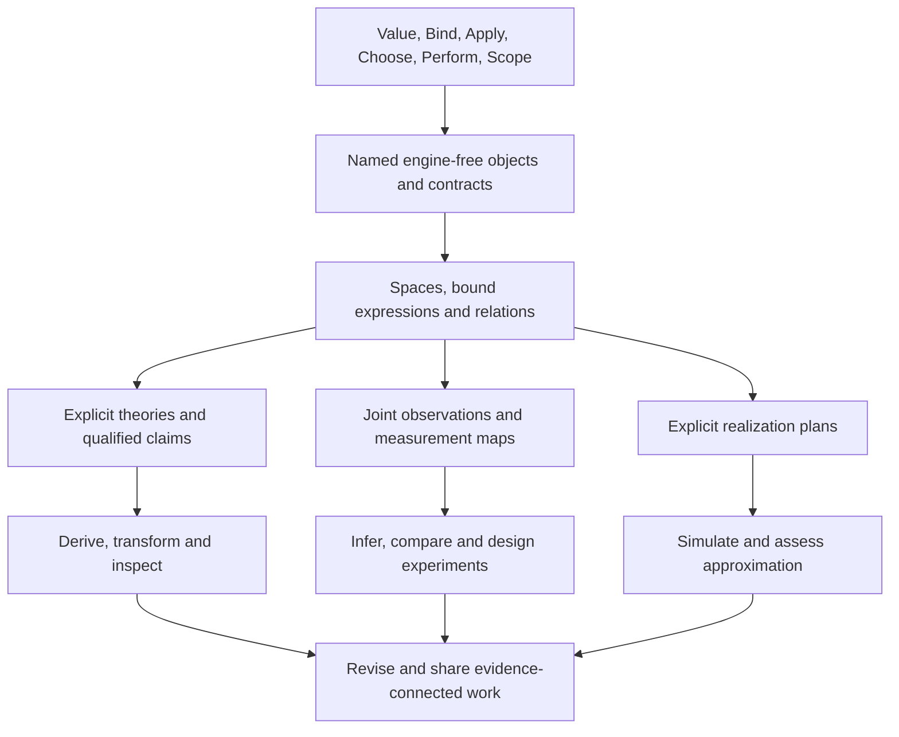

# Scientific Models And Discovery

> Status: designing proposal, 2026-10-10. Physics supplies the first pressure
> cases for a general engine-free modeling layer. No new source syntax, numeric
> profile, scientific library, solver or proof engine is admitted by this document.
> A bounded source-checkout probe now checks exact formal polynomial witnesses;
> its scope and unresolved modeling contracts are described below.

Nomi should help a person express a model, derive consequences, compare them
with observations, find a disagreement, and revise the model. A simulation is
one realization of that activity. Scientific discovery also needs symbolic
reasoning, competing explanations, experiment design and an inspectable account
of what a conclusion depends on.

The recommendation is **five reusable modeling contracts**, built over the
existing [primitive families](primitive_composition.md): semantic spaces,
bound expressions and relations, explicit theories, joint observation models,
and qualified realizations. Evidence accompanies all five. These are candidate
library/artifact contracts, not five new language keywords or machine opcodes.
The most urgent addition is a mathematical model that exists independently of
an execution plan.

The [minimal reasoning algebra](reasoning_algebra.md) takes the next step:
redesign the foundation around contextual terms, composition and judgments,
rather than treating those five contracts or the six execution families as
irreducible. It derives the user's six scientific themes as supplied structures
and works through spaces/flows, symmetry/conservation, action, Legendre transport
and approximation. Its closed map experiment adds scoped finite coordinate
contexts and exact transformations; it does not close the general binder,
continuum, manifold or asymptotic contracts below. R1/R2 refine SP1/SP2 and the
AI transformation gates, while observations and realizations retain their owners.

The shared objective is to make thinking easier: people should be able to form,
name, relate, question, compare and revise ideas without repeatedly rebuilding
the surrounding context in their heads. Physics is a demanding pressure case.
The mathematical contracts below support that activity; they are not a claim
that all thought is mathematics or that one formal calculus captures cognition.

This is a continuation of [language synthesis](synthesis.md), under the existing
language-coherence packet. The [engine-free framework](object_framework.md)
supplies the shared direction; [numeric research](../research/features/numerics.md)
and [question 9](../research/open_questions.md#9-numeric-and-scientific-model)
retain their existing evidence. The [maintainer guide](../research/synthesis_guide.md)
owns integration practice. The [vision](vision.md) remains broader than physics.

Read [thinking activities](#design-from-thinking-activities) for the organizing
principle, [contract interactions](#contracts-and-their-interactions) for the
semantic details, and [physics challengers](#physics-challengers-for-the-shared-design)
for breadth. [Primary-system synthesis](../research/scientific_models.md)
records the evidence, competing choices and bounded experiments.

## Design From Thinking Activities

The language and its environment should support the following recurring moves.
These are design questions, not a psychological taxonomy or proposed opcodes.
They elaborate the existing eight user acts rather than defining a second Core.

| Thinking activity | Nomi should make available | A concrete failure to prevent |
| --- | --- | --- |
| Make a distinction and give it a name | Referable concepts with accessible definitions, roles and domains | Equal displays silently collapse distinct concepts |
| Relate ideas | Inspectable dependencies, equations, constraints, analogies and competing causal hypotheses | Every relation is mistaken for an execution dependency or cause |
| Hold something fixed while exploring | Explicit context, assumptions and a branch with retained baseline | An exploratory assumption silently becomes a fact in another branch |
| Follow a consequence | Named intermediate steps and method-qualified evidence | An answer hides the premises that made it possible |
| Compare alternatives | Aligned question, observation basis and discriminating predictions | Two outputs are compared under different conditions without disclosure |
| Change perspective or abstraction level | Connected equation, diagram, trace, example and explanation views | A compressed view cannot lead back to an exception or concrete case |
| Encounter a surprise or a gap | Unknown, disagreement, failed expectation and unsupported work remain visible | Missing evidence is presented as false, success or an invented value |
| Revise and carry understanding forward | Semantic change, affected claims, surviving evidence and retained history | A new model inherits an old conclusion without rechecking its basis |

Not every move requires execution. Rearranging a representation, isolating a
case, checking a law, finding an assumption or comparing hypotheses can be useful
without observations. Conversely, inspecting a model does not authorize an
experiment on the world. A hypothetical branch must not operate an instrument.

The cognitive owner distinguishes representations that aid discovery from
claims that a particular representation is universally superior. Kirsh and
Maglio's Tetris study distinguishes actions that reveal information from actions
that directly advance an external goal. Victor's interactive essay demonstrates
movement between concrete cases and abstractions. These motivate experiments
with Nomi; neither establishes that this proposal improves scientific work.
[Primary study](https://doi.org/10.1207/S15516709COG1804_1),
[primary design demonstration](https://worrydream.com/LadderOfAbstraction/),
[Nomi cognitive foundations](../research/cognition.md).

### A Workspace For Reasoning

A candidate workspace connects a question, alternative models, assumptions,
derived predictions, observations, comparisons and open obligations. The
objects retain their semantic owners: an equation, a survey response and a
resource policy do not become interchangeable because a view connects them.

For an oscillator, the user-facing question could be “Why does the amplitude
decrease?” The workspace holds undamped dynamics, viscous damping, a changing
measurement gain and external forcing as distinct candidates. Each candidate
states what it predicts and what observation could distinguish it. Fitting a
damped curve alone cannot silently eliminate a calibration explanation.

The same activity appears in a service incident (“Why did latency rise?”), an
ecological study (“Why did this population decline?”) or a financial model
(“Why does the balance change?”). Shared affordances include referable ideas,
baseline/alternative comparisons and inspectable evidence. The domain's causal,
statistical and operational laws remain separate.

### Incomplete Thinking Must Be Useful

Keep a draft description distinct from a checked model and an admitted execution
plan. A draft may contain an unspecified unit, an unresolved symbol, an informal
conjecture or mutually competing assumptions. It can be saved, named, discussed
and inspected. It must not export a fabricated checked reference or execute an
unsupported claim. Promotion reports local obligations and preserves the draft.

Formalization should be gradual: write a question, attach a sketch/example,
identify the important distinctions, then make the needed slice checkable.
A greeting program must not acquire a scientific proof ceremony. Reasoning
support should compress useful context while making its expansion available.

### Measure The Intended Benefit

Compare text, structured and mixed representations using identical model facts
and task goals. Let participants predict behavior, find a missing premise,
distinguish alternative explanations, repair a changed assumption and explain
the result to another person. Include domain experts and learners separately;
do not substitute a synthetic checker for either group.

Measure correct predictions, overlooked premises, time to diagnose/repair,
ability to retrieve evidence, inappropriate confidence, and handoff accuracy.
Count interaction and annotation costs as well as successes. Keyboard, screen
reader, localization and nonvisual equation access belong in the comparison.
An attractive view, shorter program or passing proof is not itself evidence of
easier thinking. SP0 prepares these tasks; human trials remain unperformed.

## The Small Modeling Basis

| Contract | Meaning it must retain | Physics use | Other domains |
| --- | --- | --- | --- |
| Semantic space | Scalar theory, quantity kind, dimensions, axes, frame, and admitted structure; representation is a separate choice | Length, affine position, tangent vector, tensor, operator | Currency, geographic coordinates, typed signals, indexed populations |
| Bound expression and relation | Stable symbol identity, binder scope, typed application, equations/inequalities and declared unknowns | Fields, differential equations, constraints, boundary conditions | Chemical networks, optimization, circuits, consistency constraints |
| Explicit theory | Named assumptions, admissible laws, premises and bounded transformation/checking rules | Classical versus quantum algebra, smoothness, symmetries, conserved quantities | Policy reasoning, relational laws, formal specifications |
| Joint observation model | What was observed, through which measurement map, with shared sources and declared uncertainty | Calibration, sensor noise, latent state, parameter inference | Surveys, experiments, reliability, causal hypotheses |
| Qualified realization | Which mathematical object an implementation approximates or realizes, using which method and admissible error claims | Simulation, discretization, quadrature, inverse solving | Forecasting, optimization, planning, data computation |

### 1. Semantic Spaces Before Array Shapes

An array of three numbers does not establish a spatial vector. A space contract
must separate physical meaning from storage: scalar domain, quantity kind,
dimension, unit, axis identity, frame/chart and algebraic structure. A domain
need only declare the parts it supports; unresolved structure stays explicit.
Converting a representation cannot invent compatibility between spaces.

Dimensions are necessary but insufficient. BIPM's vocabulary explicitly
distinguishes energy and torque despite equal dimensions. This motivates
quantity-kind identity in addition to unit exponents.
[Primary evidence: BIPM quantity kinds](https://jcgm.bipm.org/vim/en/1.2.html).

Start with exact unit scales and named quantities. Then distinguish affine
points from displacements: point subtraction can yield a displacement, while
adding two positions requires a separate interpretation. Absolute temperatures
and temperature differences need different conversion laws. A dimensionless
angle is not automatically interchangeable with a probability or a count.
Nondimensionalization retains reference scales and an inverse interpretation;
setting physical constants to one in a natural-unit convention cannot silently
erase quantity kinds or authorize a conversion outside that convention.

Later libraries can describe vector/dual spaces, tensor variance, inner
products, complex/Hilbert spaces and manifolds. A metric is supplied structure,
not permission to silently identify vectors with covectors. Frame conversion
must retain direction and domain validity. SymPy's differential-geometry
interface separates manifolds, coordinate systems, vector fields and forms;
this supports investigating these distinctions without adopting its API.
[Primary evidence: SymPy differential geometry](https://docs.sympy.org/latest/modules/diffgeom.html).

**First refusal:** adding a length to a time reports both object names, their
spaces, and the failed compatibility obligation before any engine is selected.
Equal shape, display unit or nominal port spelling cannot discharge it.

### 2. Bound Expressions And Relations Before Solvers

Add an inert typed expression contract: symbols, exact constants, application,
and explicitly scoped binders. A mathematical symbol is distinct from an input
slot and from another symbol with the same printed name. Substitution must be
capture-avoiding; alpha-renaming preserves binding meaning. A function object
retains its domain/codomain and free dependencies without evaluating samples.

An equation is a relation, not an assignment or an instruction to evaluate its
right side. A model declares unknowns, parameters, independent variables,
relations and initial/boundary conditions. Unknowns can be functions or fields;
boundary conditions refer to the relevant domain boundary, not arbitrary rows.
Constraints may be cyclic even though expression construction is acyclic.

ModelingToolkit combines symbolic descriptions with equation-based modeling
and transformations before constructing numerical problems. This is evidence
for separating model and solve plan, not for promising that Nomi can solve any
well-formed equation system.
[Primary evidence: ModelingToolkit](https://docs.sciml.ai/ModelingToolkit/stable/).

Keep the current object graph's DAG invariant. Represent relations between
unknown symbols in a separate domain-owned model artifact; do not manufacture
a self-referential execution graph or weaken its checker. Equation counts and
structural checks can detect some problems but do not establish existence,
uniqueness, consistent initialization or well-posedness.

Differentiation, integration, contraction, operator composition and weak forms
are typed library operations over these expressions. Their binders and domains
must survive inspection. Do not add one global syntax form per operation.
Ordinary Nomi remains eager; constructing an expression creates a value rather
than changing evaluation of ordinary functions.

### 3. Explicit Theories And Evidence For Transformations

A theory context identifies the scalar/algebra profile, declarations,
assumptions, axioms and rule revisions. A claim references that context and
the named premises it uses. Assumptions are inspectable values supplied to a
transformation/checker, never an ambient global setting or an executable
`where` predicate automatically promoted to a theorem.

Wolfram's `Assuming` supplies scoped assumptions to operations including
simplification and integration. Nomi should preserve the conditional result
while comparing explicit context passing with scoped convenience.
[Primary evidence: Wolfram Assuming](https://reference.wolfram.com/language/ref/Assuming.html.en).

Do not overload one equality:

| Claim | Required evidence | What it cannot establish |
| --- | --- | --- |
| Declared definition identity | Checked expansion/alias identity | General algebra, correct backend execution |
| Mathematical equivalence or implication | Named theory, premises and replayable derivation | That the premises describe nature |
| Approximation relation | Method, norm/domain, bound or qualified estimator | Exact equality or an unprovided global bound |
| Empirical agreement | Observation model, comparison protocol and retained observations | Universal validity or a unique explanation |

Evidence records the statement, context, premise references, method/checker,
artifact revisions and outcome. Distinguish established, conditional, refuted,
unknown and unsupported outcomes; an exhausted budget is not a counterexample.
An untrusted CAS, search procedure or AI may propose a transformation, while
a small checker validates the admitted proof fragment. Lean separates elaborate
proof construction from kernel checking; imported axioms remain part of the
trust basis.
[Primary evidence: Lean elaboration and kernel](https://lean-lang.org/doc/reference/latest/Elaboration-and-Compilation/),
[axiom dependencies](https://lean-lang.org/doc/reference/latest/Axioms/).

Start with a bounded exact polynomial fragment and explicit premises. Preserve
unknown for unsupported claims. Later theory adapters can handle rational
functions, noncommutative algebras, distributions or geometry. A scalar
commutative simplifier must never reorder quantum operators. Branch cuts,
singular points and differentiability are obligations, not optimizer details.
An inconsistent assumption set must not produce an unexplained scientific
success; report known inconsistency and retain unknown consistency otherwise.

### 4. Joint Observations Rather Than Detached Error Bars

Separate the ideal modeled quantity, the measurement map, the recorded
observation and the uncertainty model. Preserve named shared sources:
instrument calibration, clock offset, environmental influence and sampling
history can connect otherwise separate observations. Unknown dependence must
remain unknown. Zero covariance does not generally assert independence.

BIPM's combined-uncertainty definition requires covariances when inputs are
correlated. This motivates a joint model instead of silently treating each
`value ± error` as independent.
[Primary evidence: BIPM combined uncertainty](https://jcgm.bipm.org/vim/en/2.31.html).

Intervals, probability distributions, stochastic processes and statistical
confidence claims have different meanings. Their adapters must state support,
dependence and propagation rules. An interval enclosure is not a posterior;
an estimate of experimental uncertainty is not a numerical error bound.
Density, sampling and conditioning are distinct operations, with explicit
randomness and measure/domain conventions where needed.

An observation model also gives an inverse problem something to infer:
parameters, latent variables and a measurement mapping. Fitting must retain
identifiability assumptions, priors where applicable, selection history and
held-out evaluation. Good fit alone must not become evidence of causation.
Experiment plans declare interventions and expected discriminating observations;
actual instruments use Nomi's existing effect, capability and resource owners.

Equation discovery composes a candidate grammar, space/symmetry constraints,
search history and an evaluation protocol. An AI or symbolic-regression engine
proposes hypotheses; dimensional consistency and training fit are separate
checks from held-out predictive agreement and scientific explanation. Retain
alternative candidates and unresolved assumptions rather than converting a
selected expression into an established law.

### 5. Realizations With Qualified Numerical Meaning

Keep `Model`, `SolvePlan`, `Run` and `ResultEvidence` distinct. A plan selects
an engine, method, representation, domain discretization, initial/boundary
conditions, stopping policy and budget. Compilation checks admitted capabilities
without executing a solver. An execution returns a method-qualified result or
a structured refusal/failure, not an unqualified `solved` flag.

Numerical evidence distinguishes model approximation, discretization,
iteration, roundoff and observation uncertainty. Record which were assessed,
how they were combined if applicable, and which remain unresolved. Residuals
need their space, scaling and norm; a small residual alone is not a bound on
solution error for an ill-conditioned problem. Local solver tolerances must not
be labeled global guarantees. SciML explicitly documents its usual adaptive
tolerances in terms of local error estimates.
[Primary evidence: solver options](https://docs.sciml.ai/DiffEqDocs/stable/basics/common_solver_opts/).

Differentiating a realized computation needs a stated target: the discrete
algorithm, an implicit root, or the underlying continuous model. These can
differ. A derivative contract names tangent/cotangent spaces, supported rules,
regularity and conventions. JAX's JVP/VJP presentation exposes derivatives as
linear maps rather than requiring materialized Jacobians.
[Primary evidence: JAX differentiation](https://docs.jax.dev/en/latest/jacobian-vector-products.html).

## Contracts And Their Interactions

### Separate Object Roles

The following record shapes describe responsibilities, not selected JSON keys,
generic syntax or an admitted public API. The common envelope carries version,
owner, stable identity, revision and explicit references. Domain payloads retain
their own schemas and checkers.

| Object | Minimum semantic facts | What promotion requires |
| --- | --- | --- |
| Question | Goal, scope, supplied facts, unresolved terms and desired discriminator | No proof requirement for asking; execution still needs an admitted plan |
| Space | Carrier/scalar theory, quantity kind, dimension and declared structure | Well-formed declarations and explicit compatibility/morphism rules |
| Symbol | Identity, role, space, scope and declared dependencies | Resolved references; no inference from display names |
| Expression | Operation identity/revision, ordered operands, result space and free references | Typed application and retained definedness obligations |
| Binder | Bound symbol identities, their domains, body and boundary of scope | Capture avoidance and alpha-equivalence under the admitted binder profile |
| Relation | Predicate identity, ordered subjects, context and declared role | Compatible subjects; assignment/causation/solvability remain separate |
| Model | Declarations, relations, assumptions, domain and initial/boundary contracts | Well-formedness; existence, uniqueness and identifiability are additional claims |
| Theory | Vocabulary, laws/axioms, profiles, named premises and rule versions | Checker-supported fragment and explicit trust basis |
| Claim | Precise statement, target context and requested evidence kind | A qualified checker outcome; the claim may remain unresolved |
| Transformation | Source, target, method, correspondence and preservation claim | Evidence appropriate to equivalence, implication, approximation or representation change |
| Observation | Measurand/measurement map, record, acquisition context and joint uncertainty references | Decode and admitted interpretation; causal support needs its own protocol |
| Realization plan | Mathematical target, adapter/method, representation, conditions, limits and requested assessments | Capability/contract checks before execution |
| Evidence | Statement, basis, used premises, artifact/method revisions, scope, outcome and limitations | Validity for the exact target context; no automatic upgrade between evidence kinds |

Questions, prose, sketches and conjectures can precede these checked records.
One question can have many models and one model can support several questions.
Saved view order, graph layout and display labels do not change symbol identity
or create a mathematical relation.

### Keep Several Graphs Distinct

| Graph | Edges mean | Cycles and identity |
| --- | --- | --- |
| Authored expression graph | One expression structurally refers to another | A checked finite DAG; named aliases and repeated operands survive |
| Binding/scope graph | A use belongs to a declaration or binder | Shadowing uses identity, not string matching; recursion has its own contract |
| Mathematical incidence graph | An equation constrains named unknowns | Cycles can be legitimate; edges are not a chosen solution direction |
| Claim/evidence graph | A conclusion depends on premises and a method | Circular justification cannot establish a claim; separate mutual conjectures |
| Execution graph | A method schedules admitted computations | Scheduler/resource contracts; it need not be the equation graph |
| Causal hypothesis graph | A model asserts a causal relationship | Domain assumptions/intervention semantics; computational reach is not causation |
| View/navigation graph | A person can move between representations | Links are navigation until a semantic owner supplies more meaning |

A common reference envelope can connect these graphs without collapsing their
edge laws. The existing dependency query describes explicit object-port reach;
it must not be relabeled scientific causality or proof-premise completeness.

### Space Morphisms And Model Changes

Distinguish unit conversion, coordinate change, change of variables,
nondimensionalization, discretization, model reduction and approximation. A
transformation records its source/target spaces, direction, domain, inverse if
admitted, reconstruction map and preserved claims. An invertible map on a
restricted chart is not a global equivalence. A reduced model may preserve one
observable while losing another.

Typed units do not settle quantity-kind algebra. For example, torque paired
with angular displacement can produce work under a mechanics contract; equal
dimensions alone cannot establish that law. Multiplication by a dimensionless
scalar is distinct from combining two semantic dimensionless quantities.
Prefer declared operations and inspectable compatibility obligations before
arbitrary coercion or global overload search.

Parameter/domain uncertainty and incomplete space information propagate as
obligations. A transformation can return a conditional candidate rather than
inventing a frame, bound or metric. A plot can render admitted numeric data while
keeping an unsupported model claim visible; neither result upgrades the other.

### Binding, Calculus And Definedness

Free parameters, independent variables, unknown functions, test functions and
integration variables have different roles. Reusing the printed `x` inside an
integral cannot capture a free `x` outside it. A derivative references the
variable or direction it differentiates with respect to; a covariant derivative
also references its connection. A partial derivative does not silently mean a
total derivative along a trajectory.

Definedness travels with the expression: division requires a denominator domain,
logarithms require their admitted real/complex interpretation, and square roots
retain branch/sign obligations. Restricting a model to a domain does not prove
that a solution remains there. Differentiating a discontinuous event, an
approximate iteration or a stochastic path needs a specific method contract.
Moving a limit/derivative through an integral is a claim with hypotheses.

An exact formal derivation on a polynomial algebra is one useful fragment. Its
generator images and linear/product laws are explicit premises. It must not be
presented as establishing smoothness, analytic existence, AD support or a
physical trajectory. This is the bounded SP2 entry rather than a general CAS.

### Open Model Composition

Components can expose a boundary with quantities, orientation and permitted
relations. Joining two components composes their equations and interface laws;
it does not necessarily wire a value from one callback to another. A circuit
connection can identify potentials and constrain signed flows. The same
boundary pattern can occur in mechanics, reaction systems and coupled fields,
with domain-specific conservation and constitutive laws.

Composing open systems through boundaries has mathematical precedents in
structured/decorated cospans. The proposed Nomi consequence is readable
component contracts, not requiring users to learn that formalism. Composition
must preserve each component's assumptions, expose newly introduced constraints,
and check conflicts/redundancy/initialization to the extent supported.
[Primary paper](https://arxiv.org/abs/2101.09363).

Flattening, solving for a variable or eliminating a state retains a map from
authored objects to transformed objects. Eliminated observables remain
referable when an admitted reconstruction exists. If multiple branches or a
singular parameter value prevent reconstruction, report the condition instead
of silently choosing a branch. Sequential, parallel and feedback composition
have distinct admissibility rules.

### Evidence And Revision Laws

An evidence record is immutable. Its use is checked against the current target,
theory, premises, observation basis, method and representation profile. Changing
any required identity makes that use stale. Retaining old evidence for an old
model is useful history; displaying it as current evidence for a new model is
an error. A display-label change can preserve meaning, while an assumption
change can invalidate a claim even when the equation text is unchanged.

Keep requested premises, premises actually used, and supported completeness
claims distinct. The first implementation can conservatively pin the complete
context. More precise reuse requires a checker that establishes dependency
completeness; a UI's abbreviated premise list is insufficient. A premise
transport/reuse operation needs its own evidence and must not be a hash bypass.

Evidence kinds have domain-specific combination rules. Two approximate results
agreeing does not yield an exact proof. Independent measurements may strengthen
a comparison only under a stated dependence/protocol model. Conflicting evidence
does not disappear into a single green status. Known inconsistent premises are
reported; unknown consistency stays visible even if an implication is checked.

### Interaction Costs And Diagnostics

The interface should lead with the question, named result and immediate reason.
Offer expansion into premises, domain/profile, method, derivation, observations
and alternative explanations. Retain a text fallback and nonvisual navigation;
color, spatial layout or typeset equations alone cannot carry evidence status.
An expert may inspect a derivation while a learner opens a concrete example.
Both see the same context and limitations.

Example diagnostics are semantic records with a concise rendering:

```text
Cannot add "travel_distance" and "elapsed_time".
Expected a compatible quantity space; received Length and Time.
No computation ran. Inspect each declaration or choose a different relation.

"energy_conserved" belongs to the undamped model revision.
The current dynamics includes "viscous_damping".
Recheck the claim; the old receipt remains available for the earlier model.

This comparison cannot distinguish stiffness from mass.
The supplied free-motion model depends on their ratio k/m.
Add relevant independent information or choose a discriminating experiment.
```

Such messages are proposals, not measured repair guidance. An instrument action,
large compute job or remote query still uses the existing authority, failure,
cancellation and resource scopes. An explanation, slider movement or refresh
must not trigger it merely because a preview changed.

## Composition: One Mass–Spring Model

This mathematical fixture is a proposed oracle, not executable Nomi syntax or
a claim that the current framework proves differential identities.
The [scientific pressure program](targets/research/scientific_model.nomi)
adds an explicit-call derivation shape alongside the existing learned-model
boundary. Its `lab.science` signatures remain fictional and untypechecked.

Take an ideal one-dimensional, unforced, undamped oscillator. Declare constant
real parameters `m > 0` and `k > 0`, a time interval, and a twice continuously
differentiable displacement `x(t)`. The unit contracts are:

```text
t : Time
x : Time -> Length
m : Mass
k : Mass / Time^2
v = D_t(x)
a = D_t(v)
dynamics: m*a + k*x = 0 [Force]
energy: E = (m*v^2 + k*x^2)/2 [Energy]
```

Space composition checks both dynamics terms have force dimension and both
energy terms have energy dimension without binding `m`, `k`, or any samples of
`x`. The declared differential/product laws yield:

```text
D_t(E) = m*v*a + k*x*v = v*(m*a + k*x) = 0
```

The last step uses the named dynamics relation. The conclusion is conditional
on the stated model and regularity; it says nothing yet about a physical spring
or a numerical trajectory. All intermediate objects, premises and derivation
steps must remain independently referable.

The same model can compose into several activities:

| Activity | Added objects | Admission question |
| --- | --- | --- |
| Derive a conservation claim | Theory, energy, derivation evidence | Which premises justify each step? |
| Simulate motion | Initial state, time domain, method and realization profile | What approximation/error statement is supported? |
| Infer stiffness | Position measurement map, calibration/noise, observation history | With this data, is `k` identifiable? |
| Design an experiment | Competing models, intervention, comparison protocol | Which observation can distinguish them? |
| Publish a result | Named revisions, plots/document views and evidence references | Can a reader trace every claim to its basis? |

For inference, free-motion observations can identify at most the ratio `k/m`;
even that needs informative motion and an adequate measurement/time basis. A
zero-displacement stationary trajectory does not identify it. Recovering `k`
requires additional information about `m` or a changed experiment. This follows
directly from dividing the model by nonzero `m`: scaling both parameters by the
same positive factor leaves its free-motion equation unchanged.

Adding viscous damping `c >= 0` changes dynamics to `m*a + c*v + k*x = 0`, so
the corresponding energy claim becomes `D_t(E) = -c*v^2 <= 0`. Revising the
dynamics invalidates the earlier conservation receipt; it must not leave the
old claim displayed as established for the new model.

## Compose Further Domains Without Enlarging The Grammar



Tensor algebra composes spaces, typed application, binders and contraction
laws. Calculus composes function/field spaces, differential/integral operators
and regularity premises. Dynamics adds relations and initial/boundary data.
Symmetry adds a typed action, invariance claims and hypotheses for any derived
conservation law. Optimization adds an objective, feasible relations and an
optimality/termination claim. Inverse problems add observation maps and
identifiability obligations. None follows merely from a shared array codec.

Chemistry can supply reaction/stoichiometric laws; biology can supply population
and feedback models; robotics can supply frames and sensors. Each owns its
admissible laws. Field theories need boundary/weak-form/gauge contracts, quantum
models need operator ordering and state/measurement semantics, and stochastic
dynamics need integration conventions. These remain later domain gates, not
claims that the first polynomial fragment covers all physics.

## Physics Challengers For The Shared Design

The shared thinking loop should survive the following changes of domain. These
prepared models expose contracts, not a promise to implement every field.

| Challenger | Required composition | Corner case that challenges the abstraction |
| --- | --- | --- |
| Constrained pendulum | Affine geometry, dynamics, holonomic relations and initialization | `q·q = l²` without `q·v = 0` can supply incompatible initial velocity |
| Diffusion or elasticity | Function spaces, differential/weak operators, boundary measures and discretization | A missing boundary flux or rigid-body/null mode changes solvability |
| Electromagnetism | Fields, orientation, differential forms, material/boundary contracts | Gauge redundancy and constraints are not independent physical states |
| Relativity | Manifolds, charts, tensor bundles, metric and connection | Coordinate singularity is not automatically physical singularity; chart validity matters |
| Quantum mechanics | State space, ordered operators, adjoints and measurement maps | Operator products need not commute; an unbounded operator needs a domain |
| Stochastic dynamics | Joint process, filtration/adaptation and integral interpretation | Itô/Stratonovich changes can require drift correction rather than a solver relabel |
| Thermodynamics | State variables, constitutive relations, process/boundary and regime | Equilibrium assumptions and path-dependent work cannot be inferred from units |
| Hybrid/contact systems | Continuous dynamics, guards, reset relations and event policy | Simultaneous events, discontinuous sensitivities and nonunique transitions need explicit handling |
| Multiscale/approximate models | Small parameters, reduction maps, regime and assessed remainder | A small parameter alone does not establish a uniform approximation near a boundary/singularity |
| Discovery from observations | Candidate basis, measurement map, selection protocol and held-out predictions | Equivalent predictions can leave several explanations unresolved |

UFL retains distinct interior, boundary and facet measures. PETSc time stepping
operates on a supplied semi-discrete problem. These support keeping continuum
meaning, weak formulation, spatial discretization and time stepping separately
inspectable. Their composition does not automatically provide convergence or
error bounds.
[UFL form language](https://docs.fenicsproject.org/ufl/main/manual/form_language.html),
[PETSc time stepping](https://petsc.org/release/manual/ts/).

xTensor distinguishes abstract tensor indices from frame components; its general
covariant derivative does not automatically assume metric compatibility. SciML
explicitly distinguishes stochastic integral interpretations. These challenge
the idea that a shared array or operation name supplies shared laws.
[xTensor indices](https://xact.es/Documentation/HTML/HTMLLinks/xTensorRefGuide.nb_3.html),
[connection assumptions](https://xact.es/Documentation/HTML/HTMLLinks/xTensorDoc.nb_39.html),
[stochastic interpretation](https://docs.sciml.ai/SciMLBase/stable/interfaces/Algorithms/).

The project should reuse reasoning affordances across these tasks: name a
distinction, retain context, inspect a consequence, compare alternatives and
revise. Importing a proven law across domains requires a meaning-preserving
interpretation, not an analogy, a matching graph shape or a common display.

## Current Gap And Ordered Implementation

The existing research framework checks nominal typed DAG composition, declared
definition identity, snapshot conditions, finite universal predicates, revisions
and dependencies with independent pinned replay. It has explicit trusted
backends. The statistical adapter proves one qualified exact-rational mean law.
Neither establishes mathematical spaces, capture-avoiding symbolic binders,
differential reasoning, scientific observation models or solver conformance.
The current bounded JSON envelope excludes host Float values; a scientific
representation needs a versioned codec rather than bypassing that boundary.

| Pass | Deliverable | Independent positive/negative oracle |
| --- | --- | --- |
| SP0: thinking workflow | Matched question/model/alternative/evidence tasks, draft/checked separation and text/structured/mixed representation comparisons | Explain fading amplitude, find a missing premise, revise damping, distinguish calibration, transfer the reasoning pattern and hand off an unfinished question; actual human trials remain open |
| SP1: spaces and expressions | Domain-owned versioned artifact, exact scale representation, symbol/binder identity, typed application, model relations and no-input inspection | Length/time refusal; distinct same-named symbols; capture-avoiding substitution; valid cyclic constraints without a cyclic executable DAG |
| SP2: theory and claims | Bounded exact polynomial rules, explicit premise contexts, derivation receipts and separately implemented replay | Oscillator energy law; damping invalidates conservation; `x/x` remains unsupported or conditional; changing theory/premises invalidates receipts |
| SP3: realization | One narrow explicit solver profile, then a second adapter under the same admitted mathematical contract | Analytic reference cases, method-qualified tolerance checks, singular/ill-conditioned refusal, stale mesh/profile receipts; local estimates never reported as global bounds |
| SP4: observations and inverse work | Measurement map, shared calibration, joint uncertainty profile, qualified inference and retained experiment history | Shared-source cancellation versus distinct sources; `k/m` non-identifiability; numerical error separated from measurement uncertainty |
| SP5: broader libraries and interaction | Compare a constrained pendulum, diffusion boundary problem and ordered quantum operators; then structured/text views and independent authoring trials | Consistent initial conditions, incompatible boundary data, noncommutative negative cases, accessible explanation of changed assumptions |

SP1 should compare a small dedicated mathematical artifact with an extension
of the generic framework, using identical model facts. Extract shared context,
reference, revision and evidence machinery only where their meanings agree.
Nominal family names cannot substitute for space compatibility, and application
nodes cannot silently supply mathematical binders. Keep domain validation and
the execution/replay boundary independently testable.

Before ordinary Nomi source admission, close library/interface typing,
diagnostics, formatting, serialized artifacts and CLI/browser contracts. Start
with ordinary constructor calls; compare scoped mathematical notation only
after beginner, production and failure-heavy workflows expose a cost. This
proposal changes no eager evaluation or existing `where`, `with`, `->` or `=>`
meaning. Its success criterion is an explained, revisable scientific workflow,
including unknown results, rather than a larger list of numerical builtins.

## Try A Formal Consequence Without Inputs

The source-checkout [producer](../../tools/scientific_probe.py) and separately
implemented [consumer](../../tools/scientific_replay.py) now exercise a narrow
SP1/SP2 fragment. They check dimensioned commutative polynomials over exact
rational coefficients, a declared formal derivation and supplied equality
witnesses. They accept no callbacks, numeric bindings, host Float values or
solver handles. This is an inspectable reasoning experiment, not analytic
calculus, a physical model validator or a Nomi source feature.

```bash
python3 -m tools.scientific_probe docs/research/scientific_models/oscillator.json
python3 -m tools.scientific_probe docs/research/scientific_models/oscillator.json --claim energy_conserved
python3 tools/scientific_replay.py docs/research/scientific_models/oscillator.json docs/research/scientific_models/oscillator_receipt.json
python3 -m tools.scientific_probe docs/research/scientific_models/damped_oscillator.json
python3 -m tools.scientific_probe docs/research/scientific_models/damped_oscillator.json --claim energy_dissipation
python3 tools/scientific_replay.py docs/research/scientific_models/damped_oscillator.json docs/research/scientific_models/damped_oscillator_receipt.json
```

The undamped [model](../research/scientific_models/oscillator.json) explicitly
declares `D(m)=0`, `D(k)=0`, `D(x)=v` and `D(v)=a`. It names every expression,
the dynamics relation and the conservation claim. The checker establishes the
polynomial identity `D(E) = v*(m*a + k*x)` under that formal derivation. A supplied
witness multiplies the named dynamics relation by `v`. It does not bind any
numbers to `m`, `k`, `x`, `v` or `a`.

`--claim` leads with one named statement and a concise outcome explanation,
then exposes the declared derivation, relations, supplied witness, residual and
scope. It does not infer a minimal premise set or generate an explanation of
physical truth. The complete context stays pinned; both explanations and full
receipts are detached from the immutable authored snapshot.

The [damped model](../research/scientific_models/damped_oscillator.json) retains
the old conservation question and adds an energy-balance question. The old
witness leaves the residual `-c*v²`, so conservation stays `unknown`; that
outcome is not a proof of non-conservation for every admitted case. The balance
identity `D(E) + c*v² = v*(m*a + c*v + k*x)` has a zero residual. Inferring
`D(E) <= 0` additionally needs an ordered real theory and `c >= 0`; this probe
does not check inequalities.

### What The Artifact Means

| Part | Contract in this bounded profile |
| --- | --- |
| Profile | Closed `formal-rational-polynomial-v1`; changing it requires a distinct admitted checker contract |
| Dimension | At most 16 named nonzero integer exponents; no quantity-kind, unit-scale, affine, axis or frame inference |
| Generator | Stable named identity, display label and dimension; this is a flat formal symbol, not a general binder or measured input |
| Rational | Exact numerator/positive denominator plus dimension; no Float coercion or ordinary-language division change |
| Expression | Named symbol/rational/add/multiply/differentiate; ordered repeated operands, checked DAG and dimensions |
| Derivation | Named variable dimension and explicitly supplied generator images; null declares zero, absence remains missing evidence |
| Relation | Equality between named expressions with compatible dimensions; it is a premise, not a solve instruction |
| Claim/witness | Named equality and a list of relation/multiplier pairs; the checker verifies `left-right = sum(multiplier*(relation.left-relation.right))` |
| Receipt | Full source/profile context, named dimensions/normal forms, witness residuals and explicit scope; changing a premise makes an old receipt stale |

The mathematical basis is a commutative polynomial algebra with a declared
linear derivation obeying the product rule. The producer uses exponent vectors;
the standalone consumer uses multisets of named factors and its own source
admission. Neither imports an algebra/physics engine. The replay result verifies
the recorded outcomes, including unknown outcomes; it does not upgrade them.

`conditional-identity` means the supplied polynomial witness reduces the claim
to the stated relations. A nonzero residual is `unknown`, not refuted: another
witness might work. A directly contradictory constant relation blocks claims
as `inconsistent-premises`. General consistency remains `not-checked`, including
contradictions that require combining several relations. No outcome certifies
regularity, existence, uniqueness, empirical truth or solver correctness.

The current limits are 128 expressions, 16 generators, 128 relations/claims,
16 operands per add/multiply, expression/artifact depth 64, a 1 MB artifact,
degree 32, 256 retained monomials and 4096-bit exact coefficients. Intermediate
algebra steps can exhaust these capacities. CLI exits distinguish checked
witnesses (0), unresolved/inconsistent claims (1), and refused artifacts (2).
These are research limits, not measured target runtime guarantees.

### The Shared-Envelope Comparison

```python
import json
from pathlib import Path
from tools.scientific_probe import Model, envelope_graph

source = json.loads(Path("docs/research/scientific_models/oscillator.json").read_text())
model = Model(source)
receipt = model.check()
graph = envelope_graph(source)
print(receipt["claims"][0]["status"])
print(graph.inspect("energy")["role"])
```

The structural projection retains authored expressions and the scientific
context as passive descriptions. It performs no scientific check and cannot
realize them. Tests deliberately project a dimensionally invalid addition: the
generic envelope accepts its structure while both mathematical checkers refuse
it. This is evidence for a shared envelope plus independently owned domain
validation, not a choice to encode all mathematical semantics in nominal ports.

Flat symbols, dimension checks and one formal witness fragment now run. General
binders/capture avoidance, semantic spaces beyond dimensions, proof search,
premise transport/completeness, analytic calculus, observation models, numerical
realizations and actual user trials remain open. The removal/extraction point is
the fixed profile and adapter boundary: retain independent fixtures and laws
when replacing the experimental artifact or algebra implementation.
