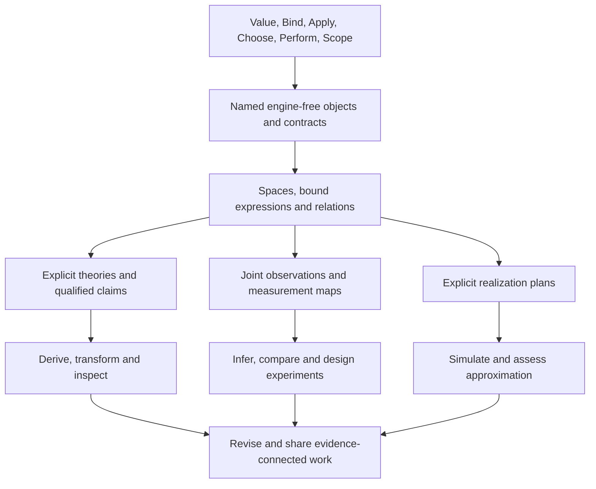

# Scientific Models And Discovery

> Status: designing proposal, 2026-10-10. Physics supplies the first pressure
> cases for a general engine-free modeling layer. No new source syntax, numeric
> profile, scientific library, solver or proof engine is admitted by this document.

Nomi should help a person express a model, derive consequences, compare them
with observations, find a disagreement, and revise the model. A simulation is
one realization of that activity. Scientific discovery also needs symbolic
reasoning, competing explanations, experiment design and an inspectable account
of what a conclusion depends on.

The recommendation is **five reusable modeling contracts**, built over the
existing [primitive families](primitive_composition.md): semantic spaces,
bound expressions and relations, explicit theories, joint observation models,
and qualified realizations. Evidence accompanies all five. These are candidate
library/artifact contracts, not five new language keywords or machine opcodes.
The most urgent addition is a mathematical model that exists independently of
an execution plan.

This is a continuation of [language synthesis](synthesis.md), under the existing
language-coherence packet. The [engine-free framework](object_framework.md)
supplies the shared direction; [numeric research](../research/features/numerics.md)
and [question 9](../research/open_questions.md#9-numeric-and-scientific-model)
retain their existing evidence. The [maintainer guide](../research/synthesis_guide.md)
owns integration practice. The [vision](vision.md) remains broader than physics.

## The Small Modeling Basis

| Contract | Meaning it must retain | Physics use | Other domains |
| --- | --- | --- | --- |
| Semantic space | Scalar theory, quantity kind, dimensions, axes, frame, and admitted structure; representation is a separate choice | Length, affine position, tangent vector, tensor, operator | Currency, geographic coordinates, typed signals, indexed populations |
| Bound expression and relation | Stable symbol identity, binder scope, typed application, equations/inequalities and declared unknowns | Fields, differential equations, constraints, boundary conditions | Chemical networks, optimization, circuits, consistency constraints |
| Explicit theory | Named assumptions, admissible laws, premises and bounded transformation/checking rules | Classical versus quantum algebra, smoothness, symmetries, conserved quantities | Policy reasoning, relational laws, formal specifications |
| Joint observation model | What was observed, through which measurement map, with shared sources and declared uncertainty | Calibration, sensor noise, latent state, parameter inference | Surveys, experiments, reliability, causal hypotheses |
| Qualified realization | Which mathematical object an implementation approximates or realizes, using which method and admissible error claims | Simulation, discretization, quadrature, inverse solving | Forecasting, optimization, planning, data computation |

### 1. Semantic Spaces Before Array Shapes

An array of three numbers does not establish a spatial vector. A space contract
must separate physical meaning from storage: scalar domain, quantity kind,
dimension, unit, axis identity, frame/chart and algebraic structure. A domain
need only declare the parts it supports; unresolved structure stays explicit.
Converting a representation cannot invent compatibility between spaces.

Dimensions are necessary but insufficient. BIPM's vocabulary explicitly
distinguishes energy and torque despite equal dimensions. This motivates
quantity-kind identity in addition to unit exponents.
[Primary evidence: BIPM quantity kinds](https://jcgm.bipm.org/vim/en/1.2.html).

Start with exact unit scales and named quantities. Then distinguish affine
points from displacements: point subtraction can yield a displacement, while
adding two positions requires a separate interpretation. Absolute temperatures
and temperature differences need different conversion laws. A dimensionless
angle is not automatically interchangeable with a probability or a count.
Nondimensionalization retains reference scales and an inverse interpretation;
setting physical constants to one in a natural-unit convention cannot silently
erase quantity kinds or authorize a conversion outside that convention.

Later libraries can describe vector/dual spaces, tensor variance, inner
products, complex/Hilbert spaces and manifolds. A metric is supplied structure,
not permission to silently identify vectors with covectors. Frame conversion
must retain direction and domain validity. SymPy's differential-geometry
interface separates manifolds, coordinate systems, vector fields and forms;
this supports investigating these distinctions without adopting its API.
[Primary evidence: SymPy differential geometry](https://docs.sympy.org/latest/modules/diffgeom.html).

**First refusal:** adding a length to a time reports both object names, their
spaces, and the failed compatibility obligation before any engine is selected.
Equal shape, display unit or nominal port spelling cannot discharge it.

### 2. Bound Expressions And Relations Before Solvers

Add an inert typed expression contract: symbols, exact constants, application,
and explicitly scoped binders. A mathematical symbol is distinct from an input
slot and from another symbol with the same printed name. Substitution must be
capture-avoiding; alpha-renaming preserves binding meaning. A function object
retains its domain/codomain and free dependencies without evaluating samples.

An equation is a relation, not an assignment or an instruction to evaluate its
right side. A model declares unknowns, parameters, independent variables,
relations and initial/boundary conditions. Unknowns can be functions or fields;
boundary conditions refer to the relevant domain boundary, not arbitrary rows.
Constraints may be cyclic even though expression construction is acyclic.

ModelingToolkit combines symbolic descriptions with equation-based modeling
and transformations before constructing numerical problems. This is evidence
for separating model and solve plan, not for promising that Nomi can solve any
well-formed equation system.
[Primary evidence: ModelingToolkit](https://docs.sciml.ai/ModelingToolkit/stable/).

Keep the current object graph's DAG invariant. Represent relations between
unknown symbols in a separate domain-owned model artifact; do not manufacture
a self-referential execution graph or weaken its checker. Equation counts and
structural checks can detect some problems but do not establish existence,
uniqueness, consistent initialization or well-posedness.

Differentiation, integration, contraction, operator composition and weak forms
are typed library operations over these expressions. Their binders and domains
must survive inspection. Do not add one global syntax form per operation.
Ordinary Nomi remains eager; constructing an expression creates a value rather
than changing evaluation of ordinary functions.

### 3. Explicit Theories And Evidence For Transformations

A theory context identifies the scalar/algebra profile, declarations,
assumptions, axioms and rule revisions. A claim references that context and
the named premises it uses. Assumptions are inspectable values supplied to a
transformation/checker, never an ambient global setting or an executable
`where` predicate automatically promoted to a theorem.

Wolfram's `Assuming` supplies scoped assumptions to operations including
simplification and integration. Nomi should preserve the conditional result
while comparing explicit context passing with scoped convenience.
[Primary evidence: Wolfram Assuming](https://reference.wolfram.com/language/ref/Assuming.html.en).

Do not overload one equality:

| Claim | Required evidence | What it cannot establish |
| --- | --- | --- |
| Declared definition identity | Checked expansion/alias identity | General algebra, correct backend execution |
| Mathematical equivalence or implication | Named theory, premises and replayable derivation | That the premises describe nature |
| Approximation relation | Method, norm/domain, bound or qualified estimator | Exact equality or an unprovided global bound |
| Empirical agreement | Observation model, comparison protocol and retained observations | Universal validity or a unique explanation |

Evidence records the statement, context, premise references, method/checker,
artifact revisions and outcome. Distinguish established, conditional, refuted,
unknown and unsupported outcomes; an exhausted budget is not a counterexample.
An untrusted CAS, search procedure or AI may propose a transformation, while
a small checker validates the admitted proof fragment. Lean separates elaborate
proof construction from kernel checking; imported axioms remain part of the
trust basis.
[Primary evidence: Lean elaboration and kernel](https://lean-lang.org/doc/reference/latest/Elaboration-and-Compilation/),
[axiom dependencies](https://lean-lang.org/doc/reference/latest/Axioms/).

Start with a bounded exact polynomial fragment and explicit premises. Preserve
unknown for unsupported claims. Later theory adapters can handle rational
functions, noncommutative algebras, distributions or geometry. A scalar
commutative simplifier must never reorder quantum operators. Branch cuts,
singular points and differentiability are obligations, not optimizer details.
An inconsistent assumption set must not produce an unexplained scientific
success; report known inconsistency and retain unknown consistency otherwise.

### 4. Joint Observations Rather Than Detached Error Bars

Separate the ideal modeled quantity, the measurement map, the recorded
observation and the uncertainty model. Preserve named shared sources:
instrument calibration, clock offset, environmental influence and sampling
history can connect otherwise separate observations. Unknown dependence must
remain unknown. Zero covariance does not generally assert independence.

BIPM's combined-uncertainty definition requires covariances when inputs are
correlated. This motivates a joint model instead of silently treating each
`value ± error` as independent.
[Primary evidence: BIPM combined uncertainty](https://jcgm.bipm.org/vim/en/2.31.html).

Intervals, probability distributions, stochastic processes and statistical
confidence claims have different meanings. Their adapters must state support,
dependence and propagation rules. An interval enclosure is not a posterior;
an estimate of experimental uncertainty is not a numerical error bound.
Density, sampling and conditioning are distinct operations, with explicit
randomness and measure/domain conventions where needed.

An observation model also gives an inverse problem something to infer:
parameters, latent variables and a measurement mapping. Fitting must retain
identifiability assumptions, priors where applicable, selection history and
held-out evaluation. Good fit alone must not become evidence of causation.
Experiment plans declare interventions and expected discriminating observations;
actual instruments use Nomi's existing effect, capability and resource owners.

Equation discovery composes a candidate grammar, space/symmetry constraints,
search history and an evaluation protocol. An AI or symbolic-regression engine
proposes hypotheses; dimensional consistency and training fit are separate
checks from held-out predictive agreement and scientific explanation. Retain
alternative candidates and unresolved assumptions rather than converting a
selected expression into an established law.

### 5. Realizations With Qualified Numerical Meaning

Keep `Model`, `SolvePlan`, `Run` and `ResultEvidence` distinct. A plan selects
an engine, method, representation, domain discretization, initial/boundary
conditions, stopping policy and budget. Compilation checks admitted capabilities
without executing a solver. An execution returns a method-qualified result or
a structured refusal/failure, not an unqualified `solved` flag.

Numerical evidence distinguishes model approximation, discretization,
iteration, roundoff and observation uncertainty. Record which were assessed,
how they were combined if applicable, and which remain unresolved. Residuals
need their space, scaling and norm; a small residual alone is not a bound on
solution error for an ill-conditioned problem. Local solver tolerances must not
be labeled global guarantees. SciML explicitly documents its usual adaptive
tolerances in terms of local error estimates.
[Primary evidence: solver options](https://docs.sciml.ai/DiffEqDocs/stable/basics/common_solver_opts/).

Differentiating a realized computation needs a stated target: the discrete
algorithm, an implicit root, or the underlying continuous model. These can
differ. A derivative contract names tangent/cotangent spaces, supported rules,
regularity and conventions. JAX's JVP/VJP presentation exposes derivatives as
linear maps rather than requiring materialized Jacobians.
[Primary evidence: JAX differentiation](https://docs.jax.dev/en/latest/jacobian-vector-products.html).

## Composition: One Mass–Spring Model

This mathematical fixture is a proposed oracle, not executable Nomi syntax or
a claim that the current framework proves differential identities.
The [scientific pressure program](targets/research/scientific_model.nomi)
adds an explicit-call derivation shape alongside the existing learned-model
boundary. Its `lab.science` signatures remain fictional and untypechecked.

Take an ideal one-dimensional, unforced, undamped oscillator. Declare constant
real parameters `m > 0` and `k > 0`, a time interval, and a twice continuously
differentiable displacement `x(t)`. The unit contracts are:

```text
t : Time
x : Time -> Length
m : Mass
k : Mass / Time^2
v = D_t(x)
a = D_t(v)
dynamics: m*a + k*x = 0 [Force]
energy: E = (m*v^2 + k*x^2)/2 [Energy]
```

Space composition checks both dynamics terms have force dimension and both
energy terms have energy dimension without binding `m`, `k`, or any samples of
`x`. The declared differential/product laws yield:

```text
D_t(E) = m*v*a + k*x*v = v*(m*a + k*x) = 0
```

The last step uses the named dynamics relation. The conclusion is conditional
on the stated model and regularity; it says nothing yet about a physical spring
or a numerical trajectory. All intermediate objects, premises and derivation
steps must remain independently referable.

The same model can compose into several activities:

| Activity | Added objects | Admission question |
| --- | --- | --- |
| Derive a conservation claim | Theory, energy, derivation evidence | Which premises justify each step? |
| Simulate motion | Initial state, time domain, method and realization profile | What approximation/error statement is supported? |
| Infer stiffness | Position measurement map, calibration/noise, observation history | With this data, is `k` identifiable? |
| Design an experiment | Competing models, intervention, comparison protocol | Which observation can distinguish them? |
| Publish a result | Named revisions, plots/document views and evidence references | Can a reader trace every claim to its basis? |

For inference, free-motion observations can identify at most the ratio `k/m`;
even that needs informative motion and an adequate measurement/time basis. A
zero-displacement stationary trajectory does not identify it. Recovering `k`
requires additional information about `m` or a changed experiment. This follows
directly from dividing the model by nonzero `m`: scaling both parameters by the same
positive factor leaves its free-motion equation unchanged.

Adding viscous damping `c >= 0` changes dynamics to `m*a + c*v + k*x = 0`, so
the corresponding energy claim becomes `D_t(E) = -c*v^2 <= 0`. Revising the
dynamics invalidates the earlier conservation receipt; it must not leave the
old claim displayed as established for the new model.

## Compose Further Domains Without Enlarging The Grammar



Tensor algebra composes spaces, typed application, binders and contraction
laws. Calculus composes function/field spaces, differential/integral operators
and regularity premises. Dynamics adds relations and initial/boundary data.
Symmetry adds a typed action, invariance claims and hypotheses for any derived
conservation law. Optimization adds an objective, feasible relations and an
optimality/termination claim. Inverse problems add observation maps and
identifiability obligations. None follows merely from a shared array codec.

Chemistry can supply reaction/stoichiometric laws; biology can supply population
and feedback models; robotics can supply frames and sensors. Each owns its
admissible laws. Field theories need boundary/weak-form/gauge contracts, quantum
models need operator ordering and state/measurement semantics, and stochastic
dynamics need integration conventions. These remain later domain gates, not
claims that the first polynomial fragment covers all physics.

## Current Gap And Ordered Implementation

The existing research framework checks nominal typed DAG composition, declared
definition identity, snapshot conditions, finite universal predicates, revisions
and dependencies with independent pinned replay. It has explicit trusted
backends. The statistical adapter proves one qualified exact-rational mean law.
Neither establishes mathematical spaces, capture-avoiding symbolic binders,
differential reasoning, scientific observation models or solver conformance.
The current bounded JSON envelope excludes host Float values; a scientific
representation needs a versioned codec rather than bypassing that boundary.

| Pass | Deliverable | Independent positive/negative oracle |
| --- | --- | --- |
| SP1: spaces and expressions | Domain-owned versioned artifact, exact scale representation, symbol/binder identity, typed application, model relations and no-input inspection | Length/time refusal; distinct same-named symbols; capture-avoiding substitution; valid cyclic constraints without a cyclic executable DAG |
| SP2: theory and claims | Bounded exact polynomial rules, explicit premise contexts, derivation receipts and separately implemented replay | Oscillator energy law; damping invalidates conservation; `x/x` remains unsupported or conditional; changing theory/premises invalidates receipts |
| SP3: realization | One narrow explicit solver profile, then a second adapter under the same admitted mathematical contract | Analytic reference cases, method-qualified tolerance checks, singular/ill-conditioned refusal, stale mesh/profile receipts; local estimates never reported as global bounds |
| SP4: observations and inverse work | Measurement map, shared calibration, joint uncertainty profile, qualified inference and retained experiment history | Shared-source cancellation versus distinct sources; `k/m` non-identifiability; numerical error separated from measurement uncertainty |
| SP5: broader libraries and interaction | Compare a constrained pendulum, diffusion boundary problem and ordered quantum operators; then structured/text views and independent authoring trials | Consistent initial conditions, incompatible boundary data, noncommutative negative cases, accessible explanation of changed assumptions |

SP1 should compare a small dedicated mathematical artifact with an extension
of the generic framework, using identical model facts. Extract shared context,
reference, revision and evidence machinery only where their meanings agree.
Nominal family names cannot substitute for space compatibility, and application
nodes cannot silently supply mathematical binders. Keep domain validation and
the execution/replay boundary independently testable.

Before ordinary Nomi source admission, close library/interface typing,
diagnostics, formatting, serialized artifacts and CLI/browser contracts. Start
with ordinary constructor calls; compare scoped mathematical notation only
after beginner, production and failure-heavy workflows expose a cost. This
proposal changes no eager evaluation or existing `where`, `with`, `->` or `=>`
meaning. Its success criterion is an explained, revisable scientific workflow,
including unknown results, rather than a larger list of numerical builtins.
