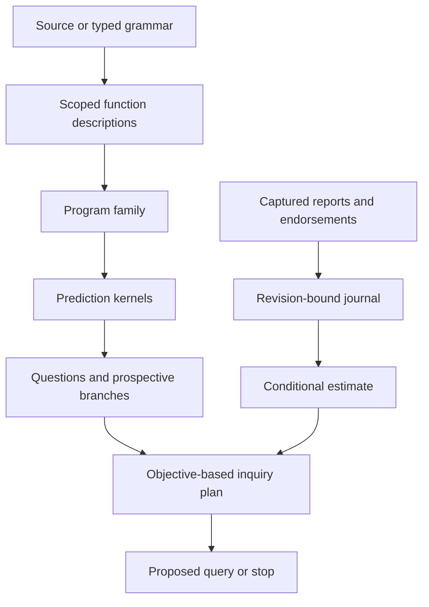

# Explore Learning And Reasoning

> Status: runnable experimental tools from a source checkout, 2026-10-11.
> These tools are separate from the ordinary Nomi runtime and browser playground.

Start with a small discovery task: two rules explain the examples you have.
Which question would distinguish them, and what changes after an observation?
The tools below make each step inspectable. They implement a bounded learning
and inquiry loop; they do not establish general intelligence or scientific truth.

## Try The Whole Loop

From the repository root, after the [local setup](getting_started.md):

```bash
python3 -m tools.intelligence_loop
python3 -m tools.intelligence_loop --observe 4 --at 2
python3 -m tools.intelligence_loop --observe 3 --at 2
```

The first command constructs `x` and `x*x` from a typed grammar. Both fit the
teaching examples `0 → 0` and `1 → 1`. Asking again at `1` adds no useful
information. Asking at `2` or `3` distinguishes the rules under this model.
The planner retains both equally useful queries, with their supplied cost.

The second command supplies a teaching observation, `2 → 4`. The square remains
supported; the line does not. The learner rechecks the enlarged example set,
and the planner stops because another paid query offers no decision benefit.
The JSON also includes a checked proposal to restrict the family to its supported
rule. It keeps the original journal active so an observation can be withdrawn.

The third supplies `2 → 3`, which neither rule predicts. The observation is
retained, but there is no supported posterior. The next step is to repair the
model or evidence. The tool does not select whichever rule is merely closer.

No command measures the world. `--observe` supplies a value for this example.
The displayed probabilities depend on an explicit uniform prior over retained
program artifacts, exact deterministic prediction and a supplied classification
loss. They are not calibrated confidence in a real scientific mechanism.

## Inspect The Intermediate Objects

Add `--json` to expose all named artifacts, assumptions and checked branches:

```bash
python3 -m tools.intelligence_loop --observe 4 --json
```

The composition follows this hierarchy:



| Object | What it means |
| --- | --- |
| Function description | A checked pure term with scoped parameters and source correspondence when source-produced. |
| Transformation provider | The selected carrier, ports and equality; its declaration is not a proof. |
| Program family | Named immutable alternatives with one callable contract. |
| Prediction kernel | An explicitly realized finite observation law for a captured input. |
| Question | A prospective experiment description and cost; creating it executes nothing. |
| Trial and report | A named occurrence and a statement about its outcome. A quoted report is inert. |
| Journal | The original prior, captured trials/reports, endorsements and dependence assumption. |
| Estimate and plan | Model-relative consequences and tied useful questions, bound to this exact context. |

Copies of one trial's report count once. Conflicting reports about that same
trial need repair. Distinct trials require an explicit conditional-independence
assumption given the modeled state; different source names do not prove it.
Withdrawal recomputes from the original prior. Old assessments cannot validate
a changed model, objective, observation law or endorsement context.

## Capture Your Own Nomi Function

Save this as `force.nomi`:

```nomi
func force(position, velocity):
    return -2 * position - velocity
```

Then capture its description:

```bash
python3 -m tools.nomi_terms force.nomi --identity my-force
```

The producer uses the existing Nomi parser. It captures the function without
calling it, and exposes its type, qualified binders and UTF-8 source intervals.
The selected laboratory interpretation uses exact Rational parameters. It does
not change ordinary Nomi numeric behavior or add implicit quotation.

The current profile accepts named single-return functions and parenthesized
anonymous functions, exact integer literals, addition, subtraction,
multiplication, negation and pure positional applications. Effects, recursion,
defaults, annotations, field access and unsupported notation are refused.
Full typed Surface production and source reconstruction remain future work.

## Build A Different Learning Task

The current integration API is Python-hosted. For example, construct a small
force-learning task from exact observations:

```python
from fractions import Fraction as F
from tools import program_search as search
from tools.program_search_replay import verify
from tools.scoped_terms import Identity

def key(name):
    return Identity("force-study", "1", name)

grammar = search.Grammar(key("grammar"), arity=2,
                        constants=(F(-2),), operators=("sub", "mul"), max_nodes=5)
examples = (
    search.Example(key("first"), (F(1), F(0)), F(-2)),
    search.Example(key("second"), (F(0), F(1)), F(-1)),
    search.Example(key("third"), (F(2), F(-1)), F(-3)),
)
task = search.Task(grammar, examples, budget=5000, retain=8)
result = search.search(task)
verify(task, result)
print(search.describe(result))
```

The retained proposals fit the supplied examples, including a composition with
the meaning `-2*position - velocity`. The grammar and units/physical meaning are
supplied assumptions. This is not automatic identification of a governing law.
`result.coverage` says whether the declared search was exhausted; `retention`
separately says whether all matching proposals were retained. Increasing a
grammar or adding examples creates a new checking context.

## Look Beyond The Next Question

Some questions are useful only together. Two unknown bits determine whether
parity is even or odd; learning either bit alone leaves that answer equally
uncertain. Compare one-step and two-step planning:

```bash
python3 -m tools.inquiry_policy --horizon 1
python3 -m tools.inquiry_policy --horizon 2
python3 -m tools.inquiry_policy --horizon 2 --budget 1
```

One step chooses to stop. Two steps propose either bit first, then the other.
The exact modeled loss plus query costs falls from `1/2` to `1/8`. The third
command deliberately limits search: it displays incomplete bounds and a feasible
choice, without claiming to have found the optimum. Add `--json` for every
prospective branch. These are plans about a fixed hidden state; they execute no
measurement and assume the declared observation dependence model.

## Compare Meaning Without Supplying Inputs

Run the source-to-polynomial interpretation:

```bash
python3 -m tools.scoped_polynomials
```

The force function becomes an exact formal polynomial and a tangent description
for how it changes with position and velocity. No measurements are supplied.
Within this profile, `x+0` equals `x` even though their syntax differs; `x*x`
and `x` are different polynomials despite agreeing at zero and one.

For an independent established symbolic check, install the optional adapter
and ask for replay explicitly:

```bash
python3 -m pip install -e '.[reasoning-check]'
python3 -m tools.scoped_polynomials --sympy
```

This pins SymPy 1.14.0 and independently checks both the source interpretation
and formal derivative. It establishes a bounded exact algebra claim, not a
numeric AD engine, an approximation guarantee or a physical law. Inspection
records indicate whether this independent replay ran.

## What The Checks Establish

Independent tuple enumeration and arithmetic replay check bounded program
search. Separate likelihood-product replay checks observation updates. The
existing joint-loss checker verifies query values and hypothetical branches.
Inspection is passive; these checks run only through explicit checker calls.

Example fit is different from a universal identity. An alpha-normal-form match
has a different scope from probability under a supplied model. Neither proves
empirical adequacy. A family restriction can preserve probability only when
dropped alternatives already have zero mass; dropping positive mass does not
earn a more confident model. Richer types and structures, causal learning, checked model
and premise transport, continuous inference, general stateful planning, library learning and ordinary Nomi
integration remain open in the [shared foundation design](../design/reasoning_algebra.md)
and [intelligent-program contract](../design/ai_frameworks.md).
