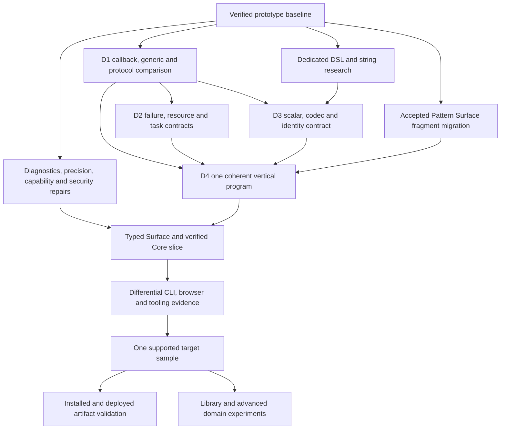

# Project Enhancement Roadmap

> Status: active project delivery plan; language proposals remain subject to their canonical owners.
>
> Baseline: checkout `6bc706f`, audited 2026-09-30 through 2026-10-01.
> This is an AI-assisted repository audit and plan, not an implementation release.

## Purpose And Ownership

This document owns project-wide priorities, dependencies, delivery slices and
completion evidence. It brings language, runtime, product, verification and
maintenance work into one sequence. It supersedes the project-wide scheduling
in older dated reviews and the independent next-step list in
[Implementation Layers](implementation_layers.md). Those reviews remain evidence;
that layer map still owns engine admission and engineering boundaries.

It does not accept syntax, settle open semantics, or create another feature
registry. [The redesign agenda](../design/redesign_agenda.md) owns D0-D7 design
closure; [synthesis](../design/synthesis.md) owns the import-workflow admission
route. Existing focused packets own their detailed research and contracts.
Work IDs below route delivery to those owners rather than copying their rules.

The product goal is one coherent, explainable language that grows from a small
script into a checked program. The next useful milestone is a modest target
slice with accurate diagnostics and matching CLI/browser behavior.

## Audit Evidence

The scan covered the tracked tree, canonical design spine, focused packets,
research agenda, feature/frontend/backend/host registries, runtime and transport
contracts, browser worker/lowerer/UI, notebook and editor adapters, distribution,
Docker, CI, documentation and agent tooling. There are 687 tracked files at the
baseline, including 222 test files/artifacts and 95 research files.

| Executed check | Result and scope |
| --- | --- |
| `git status --short` | Clean before this planning pass. |
| Syntax inspection: capabilities, target-alignment, parser-frontends, eval-backends, host-capabilities, resolved-pipelines | Registries render successfully. Three target dispositions remain unreviewed; feature-level web/notebook evidence is largely unrecorded. |
| `python3 -m tools.design_passes check` | All five registered packets coherent; four designing, pattern matching implementing. This is document/registry coherence, not target conformance. |
| `python3 .codex/scripts/agent_doctor.py` | Tracked agent assets, routing, shims, hooks and RAG presence pass. |
| `python3 scripts/check_web_runtime.py` | 55 tests pass; manifest has 121 runtime files and nine samples; eight WASM outputs fresh. |
| `python3 -m pytest -q -n 4 -rs` | 1,454 passed, 76 intentional matrix skips, four repeated Jupyter path deprecation warnings; 24.02 seconds in the successful run. |
| Focused playground-launcher rerun | Pass. The initial broad run's only failure was the sandbox denying a localhost socket bind; approved localhost access resolved it without code changes. |
| Read-only runtime probes below | Demonstrate numeric divergence, missing parse diagnostics and two intentional prototype/target differences. |

Local tools were Python 3.14.0rc3, Node 25.9.0 and Cargo 1.95.0. This audit did
not observe hosted CI, run Python 3.12 locally, rebuild a container, run a new
desktop editor host or fresh Chromium UI check, inspect Pages settings, or
publish anything. Earlier browser/editor evidence remains in the dated reviews.

### Confirmed Behavior Requiring Attention

These probes used the public `execute` API with `raise_on_error=False`:

| Source / observation | Python AST | Python Core runtime | JavaScript Core runtime | Interpretation |
| --- | --- | --- | --- | --- |
| `print(9007199254740993)` | `9007199254740993` | `9007199254740993` | `9007199254740992` | Confirmed silent cross-backend precision loss; no diagnostic. |
| `x =` followed by newline | Failed, zero diagnostics | Failed, zero diagnostics | Failed before Node execution, zero diagnostics | The facade records the exception but lacks a structured parse diagnostic. This does not test the browser parser's error path. |
| `x = 1; x = 2; print(x)` written on separate lines | `2` | `2` | `2` | Supported prototype reassignment conflicts with target immutable binding; deliberate migration needed. |
| `if 1:` then print | Accepted | Accepted | Accepted | Supported prototype truthiness conflicts with target Bool conditions; deliberate migration needed. |

Code inspection adds concrete gaps: `core_json.py` omits spans; browser worker
diagnostics use null spans; `decode.py` defines passive error records rather
than the target decoder; `pipeline.py` accepts only the default runtime profile;
Rust Raw expressions are reparsed by Python and JavaScript adapters. Existing
host metadata validates builtin names, but does not establish target static
effects or runtime authority attenuation. Container launchers print token-bearing
commands/URLs; the image has a fixed development token, and `.dockerignore`
does not explicitly exclude `.nomi/` or agent/private configuration trees.

## Priority And Sizing

- **P0:** current behavior loses information or verification can misstate support.
- **P1:** foundation for the next coherent target slice or dependable user path.
- **P2:** expands usefulness or confidence after the owning contract closes.
- **P3:** later industrial/domain work whose prerequisites are not ready.

Size is the next reviewable deliverable, not an estimate for finishing a whole
subsystem: **S** is a bounded patch, **M** several coordinated patches, **L** a
design/conformance milestone. Do not turn these into calendar promises before
the first slice is measured. Owners below are repository responsibilities, not
new staffing assignments. All work is proposed unless the evidence says complete.

## Whole-Project Work Map

| ID | Aspect | Priority / next size | Main dependency / owner |
| --- | --- | --- | --- |
| A01 | Product scope and milestone contracts | P1 / S | Target design and D4 |
| A02 | Feature, profile and capability honesty | P0 / S | Existing feature/frontend/backend registries; D0 |
| A03 | Scalars, strings, text and portable numbers | P0 / M | Syntax/semantics; D3 and open question 9 |
| A04 | Grammar, CST and parser frontends | P1 / M | A02/A03; parser registry and pattern packet |
| A05 | Name resolution and typed Surface | P1 / L | A03/A08; progressive typing contracts |
| A06 | Core IR, lowering and reduction | P1 / M | A04/A05; Core verifier and feature ownership |
| A07 | Binding, mutation and constraints | P1 / M | A05/A19; accepted binding semantics |
| A08 | Functions, generics, protocols and callbacks | P1 / L | D1; function-contracts packet |
| A09 | Nominal data and generated behavior | P1 / M | A05/A07/A08; data semantics |
| A10 | Patterns and exhaustiveness | P1 / M | Fragment work can start now; full checking needs A05/A09 |
| A11 | Option, Result, panic and cancellation | P1 / M | A05/A06; failure semantics and D2 |
| A12 | Decode, encode and schema projections | P1 / M | A03/A08/A09/A11; boundary contracts |
| A13 | Effects, grants and host capabilities | P1 / M | A08; effects/industrial contracts |
| A14 | Resources, defer and lifetime escape | P1 / L | A08/A11/A13; resource-lifetime packet |
| A15 | Async tasks, cancellation and backpressure | P1 / L | A11/A13/A14; D2 scheduler contract |
| A16 | Collections, streams, tables and arrays | P2 / M | A03/A08/A12/A15; library-first experiments |
| A17 | Prelude and standard library | P2 / M | A09/A11/A12/A13; industrial stdlib contract |
| A18 | Runtime sessions, caches and process transport | P1 / M | Existing facade; A02/A19 |
| A19 | Results, diagnostics, events and explanation | P0 / S | Existing facade/collector; source mapping in A04/A06 |
| A20 | CLI, REPL, check and formatter | P1 / M | A05/A19; bounded syntax support |
| A21 | Browser playground and interaction | P1 / M | A02/A19; A04/A06 for richer execution |
| A22 | Jupyter and notebook experience | P2 / S | A18/A19; current messaging/session contracts |
| A23 | VS Code and language-server path | P1 / M | Harness work now; semantic tooling needs A05/A19 |
| A24 | Tests, differential conformance and fuzzing | P0 / S | Existing test review; capability evidence |
| A25 | Performance and resource budgets | P2 / M | A24; current measured baseline |
| A26 | Modules, packages and reproducible builds | P2 / L | A05/A08/A13; industrial package contract |
| A27 | FFI, execution profiles and future backends | P3 / M | A03/A06/A13/A24; measured engine gate |
| A28 | Distribution, CI, release and Pages | P1 / M | A21/A24; supported revision and owner release choices |
| A29 | Docker and portable notebook delivery | P2 / S | A28/A30; current launcher/container contract |
| A30 | Security, redaction and execution isolation | P0 / S | Concrete token/context fixes now; A13/A18 later |
| A31 | Documentation, research and learning | P1 / S | Existing authority map and bounded experiments |
| A32 | Agent workflows, retrieval and maintenance | P2 / S | Existing doctor/hooks/skills; A31 |
| A33 | Dedicated DSL and string research | P1 / L | User-requested next research pass; A03/A08/A12/A13 |

## Detailed Enhancements

### A01 — Product Scope And Milestones

The target promise is clear, but the runnable prototype and aspirational suite
still describe substantially different languages.

- Define the first supported target profile using a beginner calculation,
  boundary-heavy import and cleanup-heavy job. Give each an explicit supported
  subset and list of unresolved APIs.
- Use user outcomes: time to first result, ability to locate/repair an error,
  ability to explain mutation/failure/authority, and CLI/browser agreement.
- Review target fixtures for unresolved call contracts before promoting them.
  Preserve advanced domain ambitions through explicit later gates.

**Files/owner:** target README, target suite, synthesis, redesign agenda.
**Done when:** one milestone names runnable programs, capabilities, limitations
and failure transcripts. Completing research breadth is not its exit criterion.

### A02 — Feature And Capability Honesty

The existing metadata is a useful foundation. Three dispositions are unreviewed;
the feature coverage table's web/notebook flags do not describe the actual
sample-level execution evidence.

- Review precedence, assert and pass dispositions against their canonical owners.
- Distinguish experimental explicit execution, default promotion and verified
  support; resolve host/frontend/backend/profile combinations before execution.
- Add fixture references and evidence state per capability axis to the existing
  registry. Distinguish unsupported from supported-but-unverified.
- Introduce one bounded target profile after its contract closes; reject retired
  forms in that profile while documenting the supported prototype migration.

**Files/owner:** `features.py`, frontend/backend specs, `pipeline.py`, inspection.
**Done when:** inspection and UI derive support from the same evidence, and
unsupported combinations fail before any program effects. No second feature list.

### A03 — Scalars, Strings And Portable Numbers

Large integer precision loss is reproduced. Target literal spelling is described,
but portable expression/pattern/transport behavior is not yet one complete codec.

- First fence silent loss: compare exact tagged integer interchange with explicit
  host-range rejection. Decide the bounded prototype repair separately from the
  still-open target numeric tower; never silently round.
- Specify Int widths/arbitrary precision, narrowing, division, remainder,
  Decimal context, rounding, NaN/infinity, negative zero and map-key equality.
- Give strings a dedicated contract: literal escapes/raw/multiline forms,
  interpolation evaluation/order/formatting, brace escaping, bytes versus Text,
  Unicode identity, indexing/slicing, graphemes and display versus wire encoding.
- Share scalar vectors across expressions, patterns, decode, JSON and hosts.
  Add size/depth limits and source spans without defining text by host behavior.

**Files/owner:** syntax/semantics, scalar contract, Core JSON, Rust literals,
Python/JS value adapters; related research in A33.
**Done when:** boundary vectors agree or explicitly reject on every declared
host, including the reproduced integer. A string never accidentally grants code
execution because a consumer gives its contents a second interpretation.

### A04 — Grammar, CST And Parser Frontends

Lark is the bootstrap reference; Rust has useful current-grammar parity, and
Tree-sitter remains a tooling spike. Raw text bridges duplicate parsing work.

- Write accepted/rejected fixtures from the target contract independently of
  the current grammar. Start with the accepted pattern fragment and scalar codec.
- Specify lossless source/trivia, UTF-8 spans and editor-position conversion;
  add structured recovery for incomplete edits that cannot be executed.
- Replace one Raw family at a time, beginning with calls/arguments and slices;
  version payloads and compare both adapters before changing the fallback.
- Keep parser candidates fenced. Promote a parser only for a named profile
  after acceptance, artifact, error and runtime evidence agree.

**Files/owner:** frontend specs, Rust payload/parser, Lark grammar/lowering,
JS lowerer, parser parity fixtures.
**Done when:** the selected family has structured payload parity, exact source
mapping and explicit unsupported diagnostics; formatter text is not an adapter API.

### A05 — Names, Types And Typed Surface

There is no whole-target checker. Existing Python AST and Surface islands cannot
prove the target's public signatures, dispatch, purity or lifetime requirements.

- Specify symbol/module identity, lexical resolution, shadowing and visibility.
- Define typed Surface for one closed vertical slice: literals, bindings,
  named/anonymous functions, calls, Bool choice and diagnostics.
- Implement local inference and public-interface checking without implicit Any;
  require annotations for recursive/ambiguous cases under declared rules.
- Keep type, constraint, effect, region and coverage evidence distinct; serialize
  interfaces so dependent analysis does not execute modules.

**Files/owner:** Surface/schema boundary, semantics, D1/D4, module interfaces.
**Done when:** positive and negative fixtures yield independently validated
resolved artifacts; manually supplied facts are clearly different from inferred facts.

### A06 — Core, Lowering And Reduction

Core IR and a verifier exist, but much of Core is projected from Python AST;
the browser has a separate lowering path. Core JSON explicitly drops spans.

- Carry versioned source identity/spans through serialization or a source-map
  sidecar; validate child/container relationships and unknown versions.
- Add structural cross-pipeline fixtures as well as stdout comparisons.
- Lower target-owned operations directly from Surface one owner at a time;
  keep Python AST as an adapter until that slice is independently executable.
- Preserve nearest-function return, once-only evaluation and cleanup across
  convenience expansion. Remove evaluator hooks for reduced sugar as it migrates.

**Files/owner:** `core.py`, `core_json.py`, Surface lowering, desugar registry,
Python/JS lowerers and Core verification.
**Done when:** the same typed slice reaches equivalent verified Core and source
diagnostics through two frontends; the existing demo remains honestly supported.

### A07 — Binding, Mutation And Constraints

Prototype reassignment is intentional current behavior; immutable binding and
Bool-only conditions require explicit target migration rather than a quiet fix.

- Model binding cells, immutable names and fresh lexical/arm scopes explicitly.
- Share evaluate/tentative-bind/type-check/constraint-check/atomic-commit across
  locals, parameters, fields and irrefutable destructuring.
- Implement `var`/`set` in the gated target slice, retaining type/constraints
  on updates; add rollback and mutable-capture cases.
- Separate contract violations in owned code from external decode errors;
  retain predicate source, notes, dependencies and redacted value evidence.

**Files/owner:** binding Surface, environment/runtime layers, constraints and
accepted binding semantics.
**Done when:** no partial binding leaks on failure, and creation versus update
is visible in source, diagnostics and events across the declared runtimes.

### A08 — Functions, Generics, Protocols And Callbacks

The designing packet identifies the missing foundation for many other programs.

- Select call-shape/default/label rules, then compare its existing three
  generic/function-value candidates at 80/100 columns on real programs.
- Derive map/fold, decoder and resource callback contracts together. Distinguish
  world effects, captured mutation, retained regions and latent task authority.
- Specify protocol ownership/coherence, method/extension visibility, ambiguity
  diagnostics, generic bounds and separate compilation.
- Validate pure versus effect-polymorphic candidates, List[Result] versus
  propagation, empty-input checking and non-escape through completion payloads.

**Files/owner:** function-contracts packet, open questions 2/3/10, D1.
**Done when:** actual checked positive/negative contracts replace paper-only
derivations for three programs. No function-type notation is accepted by this plan.

### A09 — Nominal Data And Derived Behavior

Current DataDecl lowering produces host classes. It does not establish the full
immutable product/variant target or protocol-derived behavior.

- Define nominal identity, ordered fields, closed variants and atomic checked
  construction, including defaults and cross-field constraints.
- Specify equality, hashability, sensitive display, copy/update operations and
  the relationship between value equality and domain entity IDs.
- Derive constructor/pattern/codec/schema metadata from one declaration.
- Keep wire-version and openness policies separate from owned data identity;
  imported extensions cannot silently replace core generated behavior.

**Files/owner:** DataDecl Surface, type descriptors, values, data semantics.
**Done when:** invalid owned values cannot be constructed on a supported checked
path, and Python/JS agree on construction, equality, matching and redacted display.

### A10 — Patterns And Exhaustiveness

Pattern Surface v1 already has Lark/Rust fixture and JSON Schema validation.
That is fragment evidence, not full target match execution.

- Extract shared reserved vocabulary/scalar decoding and strengthen relational
  span/document validation beyond the existing fixture checks.
- Add lossless match/arm/guard containers for statement and value forms.
- Implement transactional captures, pure once-only guards, exact/open collection
  rules and arm scope in Core rather than inheriting a host's match behavior.
- Add usefulness/exhaustiveness with witness diagnostics, then formatter/editor
  support and a capability-gated runnable sample.

**Files/owner:** registered pattern packet, Pattern Surface schema/producers,
checker/Core/runtime, parser/browser fixture ladders.
**Done when:** accepted and rejected match programs agree across declared hosts,
including failed captures and unreachable/missing arms. Fragment improvements
can proceed before all broader type questions close.

### A11 — Failure And Control Transfer

Current implementations mix native exceptions, boxed errors and host values;
the target separates absence, expected errors, panic and cancellation.

- Specify portable Option/Result/Unit values and typed propagation targets.
- Preserve once-only short circuiting, explicit error conversion and causes;
  `??` must never absorb Err, and `?` must never absorb panic/cancellation.
- Define normal/abnormal completion records used by scope and task composition.
- Compare successful/failed returns, nested scopes, cleanup failures and host
  exception conversion independently of one runtime's exception machinery.

**Files/owner:** failure semantics, value/control-flow layers, Core and D2.
**Done when:** result JSON, runtime behavior and diagnostics distinguish every
completion category and preserve transfer destinations and causes.

### A12 — Decode, Encode And Schema Projection

Passive DecodeError/DecodeErrorList records are useful infrastructure; they are
not a strict generated `Value -> data` implementation.

- Specify typed decoder/encoder protocols after A08; reject unknown fields and
  coercion by default, applying explicit adapters/defaults with provenance.
- Accumulate independent indexed path errors. Evaluate declaration predicates
  only when their required fields have valid tentative values.
- Define explicit variant wire representations, field aliases, version migration,
  sensitive values and input size/depth limits.
- Report representable/approximated/omitted constraints in schema exports; do
  not claim a JSON Schema projection expresses every executable predicate.

**Files/owner:** data descriptors, decode/error records, proposed codec protocols,
boundary target and D3.
**Done when:** a malformed batch reports all independent paths, constructs no
partial owned values and performs zero downstream network calls/report writes.

### A13 — Effects And Runtime Authority

Builtin inventory metadata exists. Static uses checking and unforgeable narrowed
authority remain target work; a `pure` flag is not callback purity proof.

- Close the initial effect taxonomy and transitive callback effect rules.
- Supply explicit host providers/grants, handle attenuation and task-local
  delegation; scripts expose their resolved effects before execution.
- Validate host manifests by version/schema and behavior, including arity,
  returned values, callback effects and denied capabilities.
- Provide deterministic test clock/random/network/filesystem substitutes and
  browser preflight rejection for unavailable authority.

**Files/owner:** industrial effects contract, host manifest/providers, checker,
runtime profile selection.
**Done when:** a declaration never grants authority by itself, denied work has
no partial external effect, and replay tests do not patch process globals.

### A14 — Resources, Defer And Escape

The resource experiment compares symbolic outcomes. It does not typecheck
generative regions or validate a real asynchronous scheduler.

- Close callback/error/region contracts, including heterogeneous nested errors
  and escape through Err, causes, closures, tasks and diagnostics.
- Test successful enter followed by binding failure, lexical defer/capture
  timing, nested LIFO cleanup and every control-transfer route.
- Validate actual cancellation during enter/body/exit, in-flight operations,
  revocation, join and cleanup deadlines with controlled events.
- Implement one backend-neutral scope/lease slice only after its proposal is
  accepted; distinguish current host context-manager behavior during migration.

**Files/owner:** resource-lifetime packet and D2, scope/Core/runtime metadata.
**Done when:** exactly-once acquisition/body/release rules and all causes survive
the full completion matrix, and observation occurs after required cleanup.

### A15 — Async, Tasks And Backpressure

Cold tasks and structured child lifetime are accepted direction; authorization
timing, group failure envelopes and queue bounds remain unresolved.

- Define construction versus start/await effects, scoped handle types and retained
  captures. Decide abnormal-failure policy separately from ordinary returned Err.
- Build deterministic event-controlled scheduler fixtures for parent/child
  cancellation, deadlines, multiple failures, observation order and cleanup join.
- Bound active work and queued memory independently; add a backpressure protocol
  before calling a finite batch an unbounded stream solution.
- Separate browser worker termination/reset from language cancellation semantics;
  a restarted worker is not evidence that resource cleanup ran.

**Files/owner:** concurrency comparison, D2, task/runtime protocols.
**Done when:** no child survives scope exit, queue/active peaks stay within limits,
and failure ordering agrees across declared hosts.

### A16 — Collections, Streams, Tables And Arrays

Prototype collections run; table plans, stream laws, array shapes and domain
notation are still library/research contracts.

- Close order/equality/empty cases, callback invocation counts, materialization,
  one-pass versus replayable streams and error/cleanup behavior.
- Keep pipeline insertion fixed; remove placeholder-dependent insertion only
  through a declared migration to target calls.
- Execute DW1 before a query engine, then DW2/DW3 against duplicate/null/key,
  join/window/cardinality and schema identity counterexamples.
- Compare named-axis/rank/unit libraries with explicit loops using DW4/DW5;
  preserve numeric laws, learned-state identity and data movement visibility.

**Files/owner:** collection semantics, open questions 7/8/9, existing data/workflow
experiments. **Done when:** the chosen bounded library model has independent value,
error, order and resource fixtures; notation is added only after the long form fails.

### A17 — Prelude And Standard Library

The current host builtin set is a bootstrap convenience, not the target stdlib.

- Define a small typed prelude and explicit text/bytes/collections/console/JSON
  modules before wider network/process/database integrations.
- Specify partial operations with Option/Result and effect requirements; use
  consistent data-first collection verbs and named policy arguments.
- Add files/HTTP through providers with limits, deadlines, error conversion and
  explicit publication guarantees; do not advertise atomicity from an API name.
- Incubate scientific, workflow, actor and domain libraries outside permanent
  grammar/stdlib commitments.

**Files/owner:** industrial stdlib contract and target API assumptions.
**Done when:** a bounded useful program requires no host escape and every public
call has a documented, checked input/result/failure/effect contract.

### A18 — Runtime, Sessions, Caching And Transport

The public facade and process helper improved boundaries. Backend result types
still vary; transport has no output/memory/process-tree policy.

- Define session reset, partial-failure state and cross-cell binding behavior;
  validate backend values that cannot be serialized between Node invocations.
- Include source/grammar/artifact/profile identity in cache invalidation and
  test bounded eviction and AST immutability assumptions.
- Specify request/response versions, duplicate keys, payload validation, byte
  limits, timeouts and descendant termination before persistent workers.
- Keep transport below parser/runtime registration if shared, avoiding cycles;
  extract policy or large modules only for a demonstrated ownership pressure.

**Files/owner:** API/session/pipeline, backend adapters, `json_process.py`.
**Done when:** session and transport failures are structured, bounded and
distinguishable from language failures; caches cannot reuse incompatible artifacts.

### A19 — Results, Diagnostics And Semantic Events

Binding failures have a real diagnostic producer; generic parse failures can
leave diagnostics empty. Browser records and Python objects share concepts but
do not yet form one complete versioned serialized result contract.

- First add structured parse/runtime fallback diagnostics preserving the original
  exception, source and phase; distinguish failed/no-result/Unit/none states.
- Define versioned result/diagnostic/event records, related spans, repairs,
  grouped causes, redaction and stage timings with common serialization.
- Add real producers incrementally for binding, calls, matching, propagation,
  capabilities, resource exit and tasks. Record what was observed versus inferred.
- Bound event count/payload/depth and make tracing opt-in. Connect terminal,
  notebook, editor and browser renderers to semantic records rather than strings.

**Files/owner:** API, diagnostics/collector, worker envelope and consumers.
**Done when:** the reproduced parse failure has an actionable shared record;
later event support is claimed only for instrumented producers, not passive fields.

### A20 — CLI, REPL, Checker And Formatter

The CLI currently runs files and prints a debugging environment dump. The
industrial subcommand toolchain and canonical formatter remain target work.

- Add `run`/inspection/JSON output and consistent exit codes around the current
  facade; make binding dumps an explicit inspection choice.
- Add a persistent REPL after session failure/reset rules close.
- Deliver `check` only for a named analyzed subset; explain unsupported checking
  rather than treating parse success as type success.
- Build a formatter over lossless accepted syntax, with comment preservation,
  round trips, idempotence and narrow/wide golden output. Treat examples/checks
  as a separate accepted slice rather than borrowing host assert behavior.

**Files/owner:** CLI, runtime inspection/session, typed Surface and formatter.
**Done when:** program output and tooling records are selectable and stable;
fmt/check do not claim support beyond their tested syntax profile.

### A21 — Browser Playground And Interaction

The browser has useful output/bindings/diagnostics/pipeline views, cells, local
drafts and worker timeout/restart. Those controls are already implemented.

- Add source-linked diagnostics and support/profile labels derived from A02/A19.
- Extend browser scenarios to parse errors, cancel/restart, stale completion,
  cell order/reset, draft recovery, storage quota failure and multiple samples.
- Test narrow screens, keyboard-only use, focus management, screen readers,
  zoom/IME and keyboard resizing. Existing ARIA labels are not a usability study.
- Pin or package static dependencies under a declared offline/CDN policy;
  inspect build/revision identity and verify the exact Pages artifact.
- Resume the cognitive packet with a read-only invoice projection only after
  typed evidence exists; separate document revisions, run epochs and domain IDs.

**Files/owner:** web workbench, worker, browser smoke, interaction packet.
**Done when:** a user can run, stop, repair and recover a supported program on
declared devices, with no stale result silently replacing a newer run.

### A22 — Notebook Experience

The kernel now uses the facade and suppresses silent output correctly. It still
renders values/exceptions through host-oriented paths rather than shared diagnostics.

- Render common results/diagnostics and source locations without exposing
  backend internals; make completion/inspection artifact-driven over time.
- Specify `%run`, reset, failed-cell state, interrupt and repeated effects.
- Keep generated tour notebooks reproducible, clean and explicit about prototype
  syntax; validate actual kernel startup separately from helper unit tests.
- Make installation paths and checkout-versus-installed kernels clear; remove
  stale-path assumptions before distributing notebooks broadly.

**Files/owner:** kernel/installer/launcher/notebook generator.
**Done when:** real kernel cases verify persistent state, silence, failure repair,
interrupt/reset and the same diagnostic codes used by other frontends.

### A23 — Editor And Language Server

Process-based execution/trust checks are implemented. Navigation remains regex
based, and the previously reported latest-macOS test-launcher issue needs a repair.

- Repair the host harness, then validate file/selection runs, cancellation,
  multi-root cwd, save failure and cleanup on Windows/macOS/Linux.
- Reconcile highlighting/snippets with prototype/target profiles rather than
  offering retired forms as target recommendations.
- Replace regex symbol/hover/definition logic incrementally with shared resolved
  artifacts; handle unsaved/incomplete documents and import identity.
- Introduce LSP diagnostics/completion/rename/code actions only as their semantic
  evidence is available. Keep language-server transport separate from analysis.

**Files/owner:** extension, host harness, future language-server adapter.
**Done when:** runner lifecycle works in real hosts; navigation/refactoring never
silently treats unrelated same-spelled names as the same binding.

### A24 — Tests And Conformance

The broad suite is green. Seven backend fixtures cover selected outputs/bindings;
they do not define target conformance or exercise every node's failure behavior.

- Audit/fail-fast invalid interpreter/frontend environment selectors and preserve
  the 76 intentional exclusions. Track dependency skips separately.
- Reproduce historical pytest parametrization warnings under the chosen supported
  versions before repairing them; this audit emitted Jupyter path warnings instead.
- Record behavioral coverage per Core node/capability: success, failure, control
  transfer, state, diagnostics and source mapping. Textual handler presence is useful
  inventory, not sufficient semantic proof.
- Add independent target golden cases and generated/property/fuzz cases for
  scalar codecs, spans, parser recovery, malformed payloads and decode limits.
- Keep snapshot updates reviewable and separate from harness organization;
  use focused failing cases before broad parser/interpreter changes.

**Files/owner:** test map, conftest, existing deferred-test review, fixture ladders.
**Done when:** the published matrix answers which semantics/hosts were actually
tested, and a selector typo cannot create a misleading empty green selection.

### A25 — Performance And Budgets

Existing profiling records substantial earlier parser/cache improvements, but
the recorded measurements are historical and not current release budgets.

- Measure cold CLI, warm session, parser/lowering/eval, worker bootstrap and
  full UI readiness separately, with corpus/toolchain/hardware identity.
- Track peak memory, large input/deep nesting, retained sessions and trace overhead.
- Set provisional profile budgets from measurements; compare p50/p95 and repeated
  runs without making noisy microbenchmarks hard PR gates prematurely.
- Optimize one measured bottleneck behind existing adapters, retaining the oracle
  and conformance checks; native code is not a default roadmap prerequisite.

**Files/owner:** perf tools, measured notes, runtime/worker instrumentation.
**Done when:** a proposed optimization has reproducible end-to-end benefit,
bounded cost and unchanged declared semantics.

### A26 — Modules, Packages And Builds

The language package/build model is specified as a target; Python packaging is
not an implementation of `nomi.toml`, lockfiles or typed module interfaces.

- Start with local multi-module identity, visibility, import cycles and pure
  interface discovery before a network registry.
- Define a minimal manifest/lock/build graph and deterministic local/offline
  fixture, including toolchain and declared inputs.
- Add pure content-verified fetch, mirror/offline behavior and explicit upgrades;
  signing/federation/transparency follow their threat and ownership contracts.
- Keep source editions, interface identity and wire-data migrations distinct.

**Files/owner:** industrial module/package contracts, open questions 13/14.
**Done when:** an isolated multi-module build does not execute modules during
analysis and reproduces its declared artifact from locked inputs.

### A27 — FFI, Profiles And Future Engines

Direct Python/JS Core engines are useful opt-in laboratories. Native/bytecode/
Wasm component backends and portable FFI are future contracts.

- Define typed adapter ownership, text/number conversion, errors, blocking,
  thread affinity, capabilities and panic behavior on one small interop example.
- Publish actual supported profile/capability/conformance versions; no backend
  inherits support merely by importing shared nodes.
- Compare bytecode/native/component candidates only after a measured need, using
  the existing engine admission gate and source/result/diagnostic fixtures.
- Keep accelerated array/device plans library-owned, with explicit transfer,
  precision and fallback behavior before new notation.

**Files/owner:** industrial FFI/profile contract, backend registry/layer gate.
**Done when:** a fenced adapter/engine slice has independently verified behavior
and a removal path; this plan selects no final compiler backend.

### A28 — Distribution, CI And Release

Wheels now carry runtime assets; CI declares five jobs, including minimum-Python
wheel/CLI checks. Hosted results and Pages configuration were not observed here.

- Run declared Linux/Python 3.14/Node 24 and Python 3.12 jobs; add a clean
  Node-absent Python execution profile and required Rust/native checks.
- Record tested dependency/toolchain inputs and generated-asset provenance;
  make editor checks and appropriate lint/packet/agent gates explicit in CI.
- Inspect actual Pages publishing configuration, test a minimal artifact retaining
  relative imports/samples, gate it on the same revision's checks and retain rollback.
- Add version/changelog/artifact identity. Resolve root license and Marketplace
  publisher with the owner before publication; extension MIT metadata alone is
  not a confirmed root license choice.

**Files/owner:** workflow, package metadata/build script, Pages artifact path.
**Done when:** an installed artifact works outside the checkout on declared
versions, and the deployed sample can be traced to that exact tested revision.

### A29 — Docker And Portable Notebooks

The image uses Python 3.12 and a non-root user; host port publication is loopback.
Option/URL tests do not constitute a container integration run.

- Narrow build context to required inputs and exclude local caches/configuration;
  use a locked/pinned build-input policy compatible with local development.
- Remove default credential reuse from any distributable profile and redact
  token-bearing command/URL logs through A30.
- Validate image build, kernelspec, actual notebook execution, readiness, restart,
  interruption and host/container cleanup without auto-installing unrelated tools.
- Define read-only/source mounts, resource limits and shutdown behavior for the
  portable profile; distinguish developer convenience from isolation guarantees.

**Files/owner:** Dockerfile, dockerignore, notebook container/host launchers.
**Done when:** a clean Linux image runs the selected notebook, logs no token,
and startup/shutdown/resource behavior is integration-tested.

### A30 — Security, Privacy And Isolation

Concrete current issues are token-bearing logs, fixed development credentials
and an overly broad Docker build context. Runtime redaction fields alone do not
enforce redaction, and process transport is not a sandbox.

- Fix launcher log redaction and container context first, with synthetic secret
  cases; never collect real credentials during an audit.
- Specify central sensitive-value formatting across output, bindings, diagnostics,
  events, cached artifacts, exported JSON and agent retrieval.
- Bound parser/decoder/output/event/process resources and distinguish trusted
  local execution from an explicitly restricted untrusted-code profile.
- Use capability boundaries for future filesystem/network/FFI work and validate
  escalation/delegation/revocation rather than claiming safety from a timeout.

**Files/owner:** launcher logging/context, value/rendering providers, industrial
security and runtime profiles.
**Done when:** synthetic secrets survive processing without appearing in the
declared sinks, and isolation claims identify tested mechanisms and limits.

### A31 — Documentation, Research And Learning

The authority/lifecycle/inventory checks work. Some current maps still contain
stale details: AGENTS points at the legacy target; the artifact map calls the
handwritten Rust parser pest; comments still describe already-added Core work
or notebook/result migrations as future work.

- Correct current orientation/entrypoint facts while preserving dated reviews as
  historical evidence; link the active overall/category targets consistently.
- Keep one project delivery sequence here, semantic closure in existing owners,
  and feature support in generated registry views.
- Convert research to a candidate comparison, reference oracle and stop criterion;
  label source observations, Nomi inference and untested recommendations.
- Use the [interaction edge/composition dossier](../research/interfaces/composition_cases.md)
  for HX1-HX8, 96 pressure cases and the philosophy-to-implementation map.
  Its 18 local probes motivate comparisons; D1-D3 and D5 still own semantic
  prerequisites and human evidence. Do not count a model capture as a shipped tool.
- Organize learning from current runnable examples with honest target comparisons;
  measure first-use/repair comprehension instead of claiming cognitive benefit.

**Files/owner:** docs index/orientation, AGENTS, target/research links.
**Done when:** a reader can find what runs, what is accepted and what is open
without reconciling competing backlogs; every new document has a unique owner.

### A32 — Agents And Retrieval

Nine shared skills, hooks/shims, prompts and packet routing pass the doctor.
Configuration parsing is not evidence that every client consumed the intended rules.

- Trim repeated startup context and stale skill/comment guidance, retaining shared
  owners and tool-specific discovery tests rather than adding more instructions.
- Add a few task-eval scenarios: source discovery, correct profile, honest unsupported
  feature, focused verification and resume from a clean checkpoint.
- Extend RAG source coverage deliberately: current includes omit target `.nomi`,
  Rust, JS, schemas and config. Index public contracts while excluding generated,
  local/private material; show revision/staleness and direct-source citations.
- Benchmark retrieval/resource enumeration before caching permission-sensitive
  decisions; validate rebuild and client smoke paths without assuming availability.

**Files/owner:** shared skills/prompts, doctor/hooks, RAG config/index/server.
**Done when:** bounded tasks demonstrate routing and retrieval quality; another
agent resumes from docs/artifacts/checks without relying on a private chat.

### A33 — Dedicated DSL And String Research

The user requested this as the next deep research pass after the global plan.
Existing data/workflow and interface research supplies context but does not own
the full question of layered configuration languages and embedded string DSLs.

**Research completed 2026-10-01:** [the dedicated dossier](../research/dsls/README.md)
maps 122 representatives across 50 families and 24 semantic models, deeply
compares layered YAML hosts and orthogonal rule/proof/temporal/numeric/device/
media models, and keeps string roles central. It records ten host observations
plus eight original finite-model probes, twelve composition pairs, four
extended fixtures and E1-E22 with competing candidates and rejection gates.
The catalog distinguishes mechanism review from indexing. Remote integrations,
Nomi candidate execution and reader studies remain explicit future evidence;
no DSL syntax was admitted. The bullets retain the completed research scope.

- Map internal/external, declarative/imperative, textual/structured/visual,
  embedded/standalone and static/dynamic DSLs using primary specifications.
- Examine Kubernetes resources/templates/policies, GitHub Actions `needs`/`uses`/
  `with`, and other YAML-based systems. Separate YAML decoding, application schema,
  names/dependencies, expressions, merge/default policy and runtime execution.
- Make string boundaries central: quoting/raw/multiline, interpolation stages,
  escaping, regex/glob/path/query/template/shell languages, source maps, typing,
  validation, injection resistance and secret-safe diagnostic behavior.
- Compare ordinary typed Nomi values/functions, validated DSL values and explicitly
  scoped notation. Produce real examples, failure cases, candidate laws and bounded
  experiments without treating a borrowed keyword as an accepted feature.
- Compare orthogonal semantic laws: closure/search, open-world knowledge,
  authorization/obligation, witness/proof, rewriting, token/dependency control,
  clocks/windows/signals, simulation/inference, geometry/device targets and
  locale/media composition. Preserve named result/evidence and conversion laws.

**Files/owner:** dedicated research dossier linked from the research index,
existing open questions and A03/A08/A12/A13; admission remains in design owners.
**Research gate:** layer/authority taxonomy, cited boundary examples, observed
host/finite-model probes and specific competing candidates/experiment gates
are recorded; documented versus observed versus proposed remains explicit.
**Implementation gate:** actual Nomi examples must survive adversarial
multi-stage cases before adding a DSL engine or grammar. Documentary completion
does not satisfy that later conformance gate.

## Delivery Order And Dependencies

Two tracks can progress independently: dependable current behavior and design
closure. Independent work does not require concurrent agents.



| Milestone | Deliverable | Exit gate |
| --- | --- | --- |
| M0 — Baseline and honesty | Current failure/precision reproducers, diagnostic/support evidence, token/context fixes, current doc corrections | No silent loss for the bounded repaired domain; failed source has a record; inspection does not confuse target disposition and execution. |
| M1 — Close the blocking contracts | D1 callback decisions, D2 completion/task policies, D3 scalar/codec rules; DSL research supplies string/domain pressure | Three representative programs have real checked contracts or clearly bounded remaining gaps; no open API is silently accepted. |
| M2 — Implement one accepted slice | Source/CST/Surface/type/Core/diagnostic fixtures and one runtime producer | Two frontend paths and declared backends agree; retired forms have an explicit migration/rejection route. |
| M3 — Make the slice usable | CLI, formatter, editor/notebook/browser consumers and one sample | Real user-path evidence plus fresh generated assets and regressions; target fixture is promoted only within supported coverage. |
| M4 — Trust distribution | Declared hosted CI, installed-wheel profiles, tested Pages artifact, owner release metadata | Exact artifact/revision is traceable and reproducible under its declared inputs; rollback is documented. |
| M5 — Expand carefully | Stdlib, local modules/builds, streams/tables/domain tools and later engines | Each addition passes its own program/contract/conformance gate; breadth does not bypass semantic closure. |

The accepted pattern fragment, test harness, editor runner, Docker logging,
documentation and current diagnostic repairs can advance during D1 design.
Full typed match, codec derivation, scoped resources and semantic editor views
must wait for the specific metadata they consume. Library/package/FFI work is
sequenced by prerequisites rather than by an arbitrary promise to finish it all.

## First Reviewable Work Queue

These are proposed patches; the planning pass implemented none of them.
Q01's documentary research and local host probes are now complete. Candidate
implementation experiments remain open. Current-behavior repair slices can be
scheduled without accepting open language notation.

| Slice | Exact task | Depends on | Evidence / stop criterion |
| --- | --- | --- | --- |
| Q01 | Completed: A33 DSL/string research expanded to 50 families / 24 models; ten host and eight finite-model probes; E1-E22 define Nomi comparisons | This global plan completed | [Dossier](../research/dsls/README.md), explicit depth, composition fixtures and unperformed integrations; new syntax remains unaccepted. |
| Q02 | Add a current parse-failure diagnostic producer and result fallback | Existing facade/collector | `x =` returns a stable phase/code/span where known, preserves exception/output, and renders through existing consumers. |
| Q03 | Fence JS integer precision loss and document the bounded interchange choice | Reproducer plus A03 decision | Golden vectors around the host limit are exact or explicitly rejected; no silent rounded result. |
| Q04 | Redact notebook/container tokens and narrow Docker build context | Existing launcher/context | Synthetic token absent from command/status logs; cache/private configuration absent from declared context. |
| Q05 | Audit selectors, skip accounting and historical warning/harness issues | Separate test review | Invalid selections cannot falsely succeed; existing case identities/exclusions are preserved. |
| Q06 | Close three unreviewed target dispositions and record host fixture evidence | Existing registries, canonical owners | Same inspection result across CLI/API; no change to execution defaults from disposition metadata. |
| Q07 | Resolve callback call shape and compare generic/function-value candidates | Function-contracts packet | 80/100-column examples plus negative effect/capture/region cases; stop before implementation if no coherent candidate. |
| Q08 | Strengthen shared scalar/vocabulary and Pattern Surface span invariants | Accepted pattern contract, A03 subset | Lark/Rust/schema fixtures agree; corrupt relational spans rejected; no claim of full match execution. |
| Q09 | Preserve Core source mapping and version one Raw expression-family replacement | Q02/Q08 plus relevant payload contract | Structural cross-pipeline parity and source-local diagnostics; retain explicit fallback until parity is proven. |
| Q10 | Repair editor-host launcher and test real cancellation/multi-root lifecycle | Existing editor/test review | Supported OS host evidence; harness startup is distinguished from actual execution. |
| Q11 | Run and observe declared CI/minimum-version jobs and exact browser artifact | Current revision, authorized remote execution when scheduled | Hosted checks and actual browser result recorded; workflow declaration alone is not completion. |
| Q12 | Close resource/task completion through typed contracts and real event fixtures | Q07 and A11/A13 | All causes and cleanup observed after join; symbolic model is not reported as scheduler evidence. |

After each patch: record its owner, capability change, focused check and exact
next step; checkpoint a logical slice. Broaden tests for changed semantics or
unresolved concerns. Do not mix test organization, snapshot regeneration,
target acceptance and backend replacement into one change.

## Validation And Progress Reporting

Use the existing commands; select the tier appropriate to the change:

```bash
python3 -m tools.design_passes check
python3 -m pytest -q -n 0 prototype/tests/unit/tools/test_docs_lifecycle.py prototype/tests/unit/tools/test_design_passes.py
python3 .codex/scripts/agent_doctor.py
python3 -m pytest -q -n 0 prototype/tests/unit/runtime/test_execution_result_contract.py
python3 -m pytest -q -n 0 prototype/tests/unit/parser/test_pattern_surface_frontend_parity.py
python3 -m pytest -q -n 0 prototype/tests/unit/runtime/test_backend_fixture_ladder.py prototype/tests/contracts/test_wasm_js_core_parity_contract.py
python3 scripts/check_web_runtime.py
python3 scripts/check_web_browser.py
python3 -m tools.jupyter.check_nomi_kernel
python3 tools/vscode/nomi/scripts/nomi-vscode.py test
python3 -m pytest -q -n 4 -rs
git diff --check
```

Track a small set of useful evidence: checked capability/fixture coverage,
unexplained differential mismatches, diagnostics with source/repair, first-use
and repair observations, task/resource leaks, cold/warm timing and memory,
artifact freshness/revision identity, and synthetic-secret sink checks.
Do not replace these with raw feature count, a declining skip count or an
unqualified percentage of language completion.

The planning-only pass changes documentation and navigation. Its successful
baseline establishes current prototype health; it does not validate the proposed
future milestones or execute aspirational target programs.
