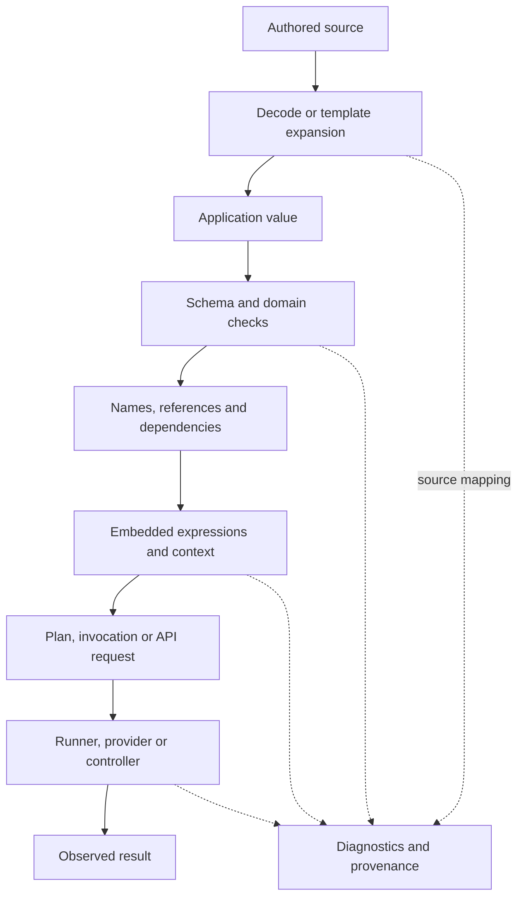

# Layered Configuration Is A Stack Of Languages

> Status: primary-source DSL evidence and original boundary examples.
>
> Checked 2026-10-01; no cluster, hosted CI, deployment or workflow execution.

## The Layer Model

For this research, describe a configuration system with the following stages.
This is an analytical model, not a claim that every product uses the same
implementation order. Some phases repeat or interleave.



For each transition, ask who owns syntax and semantics, what values can exist,
whether effects occur, and what evidence travels to the next stage. A schema
can check an integer field without checking a shell program stored elsewhere.
A plan can be well formed without guaranteeing that its remote execution will
succeed. These distinctions are the main Nomi design pressure.

## YAML's Contribution And Its Limits

YAML defines mappings, sequences, scalars, tags and aliases; mapping keys must
be unique. Its core schema differs from older implicit scalar conventions.
Literal blocks preserve line breaks, while folded blocks transform eligible
breaks; chomping controls trailing breaks. Double quotes process escape
sequences, and single quotes treat backslashes literally.
[YAML 1.2.2](https://yaml.org/spec/1.2.2/).

The names `needs`, `uses`, `with`, `spec`, `services` and `when` acquire meaning
from their applications. Quoting such a key changes scalar presentation or
resolution; it does not disable the application's meaning once the same text
key has been decoded. Quoting an expression likewise does not prevent a host
from interpreting that field as an expression.

The installed PyYAML 6.0.3 loader turns the unquoted key `on` into a Boolean
and retains the last duplicate `replicas` value. These are **observations of
this loader**, not statements about GitHub's parser or permission to accept
duplicate keys. Our tests also show that `|`, `>`, `|-` and `|+` produce
different text. See [probe results](experiments.md).

An adapter needs an explicit policy for edition/schema, duplicate keys, custom
tags, aliases/cycles, resource limits and conversion to the application's data
model. An unsafe constructor, an ordinary data loader and a source-preserving
editor have different obligations. A tree-only Value model must deliberately
copy, reject or represent YAML alias sharing; host object identity must not
accidentally decide Nomi semantics.

## Kubernetes: Resources, Admission And Reconciliation

A resource document selects an API contract through its kind and version.
CustomResourceDefinitions add schemas and resource types; structural schemas
can prune unspecified fields and define defaults and CEL validation rules.
Preserving unknown subtrees requires an explicit schema choice.
[CRD contract](https://kubernetes.io/docs/tasks/extend-kubernetes/custom-resources/custom-resource-definitions/),
[CRD API](https://kubernetes.io/docs/reference/kubernetes-api/apiextensions/custom-resource-definition-v1/).

Think of the flow as authored resource -> decoded object -> versioned API and
admission processing -> stored object -> controller observation -> reconciliation.
The exact conversion/default/admission order depends on the operation and API;
an implementation must consult those contracts rather than treating this sketch
as an API-server algorithm. A controller repeatedly moves observed state toward
desired state and may operate on systems outside the cluster.
[Controller model](https://kubernetes.io/docs/concepts/architecture/controller/).

An original embedded-configuration fixture:

```yaml
apiVersion: v1
kind: ConfigMap
metadata:
  name: boundary-example
data:
  service.conf: |-
    greeting = "hello {visitor}"
    endpoint = "${UPSTREAM}"
```

There are at least three contracts here: YAML string decoding, ConfigMap data
fields, and the eventual consumer's `service.conf` language. The inner example
is intentionally an invented application format. Neither brace interpolation
nor environment expansion is established by this outer document. The consumer
may interpret, reject or preserve them. Correct outer syntax proves nothing
about the inner grammar.

ConfigMap `data` carries UTF-8 strings and `binaryData` base64-encoded binary
content; ConfigMaps are not a confidentiality mechanism. Mounted updates and
environment-variable consumers have different update behavior.
[ConfigMap contract](https://kubernetes.io/docs/concepts/configuration/configmap/).
**Inference:** “configuration applied” needs a named observation stage, not
one success bit that conflates storage, delivery, reload and healthy operation.

CEL adds another language inside specific Kubernetes fields. Its available
variables and functions depend on the embedding site. CRD validation has
estimated/runtime cost controls; declared input size bounds can affect the
admissibility of a rule.
[Kubernetes CEL](https://kubernetes.io/docs/reference/using-api/cel/),
[CRD validation rules](https://kubernetes.io/docs/tasks/extend-kubernetes/custom-resources/custom-resource-definitions/).
An expression accepted for one policy location cannot be transplanted into
another merely because both say CEL.

### Merge And Ownership Are Domain Semantics

Server-side apply records field ownership and detects conflicts. List topology
can be atomic, set-like or keyed-map-like; maps can have granular or atomic
ownership. Force acquisition of a field is a meaningful operation, not a
formatting choice.
[Server-side apply](https://kubernetes.io/docs/reference/using-api/server-side-apply/).

JSON merge patch and strategic merge patch have different list behavior;
JSON Patch describes explicit operations instead.
[Patch comparison](https://kubernetes.io/docs/tasks/manage-kubernetes-objects/update-api-object-kubectl-patch/).
Our inference is that a Nomi configuration library should name the operation:
constraint combination, ordered overlay, replacement, patch or ownership-aware
application. A generic recursive map merge would hide material choices.

For a future adapter, keep these answers separate:

| Check | Can be established offline? | Additional authority/evidence |
| --- | --- | --- |
| Source is valid under the chosen YAML policy | Yes | Named decoder and limits |
| Resource conforms to a pinned schema | Usually, if schema is available | Schema identity and extensions |
| CEL compiles in the declared host environment | With a matching implementation | Bindings, types and cost policy |
| Admission accepts a request | Depends on live configuration | Server dry-run evidence and authorization |
| Apply owns or conflicts on fields | Depends on live state | Manager identity and field ownership |
| Workload is healthy | No source-only proof | Time-bound observation and failure policy |
| Inner application config is valid | Only with its own checker | Inner grammar/version/context |

## Helm And Kustomize: Different Composition Boundaries

Helm templates produce text. Its `tpl` operation can evaluate a string as a
template inside another template, creating an explicit second interpretation
stage. Its documentation distinguishes quoting string fields from fields that
need numeric values.
[Helm template reevaluation](https://helm.sh/docs/howto/charts_tips_and_tricks/).
Go-template pipelines pass the piped value as the final argument.
[Pipelines](https://docs.helm.sh/docs/v3/chart_template_guide/functions_and_pipelines/).
That is separate from Nomi's own pipeline contract; visual resemblance is not
semantic compatibility.

Kustomize transforms resource structure through generators, patches and other
operations. Patches are ordered and target resources; strategic and JSON Patch
forms have distinct capabilities.
[Kustomize transformations](https://kubernetes.io/docs/tasks/manage-kubernetes-objects/kustomization/).
Its inputs can still contain embedded text. Structured outer transforms do not
automatically parse an application config stored in a scalar.

Compare the candidates on the same change: add a sidecar and change a literal
message containing newline, colon, dollar and braces. A text template must
preserve YAML shape and inner text; a resource transform must preserve resource
identity and list semantics. Record resulting values, not only pretty output.
This is proposed [E5](nomi_candidates.md), not a performed Helm/Kustomize test.

## GitHub Actions: `needs`, `uses` And `with` Have Different Jobs

Workflow structure defines jobs and steps. `needs` names job dependencies;
the `needs` expression context contains direct dependencies, not every
transitive ancestor. Default dependency behavior also depends on job results.
Job conditions are evaluated before matrix expansion.
[Workflow contract](https://docs.github.com/en/actions/reference/workflows-and-actions/workflow-syntax),
[Contexts](https://docs.github.com/en/actions/reference/workflows-and-actions/contexts).

`uses` chooses an action at step level or a reusable workflow at job level.
`with` supplies that invocation's inputs. Reusable workflow inputs declare
Boolean, number or string types. An action's metadata has a different input
contract; its `required: true` flag does not itself automatically reject a
missing input.
[Reuse workflows](https://docs.github.com/en/actions/how-tos/reuse-automations/reuse-workflows),
[Action metadata](https://docs.github.com/en/actions/reference/workflows-and-actions/metadata-syntax).

The same spelling therefore needs field-path context:

| Surface | Semantic role | What a checker must resolve |
| --- | --- | --- |
| `jobs.release.needs` | Dependency edge | Job identity, graph validity and result policy |
| `needs.build.outputs.digest` | Runtime dependency data | Direct edge, availability, string conversion |
| `steps[*].uses` | Action invocation | Reference identity and action input/output contract |
| `jobs.publish.uses` | Reusable workflow invocation | Workflow reference and declared interface |
| `with` | Invocation arguments | Callee-specific names and types |
| `if` | Guard in an expression context | Available names, result type and status semantics |
| `run` | Script text | Selected shell, runner context and substitution stage |

The workflow contract allows expression delimiters to be omitted in certain
condition fields. A quoted scalar is thus not necessarily plain display text.
GitHub expressions have their own coercions and comparisons; step outputs are
strings, and `fromJSON` can cross into structured values.
[Expression semantics](https://docs.github.com/en/actions/reference/workflows-and-actions/expressions).
These behaviors should stay in a GitHub adapter rather than changing Nomi's
Bool or equality rules.

### A String Can Become Shell Source Before The Shell Runs

GitHub substitutes expression results into generated script text before shell
execution. A value placed directly inside `run` can therefore alter syntax;
the official guidance uses intermediate environment variables or action
arguments to preserve a data boundary.
[Script injection stages](https://docs.github.com/en/actions/concepts/security/script-injections),
[Secure use](https://docs.github.com/en/actions/reference/security/secure-use).

An original safer transport example for a Bash step:

```yaml
name: boundary-example
"on": workflow_dispatch
jobs:
  inspect:
    runs-on: ubuntu-latest
    steps:
      - name: Display a supplied title
        env:
          TITLE: ${{ github.event.repository.name }}
        shell: bash
        run: printf '%s\n' "$TITLE"
```

This illustrates a phase boundary, not a universal security guarantee. The
script still controls what it does with the value; invoking `eval`, treating
the value as an option, or passing it to another parser needs another contract.
The snippet was not run on GitHub. The quoted `on` also makes our local
PyYAML probe preserve the key; it does not assert which YAML schema GitHub uses.

For a Nomi workflow library, dependency handles could carry future outputs and
state explicitly. Named arguments can represent `with`; a versioned invocation
object can represent `uses`. None requires promoting these words to core
keywords. Calling such a library is still distinct from authorizing a remote
workflow run.

## Other YAML Systems: The Same Container, Different Languages

| System | Documented extra interpretation | Nomi pressure |
| --- | --- | --- |
| Compose | `${VAR}`-style value interpolation, defaults/required forms, `$$` escape; interpolation happens per file before merge | Phase order must be inspectable |
| GitLab CI | `$[[ inputs.x ]]` expansion; whole-value substitution can preserve a declared non-string type, embedding inside text yields a string | Typed splice differs from text interpolation |
| Azure Pipelines | `${{ }}` compile-time expressions, `$[]` runtime expressions, and `$(x)` task-time macros; variables are strings and parameters can be typed | Static parameters and runtime facts need separate scopes |
| Ansible | `when` is a raw Jinja expression rather than a `{{ ... }}` template | A field schema can select a sublanguage without delimiters |
| Argo | Simple `{{...}}` substitutions and `{{=...}}` expression tags; its conditional documentation also describes govaluate | One product can contain multiple expression dialects |

Sources: [Compose interpolation](https://docs.docker.com/reference/compose-file/interpolation/),
[GitLab inputs](https://docs.gitlab.com/ci/inputs/),
[Azure expressions](https://learn.microsoft.com/en-us/azure/devops/pipelines/process/expressions?view=azure-devops),
[Azure variables](https://learn.microsoft.com/en-us/azure/devops/pipelines/process/variables?view=azure-devops),
[Ansible conditions](https://docs.ansible.com/ansible/latest/playbook_guide/playbooks_conditionals.html),
[Argo variables](https://argo-workflows.readthedocs.io/en/latest/variables/),
[Argo conditions](https://argo-workflows.readthedocs.io/en/latest/walk-through/conditionals/).

Compose interpolation and the final container environment are separate
questions. Environment precedence involves additional sources.
[Environment precedence](https://docs.docker.com/compose/how-tos/environment-variables/envvars-precedence/).
Azure's missing-value behavior also differs among its three substitution forms.
[Variable syntax](https://learn.microsoft.com/en-us/azure/devops/pipelines/process/variables?view=azure-devops).
Argo specifically documents quote-sensitive conditional substitutions and an
expression form to avoid that issue.
[Nested quotes](https://argo-workflows.readthedocs.io/en/latest/walk-through/conditionals/).

Our inference is that a universal “expand YAML variables” function would erase
important distinctions. An adapter should declare a language, field path,
phase, result type, environment and diagnostic source—not infer meaning from
the delimiter's visual appearance.

## A Comparison Beyond YAML

| Choice | Useful pressure | Cost to test |
| --- | --- | --- |
| CUE-style constraint combination | Reject incompatible definitions | Explain all contributing constraints and default selection |
| Nickel-style prioritized merge | Make defaults and overrides explicit | Preserve priority, conflict and blame after composition |
| Dhall-style total typed configuration | Normalize checked configuration | Resolve imports with authority and bound practical cost |
| Jsonnet-style programmable composition | Reuse without editing every consumer document | Name when laziness ends and errors become visible |
| Pkl-style string/object construction | Reduce repetition and delimiter burden | Distinguish source-preserving text from rendered data |
| HCL-style host-owned bodies/expressions/templates | Reusable expression infrastructure | Keep host schema and environment explicit |

Primary mechanisms are indexed in the [taxonomy](README.md). These candidates
are not ranked by popularity or by source compactness. Nomi should compare
readability, semantic evidence, errors, effects and migration on the same
fixtures before choosing a mechanism.

## Checklist For A Real Nomi Adapter Experiment

For each system, record the decoder edition and limits; host schema/version;
reference resolution; expression dialect and field scopes; expansion/merge/
default order; separate parameter channels; pure checking versus remote effects;
execution/result/cancellation model; source maps; import provenance; secret
redaction; incomplete-source behavior; and round-trip preservation policy.

Reject an adapter that claims validation of an inner string program using only
the outer YAML schema. Reject an explanation that shows only generated text
while omitting substituted inputs, dependency edges or ownership policy.
Keep unknown extension fields losslessly in the draft if appropriate, but make
unsupported semantics visible before producing a checked execution artifact.
